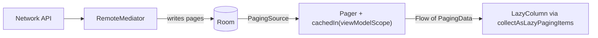

# 💾 Storage & Data on Device

*Where each kind of data belongs on the device. Covers DataStore, Room, files, scoped storage and ContentProviders.*

## 🗂️ Picking a store
<!-- related: tech-19, tech-100 -->

| Data | Store | Why |
|---|---|---|
| Settings, flags, small prefs | **[DataStore](https://www.geeksforgeeks.org/android/preferences-datastore-in-android/)** (Preferences) | Async, Flow-based, transactional |
| Typed small config | DataStore (Proto) | Schema, type-safe |
| Structured, queryable, relational | **[Room](https://www.geeksforgeeks.org/kotlin/overview-of-room-in-android-architecture-components/)** | SQL, compile-time checks, Flow queries |
| Blobs: images, downloads | Files (app-specific dirs) | Stream, don't load into DB |
| Secrets | Keystore-backed encryption | See security note |
| Legacy | [SharedPreferences](https://www.geeksforgeeks.org/android/shared-preferences-in-android-with-examples/) | Sync disk I/O on main via `apply()` flush → jank/ANR |

- 📖 [Storage & Data Management](https://www.geeksforgeeks.org/android-storage/) — overview of on-device options.

> 🔑 SharedPreferences is superseded by DataStore; never store lists or large JSON in either.

## 🏛️ Room
<!-- related: tech-72, tech-142 -->

- Room is an abstraction over [SQLite](https://www.geeksforgeeks.org/kotlin/android-sqlite-database-in-kotlin/) — prefer it to raw SQLite.
- `@Entity` (table) · `@Dao` (queries) · `@Database` (holder + version) · `@TypeConverter` (custom types).
- DAO returning `Flow<T>` re-emits on table change — the backbone of single-source-of-truth UIs.
- `@Transaction` for multi-step writes; indices on columns you filter/sort by.
- Migrations: bump `version`, provide `Migration(n, n+1)` or `AutoMigration`; test with `MigrationTestHelper`. `fallbackToDestructiveMigration` only for pure caches.

```kotlin
@Dao interface ArticleDao {
  @Query("SELECT * FROM article ORDER BY publishedAt DESC")
  fun observeAll(): Flow<List<Article>>
  @Upsert suspend fun upsert(items: List<Article>)
}
```

## 📜 Paging large collections
<!-- related: tech-101, tech-72 -->



- **`PagingSource<Key, Value>`** loads one page (`LoadResult.Page` / `Error`); `getRefreshKey` keeps the user's position on refresh. A Room DAO can return one and invalidates it when the table changes.
- **`Pager(PagingConfig(pageSize = 20)) { source }`** exposes `Flow<PagingData<T>>`; the factory must return a **new** source each time.
- **`cachedIn(viewModelScope)`** keeps loaded pages across rotation and shares them between collectors — apply `map` / `filter` before it.
- **`RemoteMediator`** (offline-first): network pages are written to Room and the UI reads only Room; persist **remote keys** so APPEND knows the next network page after process death.
- UI: `items(count = items.itemCount, key = items.itemKey { it.id })`; render `loadState.refresh` / `append` (loading, error + `retry()`).

> 🔑 The database is the source of truth; the network only fills it.

## 📁 Files and scoped storage

| Location | Visibility | Survives uninstall | Permission |
|---|---|---|---|
| [Internal storage](https://www.geeksforgeeks.org/android/internal-storage-in-android-with-example/) (`filesDir`, `cacheDir`) | App only | No | None |
| App-specific [External storage](https://www.geeksforgeeks.org/android/external-storage-in-android-with-example/) | App (others via SAF) | No | None (19+) |
| Shared: MediaStore | All apps | Yes | Own files: none; others' media: read media perms |
| Shared: documents | Via Storage Access Framework picker | Yes | User picks |

- **[Scoped storage](https://www.geeksforgeeks.org/android/scoped-storage-in-android/) (10+)** — no raw path access to shared storage; use MediaStore or SAF.
- `cacheDir` may be cleared by the OS — only for re-creatable data.
- [File I/O](https://www.geeksforgeeks.org/kotlin/how-to-read-a-file-in-android/): buffered streams, `use {}` to close, write to temp then rename for atomicity, off the main thread.

> 📝 Practice: request camera permission → take a photo → save to MediaStore; migrate legacy external storage to scoped storage.

## 🔌 ContentProviders
<!-- related: tech-59 -->

- [Content Providers](https://www.geeksforgeeks.org/android/content-providers-in-android-with-example/) expose structured data across apps via `content://` URIs with CRUD + `Cursor`.
- Grant temporary access with `FLAG_GRANT_READ_URI_PERMISSION`; share files via `FileProvider`, never `file://`.
- Inside one app, a repository is simpler — reach for a provider only when another process/app needs the data.
