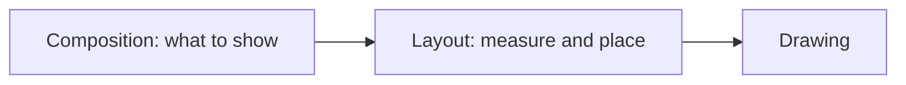

# 🎨 Jetpack Compose internals

*How Compose decides what to redraw, and how to build production screens with it. Covers phases, state and hoisting, the snapshot system, stability, side effects, lists, modifiers, layouts, animation, navigation, adaptive UI, interop, testing and performance.*

## 🧭 The three phases
<!-- related: tech-108, tech-138 -->



- A state read is tracked **in the phase where it happens**: read in composition → recompose; read only in a `layout {}` or placement lambda → re-layout; read only in `drawBehind {}` → redraw.
- So deferring a read (`Modifier.offset { }` instead of `offset(x.dp)`, passing a lambda instead of a value) skips whole phases.
- The compiler plugin turns each `@Composable` into a restartable group with a `$changed` bitmask; the **slot table** stores remembered values and group structure.

> 🔑 Read state as late as possible: the later the phase, the less work a change triggers.

## 🧠 State, lifecycle and hoisting
<!-- related: tech-12, tech-130, tech-155 -->

### ♻️ Composable lifecycle
- A composable **enters** the composition, **recomposes** zero or more times, then **leaves**. `remember` values live from enter to leave; `remember(key)` recomputes when the key changes.
- Identity comes from the **call site** (and `key(id) { }` in loops) — moving an item without a key makes Compose think it is a different item and its remembered state follows the position, not the data.

### 🗄️ Where state lives

| Holder | Survives recomposition | Rotation | Process death | Use for |
|---|---|---|---|---|
| `remember { }` | ✅ | ❌ | ❌ | Derived objects, animation state |
| `rememberSaveable { }` | ✅ | ✅ | ✅ (Bundle, small) | Text field input, selected tab, scroll position |
| `ViewModel` + `StateFlow` | ✅ | ✅ | ❌ (✅ via `SavedStateHandle`) | Screen state, business logic |
| Disk (Room, DataStore) | ✅ | ✅ | ✅ | Source of truth |

- Custom types in `rememberSaveable` need `@Parcelize` or a `Saver` / `listSaver` / `mapSaver`.
- Collect flows with `collectAsStateWithLifecycle()` (lifecycle-runtime-compose): it stops collecting below `STARTED`, unlike `collectAsState()`.

### ⬆️ State hoisting
- Make composables **stateless**: take `value` and `onValueChange`, own nothing. A thin stateful wrapper (or the screen's ViewModel) holds the state.
- Hoist to the **lowest common ancestor** that reads or writes it — no higher. UI-element state (expanded, scroll) can stay in a plain state-holder class; business state goes to the ViewModel.
- Pass the ViewModel only to the screen-level composable; children get plain values and lambdas, so they preview and test in isolation.

```kotlin
@Composable
fun SearchRoute(vm: SearchViewModel = hiltViewModel()) {
  val state by vm.state.collectAsStateWithLifecycle()
  SearchScreen(query = state.query, results = state.results, onQueryChange = vm::onQueryChange)
}

@Composable // stateless: previewable, testable, reusable
fun SearchScreen(query: String, results: List<Item>, onQueryChange: (String) -> Unit) { /* … */ }
```

## 📸 Snapshot system
<!-- related: tech-207, tech-108 -->

- Every `MutableState` keeps snapshot-aware records; a **snapshot** is an isolated, consistent view of all state — roughly MVCC for memory.
- **Read tracking**: composition installs a read observer, so each `state.value` read registers "this scope depends on this state".
- **Write notification**: apply observers tell the Recomposer which states changed; it invalidates exactly the scopes that read them and recomposes on the next frame.
- `Snapshot.withMutableSnapshot { }` makes several writes atomic; conflicting applies are resolved by the state's `SnapshotMutationPolicy` (default `structuralEqualityPolicy()`) or fail.
- `snapshotFlow { }` turns state reads into a cold `Flow` — the bridge from Compose state to coroutine code.

```kotlin
LaunchedEffect(listState) {
  snapshotFlow { listState.firstVisibleItemIndex }
    .distinctUntilChanged()
    .collect { analytics.scrolledTo(it) }
}
```

- Pitfall: a plain `ArrayList` inside `mutableStateOf` is not observed when mutated — use `mutableStateListOf` or assign a new list.

## 🧱 Stability and skipping
<!-- related: tech-120, tech-198, tech-108, tech-138 -->

| Parameter type | Stable? | Why |
|---|---|---|
| Primitives, `String`, function types | Yes | Immutable or compared by identity |
| `data class` with only `val` stable fields | Yes (inferred) | Compiler can prove it |
| `List<T>`, `Map`, `Set` | **No** | The interface could be a mutable implementation |
| Class from a module without the Compose compiler | No | Compiler cannot see inside it |
| `@Immutable` / `@Stable` annotated | Yes (promised) | You guarantee changes are notified or never happen |

- **Skipping**: a restartable composable whose inputs are all equal to last time is skipped.
- **Strong skipping mode** (default since Kotlin 2.0.20): unstable parameters no longer block skipping — they are compared by **instance** (`===`), stable ones by `equals`; lambdas are remembered automatically.
- Still worth fixing: an unstable param that is a *new instance* each time (a freshly built `List`) never skips — use `kotlinx.collections.immutable`, a stability config file, or hoist the allocation.
- Diagnose with Compose compiler reports (`composeCompiler { reportsDestination / metricsDestination }`) and Layout Inspector recomposition counts.

## ⚡ Side-effect decision table
<!-- related: tech-13, tech-207 -->

| Need | API | Cleanup |
|---|---|---|
| Suspend work tied to keys (load, animate, show snackbar) | `LaunchedEffect(key)` | Cancelled on key change / leave |
| Launch from a callback (onClick) | `rememberCoroutineScope()` | Scope cancelled on leave |
| Register / unregister a listener | `DisposableEffect(key)` | `onDispose { }` |
| Push Compose state to a non-Compose object every recomposition | `SideEffect` | None |
| Turn a non-Compose source into `State<T>` | `produceState` | Coroutine cancelled |
| Long effect that must see the latest lambda | `rememberUpdatedState(value)` | — |
| State derived from other state, recalculated only when the result changes | `derivedStateOf` | — |

> 🔑 Choose keys from the inputs the effect depends on; `LaunchedEffect(Unit)` plus a changing parameter is the classic stale-value bug.

## 🌍 CompositionLocal
<!-- related: tech-93 -->

- Passes a value **implicitly** down the tree: `MaterialTheme.colorScheme`, `LocalContext`, `LocalDensity`, `LocalLifecycleOwner`.
- `compositionLocalOf` — readers are tracked; changing the value recomposes only those readers. `staticCompositionLocalOf` — not tracked; a change recomposes the **whole** subtree, so use it for values that almost never change (theme objects, singletons).
- Provide with `CompositionLocalProvider(LocalAnalytics provides tracker) { … }`.
- Use for cross-cutting, tree-scoped context. Don't use it to smuggle screen data or ViewModels — explicit parameters stay visible, previewable and testable.

## 📜 Lazy lists
<!-- related: tech-120, tech-138, tech-101 -->

- `LazyColumn` / `LazyRow` / `LazyVerticalGrid` compose only the visible items (plus prefetch) — no adapter or ViewHolder.
- **Always pass `key`** (a stable id): state and animations follow the item when the list reorders, and unchanged items skip.
- Pass **`contentType`** when rows differ (header, ad, post) so compositions are reused only between matching types.
- `Modifier.animateItem()` (Foundation 1.7+) animates insertions, removals and moves — it needs keys.
- Read scroll position through `derivedStateOf` so a "scroll to top" button recomposes only when the boolean flips, not on every pixel:

```kotlin
val showTop by remember { derivedStateOf { listState.firstVisibleItemIndex > 0 } }
```

- Don't nest a scrollable in the same direction (a `LazyColumn` inside a `verticalScroll` `Column`) — it throws because the inner list gets infinite height. Use one lazy list with several `item {}` / `items {}` blocks.
- Keep item composables cheap: no sorting or formatting inside `items {}`; precompute in the ViewModel.

## 🧩 `Modifier.Node`
<!-- related: tech-44 -->

- Old `Modifier.composed { }` ran a composition per use, allocated, and could not be skipped — Compose's own modifiers moved to `Modifier.Node` for performance.
- Shape: a `ModifierNodeElement` (immutable, `equals`-comparable, `create()` + `update(node)`) plus a long-lived `Modifier.Node` implementing capability interfaces (`DrawModifierNode`, `LayoutModifierNode`, `PointerInputModifierNode`, `SemanticsModifierNode`…).
- Nodes are reused across recompositions (only `update` runs), get `onAttach`/`onDetach` and a `coroutineScope`, and invalidate precisely (`invalidateDraw()`, `invalidateMeasurement()`).
- **Delegation**: a `DelegatingNode` composes other nodes with `delegate(node)` — one modifier can combine pointer input and drawing.

## 📐 Custom layouts
<!-- related: tech-208, tech-44 -->

- `Layout(content) { measurables, constraints -> }`: measure each child **once** → `layout(w, h) { placeable.placeRelative(x, y) }`. Constraints go down, sizes come up.
- Measuring a child twice throws; when a parent needs sizes first, use **intrinsics** (`Modifier.height(IntrinsicSize.Min)`).
- `Modifier.layout { }` for one element; `SubcomposeLayout` when *what you compose* depends on measured size (`BoxWithConstraints`, lazy lists, `Scaffold`) — more expensive, use sparingly.
- Check built-ins first: `FlowRow`, `ConstraintLayout`, `LazyVerticalStaggeredGrid`.

## 🎬 Animation

| Need | API |
|---|---|
| Animate one value to a target | `animateFloatAsState`, `animateColorAsState`, `animateDpAsState` |
| Show / hide content | `AnimatedVisibility(visible) { }` with `enter` / `exit` transitions |
| Swap content on state change | `AnimatedContent(targetState) { }`, `Crossfade` |
| Several values driven by one state | `updateTransition(state)` + `animate*` children |
| Imperative, gesture-driven or interruptible | `Animatable` with `animateTo` / `snapTo` in a coroutine |
| Loop forever (shimmer, pulse) | `rememberInfiniteTransition()` |
| Size change of a container | `Modifier.animateContentSize()` |

- Apply fast-changing animated values in **lambda modifiers** — `graphicsLayer { alpha = a }`, `offset { }` — so each frame only redraws or re-places instead of recomposing.
- Animations are interruptible: a new target continues from the current value and velocity.
- Shared elements between screens: `SharedTransitionLayout` with `Modifier.sharedElement()`.

## 🧭 Navigation
<!-- related: tech-28, tech-151 -->

- Single Activity; a `NavHost` maps routes to composable destinations and owns the back stack.
- **Type-safe routes** (Navigation 2.8+): routes are `@Serializable` classes or objects instead of strings; arguments are typed fields.

```kotlin
@Serializable data object Home
@Serializable data class Detail(val id: String)

NavHost(navController, startDestination = Home) {
  composable<Home> { HomeScreen(onOpen = { navController.navigate(Detail(it)) }) }
  composable<Detail> { entry -> DetailScreen(entry.toRoute<Detail>().id) }
}
```

- Each back-stack entry is a `ViewModelStoreOwner`, so `hiltViewModel()` inside a destination is scoped to that screen; read arguments in the ViewModel from `SavedStateHandle` (`savedStateHandle.toRoute<Detail>()`).
- Pass **ids**, not objects; the destination loads data from the repository, so it also works after process death and from deep links.
- Feature modules expose a `NavGraphBuilder.featureGraph()` extension; the app module assembles them — features never import each other.
- Pop with `popUpTo(Home) { inclusive = false }`, avoid duplicates with `launchSingleTop = true`, keep tab state with `saveState` / `restoreState`.

## 📱 Adaptive layouts
<!-- related: tech-64, tech-199 -->

- Decide layout by **window size class**, not device type or orientation: `currentWindowAdaptiveInfo().windowSizeClass` gives compact / medium / expanded width and height buckets.
- Material 3 adaptive scaffolds do the common cases: `NavigationSuiteScaffold` switches bottom bar ↔ rail ↔ drawer; `ListDetailPaneScaffold` shows one or two panes.
- Foldables: `WindowInfoTracker` reports hinge position and posture (tabletop, book).
- Configuration changes on resize must not lose state — keep it in `rememberSaveable` or the ViewModel, never in Activity fields.
- Pair with edge-to-edge: pad content by `WindowInsets` (`safeDrawing`, `ime`), keep backgrounds full-bleed.

## 🔁 Interop and migration
<!-- related: tech-130 -->

- **Compose inside Views**: `ComposeView` in XML or a Fragment. In a Fragment set `ViewCompositionStrategy.DisposeOnViewTreeLifecycleDestroyed`, so the composition is disposed with the Fragment's view, not the window.
- **Views inside Compose**: `AndroidView(factory = { MapView(it) }, update = { it.setX(…) })`; `AndroidViewBinding` for existing XML layouts.
- **Migration order**: new screens in Compose first → leaf components (shared design-system pieces) → whole screens → navigation last. Bridge themes so both worlds read the same colours and typography.
- Track it like a project: a lint rule against new XML screens, a design-system module in Compose, and per-screen startup and jank metrics before and after.

## 🧪 Testing and accessibility
<!-- related: tech-47, tech-104 -->

### 🔬 UI tests
- `createComposeRule()` (or `createAndroidComposeRule<Activity>()`), `setContent { }`, then **find → act → assert** on the **semantics tree**: `onNodeWithText("Save").performClick()`, `onNodeWithTag("list").assertIsDisplayed()`.
- Prefer text and content descriptions over `testTag` — they double as accessibility checks. Merged nodes hide children; use `useUnmergedTree = true` to reach them.
- Control time: `mainClock.autoAdvance = false` + `advanceTimeBy()` for animations; `waitUntil { }` for async work.
- Test stateless composables directly with fake state; test the screen with a fake repository behind a real ViewModel.
- Screenshot tests (Paparazzi, Roborazzi or the Compose Preview Screenshot Testing plugin) catch visual regressions that assertions miss.

### ♿ Accessibility
- Every meaningful image gets `contentDescription`; decorative ones get `null`.
- Group a row into one announcement with `Modifier.semantics(mergeDescendants = true) { }`; replace noisy children with `clearAndSetSemantics { }`.
- Describe custom controls: `role = Role.Switch`, `stateDescription`, `heading()`, `onClick(label = "Open details")`.
- Touch targets at least **48 dp** (Material components enforce it); support font scaling — never fix text heights in dp.

```kotlin
Row(Modifier.toggleable(value = on, role = Role.Switch, onValueChange = onToggle)) {
  Text("Wi-Fi")
  Switch(checked = on, onCheckedChange = null) // the Row handles the click and semantics
}
```

## 🚀 Performance checklist
<!-- related: tech-138, tech-120, tech-63 -->

1. Measure a **release** build with R8 — debug Compose is much slower and misleading.
2. Ship a Baseline Profile (Compose libraries include their own; add one for your screens).
3. Keys and `contentType` on every lazy list.
4. Defer reads: lambda modifiers, `derivedStateOf` for thresholds, state read in the lowest composable that needs it.
5. Stable inputs: immutable models, no new `List` instances on every recomposition.
6. `remember` expensive calculations; never do I/O or sorting in a composable body.
7. No backwards writes — writing state that the same composition already read loops forever.
8. Verify with Layout Inspector recomposition counts, compiler reports and a Macrobenchmark `FrameTimingMetric` run.

> 📝 Practice: build a tag-cloud layout with `Layout`; convert a stateful screen into a stateless one plus a route; then measure recomposition counts of a list screen before and after adding keys and stable item models.
