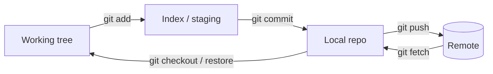

# 🌿 Git for engineers

*The commands an interviewer expects you to reason about, not recite: the object model, merge vs rebase, undoing mistakes and keeping a branch history reviewable.*

## 🧱 The model underneath

### 🗺️ Three areas, one graph

- A **commit** is an immutable snapshot plus a pointer to its parent(s); a **branch** is just a movable pointer to a commit; `HEAD` points at the branch you are on.
- Because history is a DAG of snapshots, "rewriting" history means creating *new* commits and moving a pointer — the old ones stay reachable through the **reflog** for ~90 days.
- `git fetch` updates remote-tracking refs only; `git pull` = fetch + merge (or rebase with `--rebase`).

> 🔑 Nothing committed is truly lost until garbage collection: `git reflog` finds the old tip.

## 🔀 Merge vs rebase

| | Merge | Rebase |
|---|---|---|
| Result | merge commit with two parents | your commits replayed on the new base |
| History | true, branchy | linear |
| Rewrites commits | no | yes (new hashes) |
| Safe on shared branches | yes | **no** — force-push breaks teammates |
| Conflicts | resolved once | may be resolved per replayed commit |

- Use **rebase** to tidy a private feature branch before review; use **merge** to integrate a shared branch.
- **Squash merge** collapses a branch into one commit on `main` — clean history, but the per-commit story is gone.
- **Fast-forward** happens when the target has not moved; `--no-ff` forces a merge commit to keep the branch visible.

> 💡 `git pull --rebase` keeps local commits on top of upstream instead of sprinkling merge commits.

## ↩️ Undoing things

| Situation | Command | Effect |
|---|---|---|
| Unstage a file | `git restore --staged f` | index only |
| Discard working edits | `git restore f` | **destructive** |
| Fix the last commit | `git commit --amend` | rewrites tip |
| Undo a pushed commit | `git revert <sha>` | new inverse commit, history-safe |
| Move branch back | `git reset --soft/--mixed/--hard <sha>` | keep index / unstage / discard all |
| Recover "lost" work | `git reflog` then `git branch rescue <sha>` | restores a tip |

- `reset` moves the branch pointer (and optionally index/tree); `revert` adds a commit. On shared history prefer **revert**.
- `git stash` parks uncommitted work; `git stash pop` re-applies it.
- `git cherry-pick <sha>` copies one commit onto the current branch — the standard hotfix backport.

> 📝 Practice: you committed a secret and pushed. Explain why `revert` is not enough and what you must do (rotate the key first, then rewrite history if policy demands).

## 🧰 Advanced tools

- **Interactive rebase** — `git rebase -i HEAD~5` to squash, reword, reorder or drop commits (`fixup` for follow-up fixes; `--autosquash` pairs with `git commit --fixup`).
- **Bisect** — `git bisect start / bad / good` binary-searches history for the commit that introduced a bug in O(log n) builds; `git bisect run <script>` automates it.
- **Worktrees** — `git worktree add ../hotfix main` gives a second checkout of the same repo without stashing.
- **Blame / log -S** — `git blame -L` for line authorship; `git log -S'symbol'` finds when a string was added or removed.
- **Hooks** — pre-commit/pre-push scripts for lint and tests; CI should repeat them.

## 🏢 Team workflow

- **Trunk-based** — short-lived branches merged to `main` daily behind feature flags; fewer long-lived conflicts.
- **Git Flow** — `develop`/`release`/`hotfix` branches; heavier, fits scheduled releases.
- **Stacked PRs** — a chain of small branches each based on the previous; rebase the stack when the base changes.
- Keep commits atomic (one reason to revert), messages in the imperative with the *why* in the body, and PRs small enough to review in one sitting.
- **SSH keys** authenticate pushes without passwords: generate an ed25519 key, add the public half to the host, keep the private half out of the repo.

> 🚩 Force-pushing a shared branch, committing generated files or secrets, and mega-PRs are the usual review complaints.
