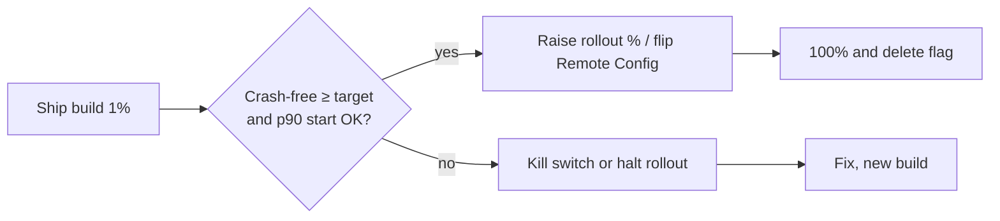

# 🔭 Firebase: crashes, remote config & performance

*Crashlytics, Remote Config and Performance Monitoring — what each captures, how to wire them for a staged rollout, and what they cost in privacy and startup.*

## 💥 Crashlytics
<!-- related: tech-83 -->

- Captures **fatal** crashes and ANRs automatically, groups them by stack signature into *issues*, and shows affected-user percentage per app version.
- Add context before the crash happens:
  - `setCustomKey("screen", "checkout")` — searchable state.
  - `log("tapped pay")` — **breadcrumbs** shown in the report.
  - `setUserId(hashedId)` — never raw PII.
- **Non-fatal** exceptions: `recordException(e)` for caught-but-important failures (parse errors, retries exhausted); they appear as separate issues.
- Upload **mapping files** (R8/ProGuard) so stacks de-obfuscate; missing mappings are the most common "useless trace" cause.
- Triage order: crash-free users % by version → top issue by affected users → regression vs. new → reproduce from keys and breadcrumbs.

```kotlin
FirebaseCrashlytics.getInstance().apply {
    setCustomKey("cart_size", cart.size)
    log("checkout started")
    recordException(PaymentTimeout(orderId))
}
```

> 🔑 Gate rollouts on **crash-free users** (e.g. ≥ 99.5%) before widening the percentage.

## 🚩 Remote Config
<!-- related: tech-83 -->

- Key/value parameters fetched from Firebase and evaluated against **conditions** (app version, country, percentage, audience), enabling gradual rollout, A/B tests and **kill switches** without a Play release.
- Flow: app ships **in-app defaults** → `fetch()` caches values → `activate()` applies them (usually on next launch so the UI does not change mid-session).
- Fetch is throttled (default minimum interval ~12 h in production); use a short interval only in debug builds.
- Treat flags as code: name them, give each an owner and expiry, delete after full rollout, and keep the default safe (off) if fetch fails.
- Never ship secrets in Remote Config — values are readable by the client.

| Use | Pattern |
|---|---|
| Kill switch | boolean, default `false`, flip to disable a broken feature |
| Staged rollout | percentage condition 1 → 5 → 25 → 100 |
| Experiment | variant parameter + analytics event on exposure |
| Tuning | numeric parameter (timeouts, page size) |

## ⏱️ Performance Monitoring
<!-- related: tech-83 -->

- **Automatic traces**: app start (cold/warm), screen rendering (slow and frozen frames), foreground/background.
- **HTTP metrics**: request time, payload size and success rate per URL pattern (auto-instrumented for OkHttp/URLConnection).
- **Custom traces**: `Firebase.performance.newTrace("load_feed")` with counters and attributes, to time a business flow end to end.
- Read results by percentile (p50/p90/p99) and by device tier, OS and country — the p99 on low-end devices is where the regressions hide.
- Complements, not replaces, local tooling (Perfetto, Android Studio profilers, Macrobenchmark): Firebase tells you *where in the field* it is slow; the profiler tells you *why*.

## 📈 Wiring it together



- Tag every event and trace with app version and flag variants so you can slice by exposure.
- Keep analytics, crash reporting and performance in one consent model — honour the user's opt-out and avoid PII in keys and logs.

> 💡 SDK cost matters: each Firebase component adds startup work; initialise lazily (App Startup library) and measure.
