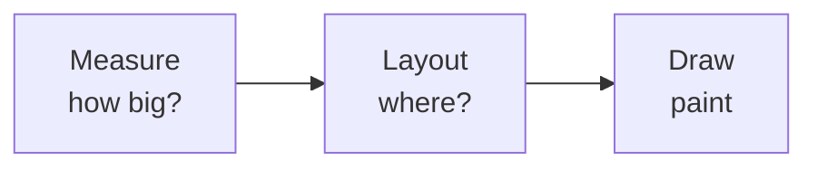

# 🖼️ View system, custom views & resources

*How the classic View toolkit measures, lays out and draws, how to build a custom View, and how resource qualifiers pick the right asset per device.*

## 🌲 View hierarchy and the three passes
<!-- related: tech-94, tech-85 -->

- A screen is a tree: the window's `DecorView` → your layout → `ViewGroup`s → leaf `View`s. Each frame the framework walks the tree in **three passes**.



| Pass | Method | Question | Rule |
|---|---|---|---|
| Measure | `onMeasure(wSpec, hSpec)` | size I want, given constraints | must call `setMeasuredDimension` |
| Layout | `onLayout(changed, l, t, r, b)` | position of each child | ViewGroups only |
| Draw | `onDraw(canvas)` | paint content | no allocation, no heavy work |

- `MeasureSpec` packs a mode and size: `EXACTLY` (match_parent / fixed dp), `AT_MOST` (wrap_content, up to a limit), `UNSPECIFIED` (scrollers). A view that ignores the mode breaks `wrap_content`.
- `requestLayout()` re-runs measure+layout (size/position changed); `invalidate()` re-runs draw only (looks changed).
- Deep or nested-weight hierarchies measure children more than once — flatten with `ConstraintLayout`.

> 🔑 Budget: the three passes plus everything else must fit in ~16 ms (60 Hz) or ~8 ms (120 Hz).

## 🛠️ Writing a custom view

- Extend `View` for something drawn from scratch, or an existing widget to tweak behaviour; extend `ViewGroup` to arrange children.
- Provide the three constructors (or `@JvmOverloads`) so it inflates from XML; read `declare-styleable` attributes with `obtainStyledAttributes` and **recycle** the array.
- **Allocate `Paint`, `Path` and `Rect` once** (in `init`), never in `onDraw` — allocation per frame causes GC jank.
- Handle `wrap_content` in `onMeasure`, support padding, and save state with `onSaveInstanceState`.
- Touch: override `onTouchEvent` (or use `GestureDetector`); call `performClick()` and expose accessibility via `contentDescription` / `AccessibilityDelegate`.
- Animate with `ValueAnimator` / `ViewPropertyAnimator`; prefer property animations that stay on the render thread (translation, alpha, scale).

```kotlin
class DotView @JvmOverloads constructor(c: Context, a: AttributeSet? = null) : View(c, a) {
    private val paint = Paint(Paint.ANTI_ALIAS_FLAG).apply { color = Color.RED }

    override fun onMeasure(w: Int, h: Int) {
        val size = 48.dp(context)
        setMeasuredDimension(resolveSize(size, w), resolveSize(size, h))
    }

    override fun onDraw(canvas: Canvas) {
        val r = minOf(width, height) / 2f
        canvas.drawCircle(width / 2f, height / 2f, r, paint)
    }
}
```

## ♻️ Lists: RecyclerView
<!-- related: tech-8 -->

- Recycles item views: a pool of `ViewHolder`s is rebound (`onBindViewHolder`) as rows scroll, so only visible rows exist in memory.
- Use `ListAdapter` + `DiffUtil` to compute minimal updates off the main thread; set stable ids when items move.
- Cut cost: share a `RecycledViewPool` between nested lists, avoid heavy work in bind, load images asynchronously and cancel on recycle.

## 🎛️ Resources and qualifiers

- Everything non-code lives in `res/`: `layout`, `drawable`, `values` (strings, colours, dimens, styles, themes), `font`, `anim`, `xml`.
- Android picks the best match from **qualifiers** appended to the folder name — `values-night`, `values-sw600dp`, `layout-land`, `drawable-xxhdpi`, `values-fr`, `values-ldrtl`.
- Resolution order narrows by locale, screen size/width, orientation, UI mode, density; the unqualified folder is the fallback and **must be complete**.
- Units: `dp` for layout (density-independent), `sp` for text (honours the user's font scale), `px` almost never.
- **Styles** bundle attributes for one view; **themes** apply to a whole context and are looked up by attribute (`?attr/colorPrimary`) so a dark theme can swap values.
- Configuration changes (rotation, dark mode, locale) recreate the Activity and reload resources — see the lifecycle note for state handling.

> 💡 Prefer vector drawables for icons, `sp` for text and `sw<N>dp` qualifiers for tablet layouts over guessing devices.

## 🔔 Notifications in brief

- Since Android 8 every notification needs a **channel** with its own importance; users control channels, not the app.
- Android 13+ requires the `POST_NOTIFICATIONS` runtime permission.
- Build with `NotificationCompat.Builder`: small icon, title/text, content `PendingIntent` (use `FLAG_IMMUTABLE`), actions, group/summary for bundles.
- Heads-up needs high importance (calls, messages); use `fullScreenIntent` only for true calls/alarms.

> 📝 Practice: a custom `ProgressRingView` — handle `wrap_content`, draw with one reused `Paint`, and animate the sweep angle with a `ValueAnimator`.
