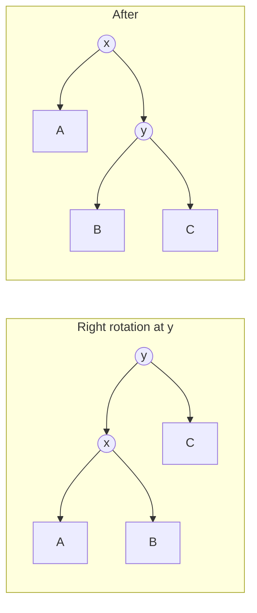

# ⚖️ Balanced binary search trees

*Why a plain BST degrades to a list and how AVL, red-black and splay trees keep operations at O(log n) — with the rotation logic you may be asked to write.*

## 🪓 The problem

- A BST gives O(h) search/insert/delete, where h is the height. Inserting sorted keys into a plain BST builds a chain: h = n, so everything is O(n).
- A **self-balancing** BST restructures on insert/delete to keep h = O(log n).
- Balance is restored by **rotations**: local pointer changes that preserve the in-order sequence.

## 🔄 Rotations



```kotlin
class Node(var key: Int) { var left: Node? = null; var right: Node? = null; var h = 1 }

fun height(n: Node?) = n?.h ?: 0
fun update(n: Node) { n.h = 1 + maxOf(height(n.left), height(n.right)) }

fun rotateRight(y: Node): Node {
    val x = y.left!!
    y.left = x.right      // subtree B moves under y
    x.right = y
    update(y); update(x)  // child first, then new root
    return x              // caller re-attaches
}

fun rotateLeft(x: Node): Node {
    val y = x.right!!
    x.right = y.left
    y.left = x
    update(x); update(y)
    return y
}
```

- A rotation is O(1) and keeps the in-order order of A, x, B, y, C unchanged.
- Return the new subtree root and let the recursive caller re-link it — the usual source of bugs is forgetting to update heights bottom-up.

## 🅰️ AVL trees

- Invariant: for every node, `|height(left) − height(right)| ≤ 1`. Track the **balance factor** = `height(left) − height(right)`.
- After an insert, walk back up; at the first node with factor ±2 apply one of four cases:

| Case | Shape | Fix |
|---|---|---|
| Left-Left | new key in left subtree of left child | right rotate |
| Right-Right | right of right child | left rotate |
| Left-Right | right of left child | left rotate child, then right rotate |
| Right-Left | left of right child | right rotate child, then left rotate |

```kotlin
fun rebalance(n: Node): Node {
    update(n)
    val bf = height(n.left) - height(n.right)
    if (bf > 1) {
        if (height(n.left!!.left) < height(n.left!!.right)) n.left = rotateLeft(n.left!!)
        return rotateRight(n)
    }
    if (bf < -1) {
        if (height(n.right!!.right) < height(n.right!!.left)) n.right = rotateRight(n.right!!)
        return rotateLeft(n)
    }
    return n
}
```

- Insert needs at most one single/double rotation; delete may need O(log n) rotations along the path.
- Height ≤ ~1.44 log₂ n — the tightest balance, so **fastest lookups** but more rebalancing work on writes.

## 🔴 Red-black trees

- Each node is red or black. Rules: root is black; no red node has a red child; every root-to-null path has the same number of black nodes.
- Consequence: the longest path is at most 2× the shortest, so height ≤ 2 log₂(n + 1).
- Insert: add a red leaf, then fix a "red-red" violation using the **uncle**'s colour — red uncle → recolour and move the problem up; black uncle → rotate (one or two) and recolour. At most 2 rotations per insert.
- Delete: at most 3 rotations, with a more involved "double black" case analysis.
- Used where write speed matters: Java's `TreeMap`/`TreeSet`, Linux's CFS scheduler, many language runtimes' ordered maps.

## 🌀 Splay trees

- After any access, **splay** the node to the root with zig / zig-zig / zig-zag rotations. No balance metadata is stored.
- Individual operations can be O(n), but **amortized** O(log n); recently used keys sit near the root, so skewed access patterns are fast.
- Weakness: reads mutate the tree (hard for concurrency) and a single access can be slow.

## 📊 Choosing

| Tree | Height bound | Rebalancing cost | Best for |
|---|---|---|---|
| AVL | ~1.44 log n | more rotations on write | read-heavy ordered maps |
| Red-black | ≤ 2 log n | ≤ 2 rot. insert, ≤ 3 delete | general-purpose ordered maps |
| Splay | amortized log n | none stored | caches with locality |
| B-tree | log base B | page splits | disk-resident indexes |

> 🔑 In an interview, state the invariant, name the four AVL cases, and implement the rotations; red-black you describe by its rules and recolouring, not by writing full delete.

> 💡 If you only need ordered iteration with no inserts after build, a sorted array plus binary search beats any tree.

> 📝 Practice: insert 1…7 in order into an AVL tree and draw the tree after each rotation.
