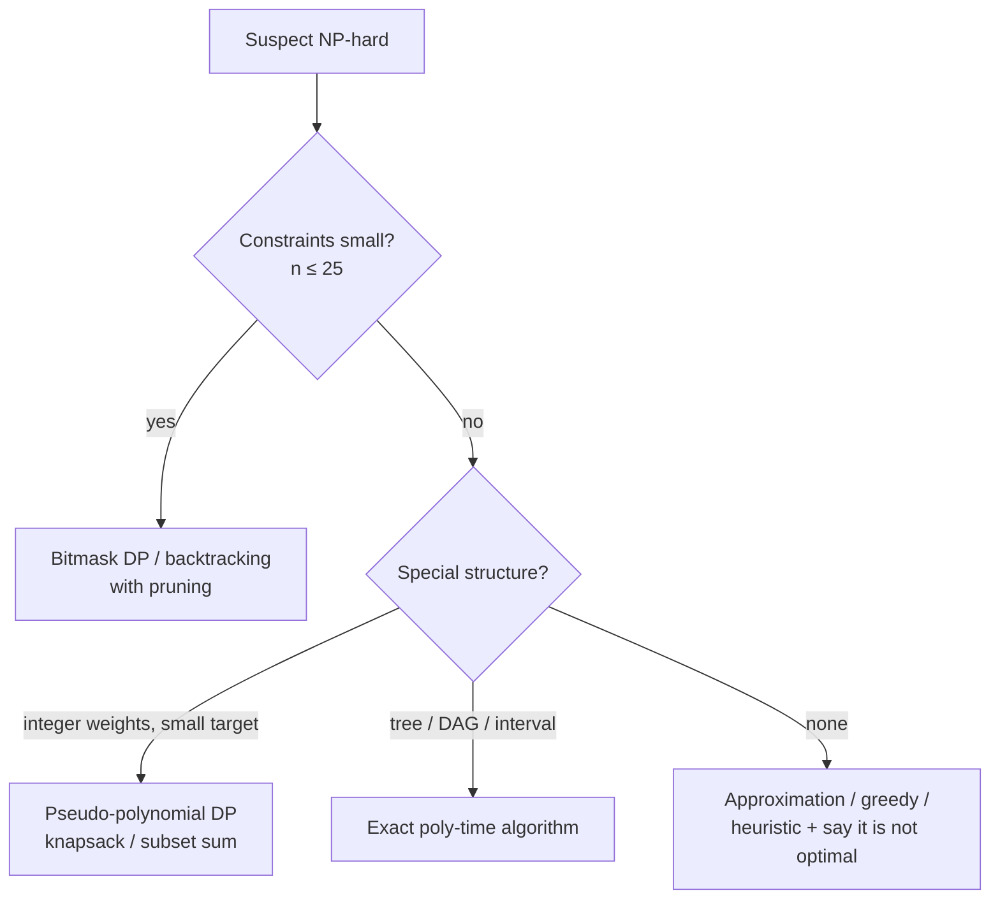

# 🧩 Recognising NP-complete problems

*You will not solve TSP in 30 minutes. The skill is spotting a famous hard problem in disguise, saying so, and pivoting to an approach that fits the constraints.*

## 📖 Vocabulary
<!-- related: ds-14, ds-84 -->

| Term | Meaning |
|---|---|
| **P** | solvable in polynomial time |
| **NP** | a proposed solution can be *verified* in polynomial time |
| **NP-complete** | in NP and every NP problem reduces to it — if one is in P, all are |
| **NP-hard** | at least as hard as NP-complete (may not even be a yes/no problem) |

- "Hard" here concerns worst case as the input grows; small inputs and special structure are often fine.
- The open question P vs NP is not needed — only the practical consequence: **no known polynomial algorithm** for NP-complete problems.

## 🕵️ The usual suspects (and their disguises)

| Problem | Disguise in an interview prompt |
|---|---|
| **Travelling salesman** | visit every city once, minimum total distance; schedule deliveries over all stops |
| **Subset sum / partition** | split into two equal halves; pick items summing to exactly T |
| **0/1 knapsack** | maximise value under a weight/budget cap |
| **Boolean satisfiability (SAT)** | satisfy all constraints of boolean clauses; configuration conflicts |
| **Graph colouring** | assign slots/frequencies/rooms so conflicting items differ; timetabling |
| **Hamiltonian path/cycle** | visit every node exactly once |
| **Vertex cover / independent set / clique** | choose the fewest servers covering all links; largest group with no/all conflicts |
| **Set cover** | fewest sets that cover every element (e.g. fewest tests covering all features) |
| **Bin packing** | pack items into the fewest fixed-size containers |
| **Longest simple path** | longest path with no repeated nodes (the shortest-path look-alike) |

> 🔑 Red flags: "every / all subsets", "exactly once", "minimum number such that all", and n ≤ ~20–25 in the constraints (a hint that exponential is expected).

## 🧭 What to do when you spot one



- **Small n**: exhaustive search with pruning, or **bitmask DP** — TSP in O(2ⁿ·n²) (Held–Karp) versus n! brute force.
- **Pseudo-polynomial DP**: knapsack and subset sum run in O(n·W) — polynomial in the *numeric value* W, not its bit length, so still NP-complete in theory but fine when W is small.
- **Special structure** can drop the problem into P: vertex cover on a tree, 2-colouring (bipartite check), 2-SAT, longest path in a DAG, and shortest paths (which are *not* the hard cousin of longest simple path).
- **Approximation**: greedy set cover is within ln n of optimal; minimum spanning tree doubled gives a 2-approximation for metric TSP; first-fit-decreasing bin packing is ≤ 11/9·OPT + 1.
- **Heuristics** (nearest neighbour, local search, simulated annealing) for large inputs — be explicit that they give no optimality guarantee.

```kotlin
// Held–Karp: shortest tour over n ≤ ~20 cities
fun tsp(d: Array<IntArray>): Int {
    val n = d.size
    val INF = Int.MAX_VALUE / 2
    val dp = Array(1 shl n) { IntArray(n) { INF } }
    dp[1][0] = 0
    for (mask in 1 until (1 shl n)) for (last in 0 until n) {
        if (mask and (1 shl last) == 0 || dp[mask][last] >= INF) continue
        for (next in 0 until n) if (mask and (1 shl next) == 0) {
            val m2 = mask or (1 shl next)
            dp[m2][next] = minOf(dp[m2][next], dp[mask][last] + d[last][next])
        }
    }
    return (1 until n).minOf { dp[(1 shl n) - 1][it] + d[it][0] }
}
```

## 🗣️ How to say it

- Name the reduction: "This is subset sum in disguise — with a bounded target I can use a DP over sums."
- State the consequence: "There is no known polynomial algorithm, so I'd confirm the input limits."
- Offer the ladder: exact for small n → pseudo-polynomial or structured exact → approximation → heuristic.
- Prove by **reduction** if asked why it's hard: transform a known NP-complete instance into this one in polynomial time.

> 💡 Many interview "hard" problems are *not* NP-complete — shortest path, MST, matching, flows, edit distance and LIS are all polynomial. Check before giving up.

> 📝 Practice: Partition Equal Subset Sum — explain why it is NP-complete in general yet the O(n · sum/2) DP is accepted.
