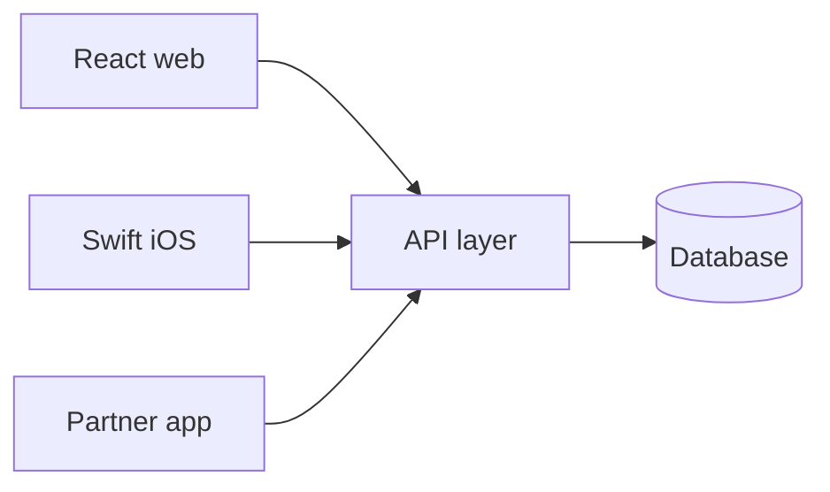
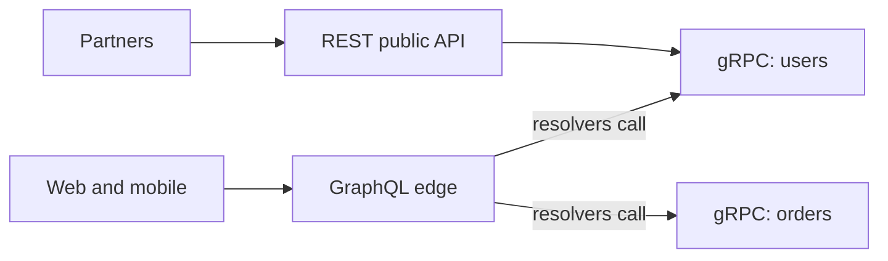
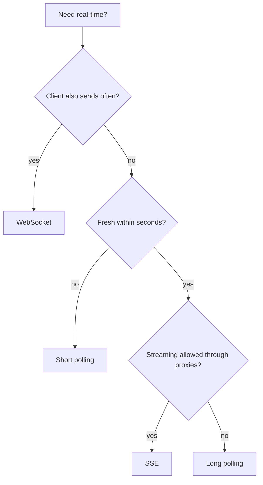
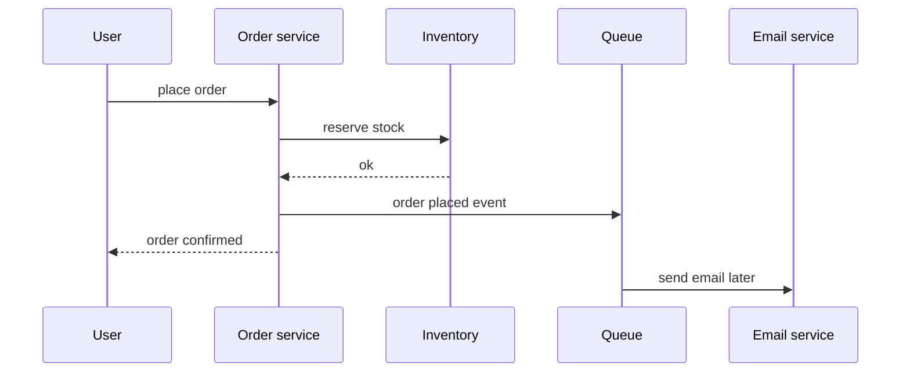

# 🔌 APIs & communication styles

*An API is the contract one application exposes so others can use its data and actions without touching its internals. Pick the style by who calls it, how often, and who needs to start the conversation.*

## 🤝 What an API is

### 🗺️ Using someone else's system
- Zomato, Uber, Ola, Rapido and Swiggy show maps without building a mapping engine: they call **Google Maps APIs**.
- **API = Application Programming Interface**: the endpoints an application exposes for others.

### 🎬 Use case 1 — other applications
- A movie-ratings app (IMDb / Rotten Tomatoes style) already holds decades of films, ratings and reviews.
- A third party calls its **read APIs** instead of re-curating everything, and its **"write a review"** endpoint instead of building one.

### 📱 Use case 2 — your own front ends
- One back end, many clients: a **React** web app and a **Swift** iOS app consume the same APIs.
- Clients don't care what language the back end is written in; the API is the contract.
- Some APIs are private to your own clients; others are opened to partners. Both can coexist.

### 🔒 Why never expose the database
- The caller would have to understand every table and query path.
- One bad or malicious query can **delete or corrupt data** other apps depend on.
- No place to enforce auth, validation, rate limits, or to change the schema later.

## 🧰 The five API styles

### 📊 Comparison

| Style | Format / transport | Key idea | Best for |
|---|---|---|---|
| **REST** | JSON over HTTP; resources + verbs | Simple, cacheable, most widely used | Public and client-facing APIs |
| **SOAP** | XML envelopes, strict contracts (WSDL) | Verbose — tags repeated for every field | **Legacy** enterprise systems; bridge with a middleware that converts XML ↔ JSON |
| **GraphQL** | JSON over HTTP, **single endpoint** | Client sends a typed **field-selection query** over a schema; gets exactly those fields | Many clients with different screens; avoids over- and under-fetching |
| **gRPC** | **Protocol Buffers** over **HTTP/2** | Binary, schema-first, much smaller than JSON; streaming; created by Google | **Internal service-to-service** calls where latency matters |
| **WebSockets** | Persistent full-duplex connection | After the handshake **either side can send** — the server can push | Chat, notifications, live quizzes, collaboration |

### 🧠 Precise points
- GraphQL is **not SQL-like**: it selects fields from a typed schema; it does not join or aggregate — resolvers do that work server-side.
- GraphQL loses easy HTTP caching (one POST endpoint) and needs query cost limits.
- gRPC needs HTTP/2 end to end; browsers need **gRPC-Web** or a gateway.
- Live-quiz example: scores depend on **response time + correctness**, and results, notifications and GIFs are pushed live — a WebSocket fit.

- GraphQL's **N+1 problem**: a list of 50 posts whose resolver loads each author separately runs 1 + 50 queries. **DataLoader** batches and deduplicates the loads within one request tick, so the author lookups become a single query.
- GraphQL needs **query depth and complexity limits**; one deeply nested query can work as a denial of service.
- Because GraphQL is usually a POST, HTTP caches cannot see it. **Persisted queries** (a stored, hashed query sent as a GET) bring CDN caching back for read traffic.
- gRPC: **never reuse a retired field number**. Old clients decode the reused number as garbage, so mark removed numbers `reserved`.
- gRPC on a public API is a poor fit: browsers need gRPC-Web plus a proxy, and browser streaming is mostly unary.

> 🔑 Common split: REST (or GraphQL) at the edge for clients, gRPC inside between microservices.

### 🧭 Pick by consumer

| Consumer | Protocol | Why |
|---|---|---|
| Public third parties | REST with OpenAPI | HTTP caching and CDN semantics work; partners already know REST |
| Own web and mobile clients | GraphQL | Clients select exact fields per screen; no over-fetching or request waterfalls |
| Internal services | gRPC | Protobuf is 3–10× smaller than JSON, typed, streams; latency dominates internally |

- Putting GraphQL on the public API too loses HTTP caching and pushes complexity onto third parties; per-field auth and rate limits are hard.
- A hybrid is normal: a GraphQL edge whose resolvers call gRPC services, with REST for the public surface.

## ⏱️ Real-time transports

### 🔄 Four options

| Transport | How it works | Latency | Cost | Use when |
|---|---|---|---|---|
| **Short polling** | Client asks every N s | Up to N s | Many empty responses | Badges, dashboards refreshed every ~30 s |
| **Long polling** | Server holds the request until data or ~30 s timeout; client re-asks | Near real time | One request per message + held connection | Fallback when streaming is blocked |
| **SSE** | One long HTTP response streaming `text/event-stream`, server → client only | Real time | One connection; auto-reconnect with `Last-Event-ID` | Tickers, live scores, feeds |
| **WebSockets** | Upgraded TCP connection, both directions | Real time | Stateful; needs sticky gateways and heartbeats | Chat, games, collaboration |

- WebSockets and SSE both run over **TCP**; UDP-based real-time (games, calls) uses WebRTC or QUIC.
- Backgrounded mobile apps lose sockets; use push notifications (FCM/APNs) there.

### 🎯 Pick per feature

| Feature | Transport | Why |
|---|---|---|
| Notification badge | Short polling every ~30 s; push when backgrounded | Seconds of freshness is enough; stateless and CDN-friendly |
| Live score or price ticker | SSE | One direction only; built-in reconnect with `Last-Event-ID`; plain HTTP |
| 1:1 chat | WebSocket | Both sides send often; one open channel beats a request per message |

- **Blocked upgrades**: some corporate proxies strip the WebSocket upgrade. Serve those clients long polling instead of failing them.

### 🔢 Surviving reconnects
- Sockets drop silently, so an open socket does not prove every message arrived.
- Give every message a **monotonically increasing sequence number**. The client reconnects with its last sequence number, and the server replays the gap from a log.
- Heartbeats about every 30 s expose half-open connections, where messages vanish while the socket still looks alive.
- Reconnect with **exponential backoff and jitter**. Without jitter, every client hammers the servers at the same instant after an outage.

### 🏭 Scaling and deploying the connection tier
- Gateways hold sockets and are otherwise stateless. At roughly 50–100k connections per node, 1M concurrent clients need about 10–20 gateway nodes.
- A registry maps user → gateway. A pub/sub bus (Redis, Kafka) delivers each event to the gateway holding that user, and the message log replays anything a disconnected client missed.
- Long-lived connections and handshakes need **session affinity**; plain round-robin breaks them.
- **Deploys**: take a gateway node out of the load balancer so it gets no new connections, then send its clients a "reconnect" frame in batches with random jitter. They resume on other nodes from their last sequence number, so nothing is lost and there is no reconnect storm.

## 🔀 Sync vs async calls

### 📦 E-commerce order

| Task | Mode | Why |
|---|---|---|
| Update inventory | **Sync** | The last unit must be out of stock immediately |
| Email confirmation | Async | A minute late is fine |
| Notify delivery partner | Async | Another service's job |
| SMS / WhatsApp | Async | Same |

- **Sync**: caller waits for the answer — needed for money, security checks, and steps the next step depends on.
- **Async**: caller hands work to a **message queue** and moves on — the queue buffers, retries, and absorbs a slow or down consumer.
- Rule: if you can **fire and forget**, go async. OTP timers are usually **> 30 s** because delivery is async.
- Queues deliver **at least once**, so consumers must be **idempotent**.

