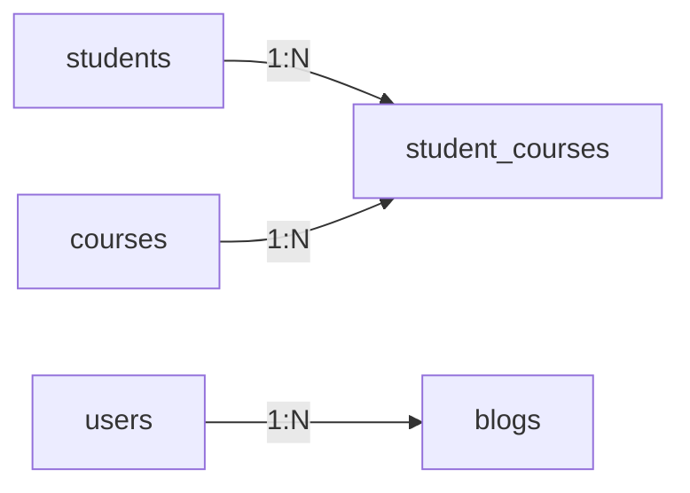
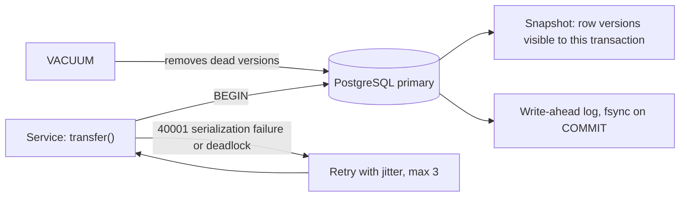
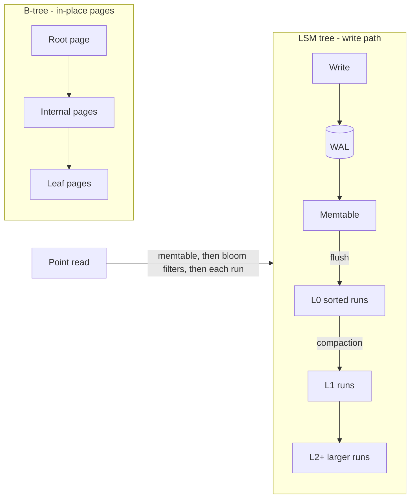

# 🗃️ SQL & relational modelling

*Relational databases store entities as tables of rows and columns, enforce correctness with constraints, link tables through keys, and guarantee ACID transactions.*

## 🧱 Tables, rows, columns

### 💾 Why a database at all
- Data held only in server memory is lost on restart; a DB **persists** what users need next time.
- "SQL vs NoSQL" is like "Java vs no-Java": NoSQL is many different models (key-value, wide-column, graph, document).
- **SQL** = Structured Query Language over an **RDBMS**. Common engines: **PostgreSQL**, **MySQL**.

### 📐 Anatomy
- **Table ≈ entity**: `users`, `posts`, `comments`, `videos`.
- **Column = attribute**: `users(id, first_name, last_name, phone)`.
- **Row = one record**: `1, Alice, Agarwal, 98765…`.
- **Naming**: plural table names (`users`, not `user`) because a table holds many records — a convention, not a rule; pick one and stay consistent.

## 🛡️ Constraints

### 📋 The six
Forms validate in the UI, but the **database is the last line of defence** — faulty data is useless.

| Constraint | Meaning | Example |
|---|---|---|
| **PRIMARY KEY** | Unique, non-null identifier; `WHERE id = 3` returns exactly one row | `users.id` |
| **UNIQUE** | Value can't repeat in the column | `username`: if "abc" exists nobody else can insert "abc"; Instagram/Gmail then suggest variants with extra characters |
| **NOT NULL** | Value is mandatory | `first_name`, since the app addresses users by it |
| **CHECK** | Value must satisfy a rule | `phone` digits only; `LENGTH(first_name) >= 2` (2-letter names exist) |
| **DEFAULT** | Filled when nothing is supplied | `plan = 'free'` until they pay; `role = 'student'`, later updated to `'trainer'` if hired |
| **FOREIGN KEY** | References another table's primary key | `posts.author_id → authors.id` |

### 🔐 Passwords are validated in the app
- The DB stores only a **salted hash** (bcrypt / Argon2), so a `CHECK` on the stored column can't see length, digits or special characters.
- Enforce password rules in the application **before hashing**.

```sql
CREATE TABLE users (
  id          BIGSERIAL PRIMARY KEY,
  username    VARCHAR(30) NOT NULL UNIQUE,
  first_name  VARCHAR(50) NOT NULL CHECK (LENGTH(first_name) >= 2),
  phone       VARCHAR(15) CHECK (phone ~ '^[0-9]+$'),
  plan        VARCHAR(10) NOT NULL DEFAULT 'free',
  role        VARCHAR(10) NOT NULL DEFAULT 'student',
  pw_hash     TEXT NOT NULL
);
```

## 🔗 Relationships

### 1️⃣➡️🔢 One-to-many / many-to-one
- `users(1 Alice, 2 Bob)`; `blogs(HTML → 1, AI → 2, System Design → 1)`.
- One user has many blogs (1:N); read from the blog side, many blogs belong to one user (N:1).
- The foreign key lives on the **many** side (`blogs.user_id`). Store the id, never copy the author's details.

### 🔢↔️🔢 Many-to-many
- `students(Alice, Bob)` ↔ `courses(Master Java, Master AI)`.
- Needs a **junction table** `student_courses(student_id, course_id)` — primary key on the pair, or its own id if queries need it.

| student_id | course_id |
|---|---|
| Alice | Master Java |
| Alice | Master AI |
| Bob | Master Java |
| Bob | Master AI |



### 1️⃣↔️1️⃣ One-to-one — content split
- Platform with three heavy content kinds: **blog text, audio (MP3), video (MP4)**.
- One fat `contents` table with every column for every type gets huge and every filter scans all types.
- Better: a slim `contents(id, name, type, content_id, keywords, slug)` for search and listing; payloads live in `blogs`, `audios`, `videos`.
- `type = video, content_id = 1` → exactly one row in `videos` where `id = 1`: one-to-one.

## ⚛️ ACID transactions

### 🧪 The four guarantees

| Letter | Means | Example — transfer ₹100 |
|---|---|---|
| **Atomicity** | All or nothing | Debit and credit both happen or neither |
| **Consistency** | Constraints hold before and after | Balance never violates `CHECK (balance >= 0)` |
| **Isolation** | Concurrent transactions don't see each other's partial work | Two withdrawals can't both read the old balance (isolation level decides how strictly) |
| **Durability** | Committed data survives a crash | Write-ahead log flushed before "OK" |

- ACID's C (constraints) is not CAP's C (every read sees the latest write).
- Isolation levels trade safety for throughput: read committed → repeatable read → serializable.
- Durability can be relaxed. `synchronous_commit = off` returns before the WAL flush: a crash can lose the last few commits, but the database is never corrupted. Keep it on for money and bookings.

## 🧵 Isolation levels and MVCC

### 🐛 The anomalies
- **Dirty read** — you read another transaction's uncommitted write, which may roll back.
- **Non-repeatable read** — the same row read twice in one transaction returns different values.
- **Phantom** — the same range query returns new rows because someone inserted into the range.
- **Lost update** — two read-modify-write cycles overlap and one overwrites the other.
- **Write skew** — two transactions read the same rows, each writes a *different* row, and together they break a rule (two doctors both go off call because each saw the other still on call).

### 📶 The levels (ANSI SQL)

| Level | Prevents | Still allows |
|---|---|---|
| Read uncommitted | — | Dirty reads and everything below |
| **Read committed** | Dirty reads | Non-repeatable reads, phantoms, lost updates |
| **Repeatable read** | + non-repeatable reads | Phantoms (per the standard), write skew |
| **Serializable** | All of the above | Nothing — results equal some serial order |

- Defaults differ: **PostgreSQL** and Oracle use read committed; **MySQL InnoDB** uses repeatable read.
- Engines diverge from the standard: PostgreSQL's repeatable read is **snapshot isolation** (no phantoms, but write skew possible) and its serializable is **SSI**, which aborts conflicting transactions — so callers must **retry** on serialization failure.
- PostgreSQL treats read uncommitted as read committed; it never returns dirty reads.

### 🗂️ MVCC
- **Multi-version concurrency control**: an update writes a **new row version** instead of overwriting; each transaction reads the versions visible in its **snapshot**.
- Result: **readers don't block writers and writers don't block readers**; only write–write conflicts on the same row wait or abort.
- Old versions must be cleaned up — PostgreSQL's **VACUUM**, InnoDB's undo-log **purge**. A long-running transaction pins old versions and causes bloat.
- Two writers on the same row still conflict. The second waits, then fails (repeatable read, serializable) or re-reads the new value (read committed).

### 🛠️ Fixing lost updates and write skew
- Atomic update: `UPDATE accounts SET balance = balance - 100 WHERE id = 1 AND balance >= 100`.
- Pessimistic lock: `SELECT … FOR UPDATE` on the rows you will change (for write skew, lock the rows you *read*).
- Optimistic: a `version` column, `UPDATE … WHERE version = ?`, retry if 0 rows changed.
- Or run that transaction as serializable and retry on conflict.
- Counter row: when a rule like "at least two on call" spans rows, make every transaction update one shared counter row. The row lock serialises them, and the rule is checked in one place.

> 🔑 Name the anomaly first, then pick the cheapest fix that prevents it — serializable everywhere is rarely the answer.

## 🔒 Concurrency patterns

### 🎯 Pick the pattern per invariant

| Invariant | Pattern | Why |
|---|---|---|
| Balance never goes negative | Atomic `UPDATE … WHERE balance >= :amt`; zero rows updated means insufficient funds | One statement cannot lose an update |
| A seat is sold at most once | `UNIQUE (show_id, seat_no)` plus an insert | The constraint turns the race into a clean error; no lock is held |
| A multi-row rule (on-call roster) | Serializable with retry, `SELECT … FOR UPDATE` on the rows read, or a shared counter row | Snapshot isolation allows write skew |
| A user edits a record over minutes | Optimistic `version` column | A lock must never span a human's think time |
| Few rows, heavy contention | Pessimistic `SELECT … FOR UPDATE`, rows locked in a fixed order | Predictable under contention; locks are held until commit |

### 🧱 Double-booking with a unique constraint

Check-then-insert fails under concurrency: two requests both see seat 12A free and both insert. A unique constraint lets exactly one commit.

```sql
INSERT INTO bookings (show_id, seat_no, user_id)
VALUES (:show_id, :seat_no, :user_id);
-- unique violation on (show_id, seat_no): the service answers "seat taken"
```

### 🔁 Retries and transaction hygiene

- Serialization failures (SQLSTATE 40001) and deadlocks are normal under serializable isolation. Retry the whole transaction, with jitter, up to three attempts, then surface the error.
- Keep transactions short: no network calls and no user think time inside them. Target p99 under 50 ms.
- Lock rows in a consistent order to prevent deadlocks.
- Reads must not block writes. MVCC snapshots make that true; do not add shared read locks.
- Housekeeping: no transaction should stay open for more than seconds, or old row versions cannot be vacuumed.



## 🧩 Normalisation vs denormalisation

### 📏 Normal forms
- **1NF** — atomic values, no repeating groups (no `phone1, phone2, phone3` or comma lists in a column).
- **2NF** — no column depends on only *part* of a composite key.
- **3NF** — no column depends on another non-key column (store `city_id`, not `city` *and* `city_population`).
- **BCNF** — every determinant is a candidate key; a stricter 3NF.
- Goal: each fact stored **once**, so an update can't leave copies disagreeing (update anomalies).

### ⚡ When to denormalise
- Read-heavy paths where joins dominate latency: copy `author_name` into `posts`, keep a `like_count` counter, precompute aggregates or materialised views.
- Cost: every write must update the copies (in the same transaction, a trigger, or an event), and stale copies are now possible.

| | Normalised | Denormalised |
|---|---|---|
| Writes | One place, simple | Fan out to copies |
| Reads | Joins | Single lookup |
| Fits | OLTP source of truth | Read models, analytics (star schema), NoSQL |

> 💡 Normalise the source of truth to 3NF; denormalise read models you can rebuild from it.

## 📇 Indexes

### ⚡ Basics
- Without an index a filter is a **full table scan**; an index (usually a **B-tree**) finds rows in O(log n).
- Primary keys and UNIQUE columns are indexed automatically; index foreign keys and frequent filter/sort columns yourself.
- **Composite index** `(user_id, created_at)` serves `WHERE user_id = ? ORDER BY created_at` — column order matters (leftmost prefix).
- Cost: every index slows writes and uses storage. Index for real queries, confirm with `EXPLAIN`.

## 🌲 B-tree vs LSM tree

Both engines keep keys sorted, but they disagree on how writes reach disk. A B-tree updates pages in place. An LSM tree appends and merges later. The read/write ratio of the workload decides which one wins.

### 🧬 Two storage shapes

- **B-tree** (PostgreSQL, InnoDB) — a balanced tree whose leaves hold the sorted data. Updates go to pages in place. Reads and writes are O(log N). MVCC comes from undo or version data.
- **LSM tree** (RocksDB, LevelDB, Cassandra, HBase) — writes go to a memtable and a WAL, then flush as immutable sorted runs (SSTables). Background compaction merges runs so their number stays bounded. Bloom filters let a read skip any run that cannot hold the key.



### ⚖️ The amplification trade

| Cost | B-tree | LSM tree |
|---|---|---|
| Write amplification | Random page writes, immediately | Cheap appends now; large sequential compaction writes later |
| Read amplification | Low: one root-to-leaf walk | Higher: memtable, bloom checks, then each run not ruled out |
| Space amplification | Low, aside from fragmentation | Stale versions and tombstones linger until compaction |
| Tail latency | Steady | p99 spikes during compaction unless it is throttled |

- Write-heavy ingestion → LSM. Appends plus background merges beat random page writes by a wide margin.
- Read-heavy queries with joins, ranges and ordering → B-tree. Predicates and ordering are native to sorted pages, and p99 stays stable.
- Latency-sensitive key-value → leveled-compaction LSM, tuned. Size-tiered compaction spikes space and read amplification between merges.
- Storage budget → B-tree. Tombstones and versioned keys make LSM space amplification a real cost.
- Analytics on event streams → LSM, because ingest throughput dominates. Columnar storage is still the better fit for scans (see alternatives).

> 🔑 Decide the workload first: write or read heavy, point or range, and how much space and tail latency you can spend.

### 🧰 Alternatives

- **Hash index** — O(1) point lookups. No range scans or ordering, and resizing is expensive.
- **Columnar storage** (Parquet, ClickHouse) — compression and vectorised scans for analytics. Poor at point lookups and single-row updates, so it is an OLAP tool, not an OLTP index.

### 🗂️ Index types

- **Clustered (primary)** — the table's rows are stored in index order.
- **Secondary** — a separate structure that points at rows.
- **Covering** — the index holds every column the query needs, so the table is never read.

### 🚫 When not to add an index

- Low-cardinality columns such as booleans. The index barely narrows the result.
- Small tables, where a full scan is cheaper than index overhead.
- Write-heavy tables, where index maintenance dominates the cost.
- Tombstone-heavy LSM tables, such as queues or TTL data. Reads wade through thousands of tombstones and can time out.
- Functions on the indexed column, such as `WHERE LOWER(email) = ?`. A plain index is skipped; use an expression index on `LOWER(email)` instead.

