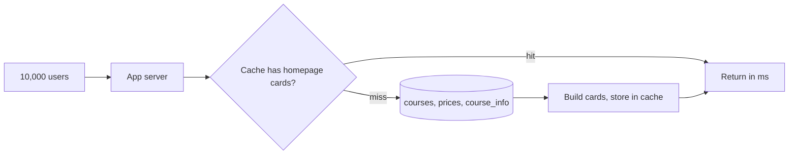
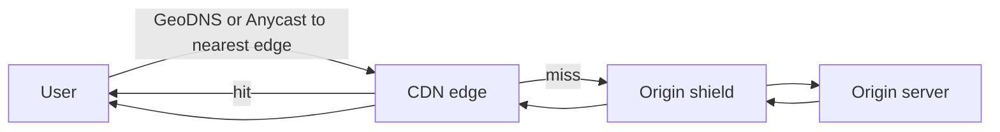
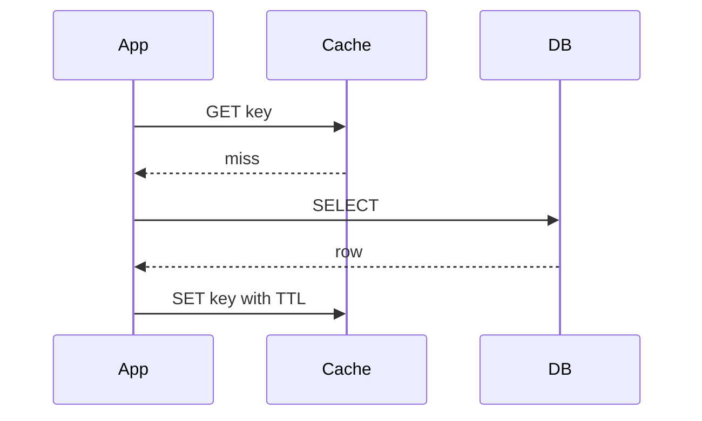
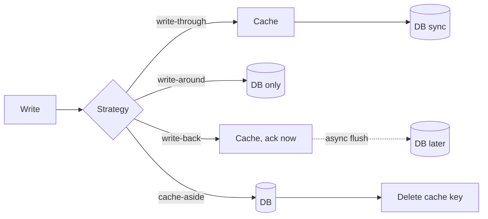
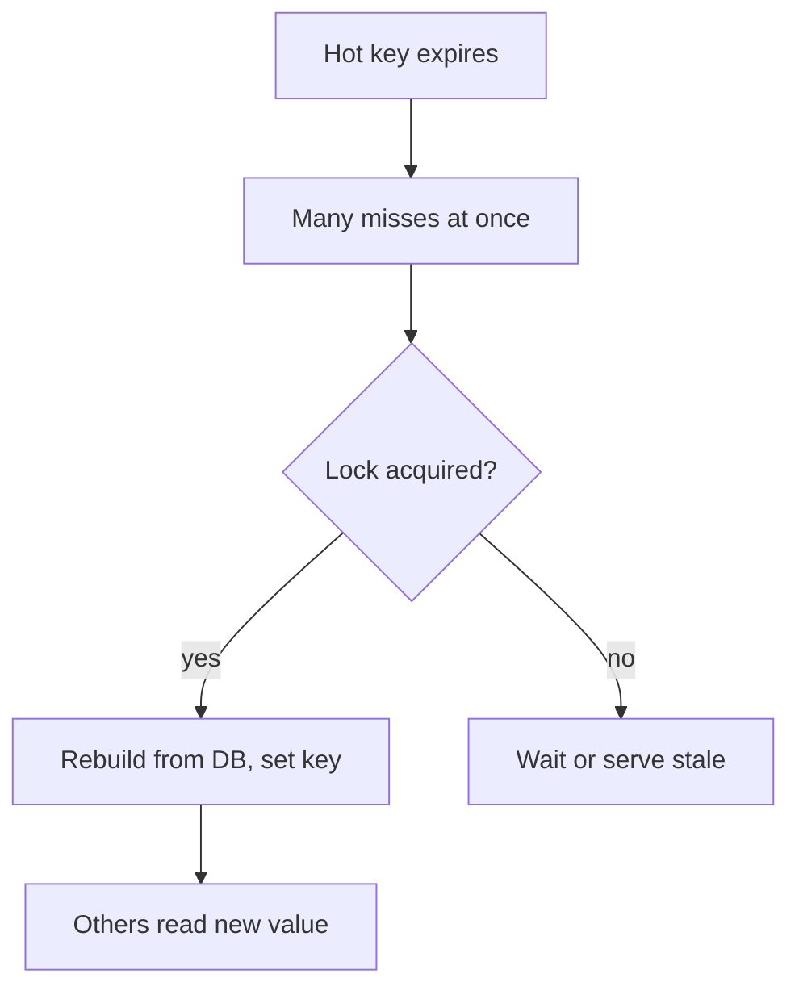
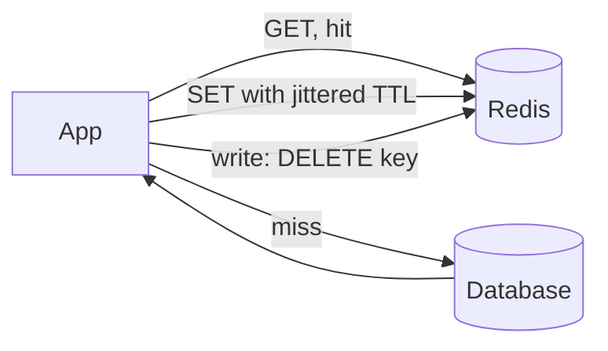

# ⚡ Caching

*A cache is a small, fast store of hot data kept in front of a slower source. The design questions are where it lives, how it's filled and written, how it stays fresh, and what it evicts.*

## 🏠 Why cache — the homepage example
<!-- related: sd-7 -->

### 🧮 The numbers
- A course site's homepage shows **3 popular courses**. Each card needs:
  - **thumbnail** — from the CDN;
  - **name** — from `courses`;
  - **price + discounted price** — from `prices` (varies by locality/currency);
  - **key sections** — from `course_info`.
- That's **4 fetches per course** (3 tables + CDN), for **every user on every visit**.
- **10,000 DAU** × those fetches, and growing to **6 courses** → 6 × 4 = **24 requests per user visit** — about **60,000 course-name reads a day** alone, for data that barely changes.
- Result: slow homepage, poor performance, lost sales.

### ✅ The fix
- Compute the six course cards once, store them in memory, serve every visitor from there.

## 📍 Where caches live
<!-- related: sd-7 -->

### 🧅 Layers

| Layer | Example | Caches |
|---|---|---|
| **Client** | Browser HTTP cache, mobile memory/disk cache | Images, API responses, static assets |
| **CDN / edge** | Edge servers near users | Media, static files, cacheable GETs |
| **Server-side** | Redis / Memcached, in-process LRU | Query results, sessions, rendered fragments |
| **Database** | Buffer pool, query cache | Hot pages and index blocks |

- Each layer closer to the user saves more latency but is harder to invalidate.

## 🌐 CDN
<!-- related: sd-7 -->

A CDN is a geographically spread set of edge caches. It is the cache layer closest to the reader, so it is the best place for anything many users receive identically.

### 🛰️ How a request is served

- DNS (GeoDNS or Anycast routing) sends each user to the nearest edge point of presence (PoP). Target: a PoP within about 30 ms of the user.
- On a **hit** the edge answers from its cache. On a **miss** it fetches from the origin, stores the response under its TTL, and serves it.
- TLS is terminated at the edge, so the handshake stays close to the user.

### 🔀 Pull vs push

| Model | How content arrives | Good for | Cost |
|---|---|---|---|
| **Pull** | The edge fetches from the origin on the first miss | Web assets, popular video, content with an unknown access pattern | Zero pre-provisioning; the first viewer in each region pays the miss |
| **Push** | You upload content to the edges ahead of time | Large, predictable downloads such as game builds and firmware | No origin egress per download; you pay to move bytes whether or not anyone downloads them |

> 💡 Pull is the default. Push earns its place when a single file is huge and its release date is known in advance.

### 🔁 Invalidation

- **TTL expiry** — simplest; staleness is bounded by the TTL.
- **Explicit purge** through the CDN API — an emergency tool, not part of a routine deploy.
- **Content-hashed filenames** (`bundle.3f9a1c.js`) — a deploy changes the reference, so the new file is fetched at once with no purge. Old files simply age out, which lets hashed assets carry a very long TTL.
- **Freshness budget per content class** — HTML may be allowed to be about a minute stale; API responses must be fresh and are usually not edge-cached at all.

> 🔑 Make the URL change, not the cache. Versioned URLs invalidate instantly at zero purge cost.

### 🧱 Origin shielding and DDoS absorption

- **Origin shield** — a mid-tier cache between the edges and the origin. Many edges missing at the same moment collapse into one origin fetch.
- **DDoS** — volumetric attacks are absorbed at the edge, which has terabits of aggregate capacity. Rate limiting and a WAF run there too. The origin IP stays hidden and never sees attack traffic.
- **Signed URLs** protect private content such as paid downloads.

### 🧭 What belongs on a CDN

| Put on the CDN | Keep off the CDN |
|---|---|
| Static assets, images, video segments, large downloads | Personalised responses, write APIs, real-time data |

Dynamic acceleration (routing uncacheable requests over the CDN's optimised network) helps latency. It does not raise the hit ratio.

### ⚖️ Design decisions

| Decision | Chosen | Alternative | Why |
|---|---|---|---|
| Delivery model | Pull for web and video; push for huge predictable files | One model everywhere | Pull needs no pre-provisioning; push avoids origin egress for very large files |
| Invalidation | Content-hashed versioned URLs | TTL only, with purge | Renaming the reference invalidates instantly |
| Dynamic content | Straight to origin, no edge caching | Edge-computed personalisation | Personalised responses defeat caching |
| DDoS | Absorb at the edge with rate limits | Filtering at the origin only | Edge capacity plus a hidden origin IP is the only scalable defence |

**Alternative: self-hosted regional caches (Nginx, Varnish)** — full control and no per-GB fees, but you own PoP capacity, peering and DDoS defence.

**Alternative: origin only, with aggressive browser caching** — simplest, but global latency is unbounded, there is no DDoS absorption and no offload at scale.

### 🚩 Pitfalls

- A cache key that includes every query parameter or cookie — the hit ratio collapses toward zero. Vary only on what changes the response.
- Caching a response that carries `Set-Cookie` — one user's session is served to everyone.
- Wildcard purges on every deploy instead of versioned URLs — the edge-wide cold misses stampede the origin.
- The origin still reachable directly — attackers bypass the WAF and DDoS absorption. Lock the origin to the CDN's IP ranges.

## 🎯 Hit, miss, TTL — and why caches are small
<!-- related: sd-114 -->

### 📖 Terms
- **Hit** — found in cache → no DB call, fast.
- **Miss** — not found → read the DB, usually fill the cache, slower.
- **TTL** — how long an entry lives before it **expires**.
- Storage is **key → value + TTL**; expired or evicted pairs make room.
- **Hit ratio** = hits ÷ lookups — the metric that tells you whether the cache earns its cost.

### 🤏 Why not cache the whole DB?
- Memory is expensive; the cache is fast and cheap **because it holds only the hot subset**.
- Hot data shifts: today's featured course is Master **Java**; tomorrow the campaign moves to **AI** — the cache must follow.
- A cache as big as the DB costs as much as a second DB and still has to be kept in sync.
- So: **cache ≪ DB**, sized to the working set, continuously refreshed.

## ✍️ Read and write strategies
<!-- related: sd-64 -->

### 📊 Comparison

| Strategy | Write path | Read path | Trade-off | Example |
|---|---|---|---|---|
| **Cache-aside** | App writes DB, then **deletes** the key | App checks cache; on miss app reads DB and fills cache | Most common; app controls everything; survives cache outage | General-purpose |
| **Read-through** | Writes go to DB | Cache itself loads from DB on a miss | Library/provider does the loading; cache holds only data actually read | Product details |
| **Write-through** | Write to cache, cache writes DB **synchronously** | From cache | Cache always current; every write pays both latencies | **Stock prices**, anything needing the latest value |
| **Write-around** | Write **only to DB**, bypass cache | Read-through / cache-aside on miss | New data isn't cached until someone reads it; first read misses | **Tweets**: don't cache at creation; cache when read, because then others will read it too |
| **Write-back** | Write to cache, **ack immediately**, flush to DB **asynchronously** | From cache | Fastest writes; risk of **losing data** if the cache dies before flush | **Food-delivery order status**: millions of rapid updates, users read from cache, DB catches up |

### 🔁 Cache-aside read path

### ✏️ Write paths side by side

> 🔑 Write-around = DB-only writes + read-through reads. Write-through = writes go via the cache. They're opposites.

## 🧹 Invalidation and stampedes
<!-- related: sd-64 -->

### 🔄 Keeping data fresh
- **TTL** — simplest; bounded staleness.
- **Delete on write** — the writer deletes the key after updating the DB; the next read refills it. Deleting beats updating (avoids racing writers leaving an old value).
- **Versioned keys** — `course:42:v7`; bump the version on change, old keys age out.
- **Events** — a change stream (CDC) invalidates keys across services.

### 🐘 Cache stampede
- A hot key expires → thousands of requests miss together → all hit the DB.
- Fixes:
  - **Request coalescing / single-flight** — one request rebuilds, others wait for it.
  - **Jittered TTLs** — hot keys don't expire at the same instant.
  - **Early refresh** — refresh in the background before expiry.
  - **Serve stale while revalidating.**

## 🗑️ Eviction policies
<!-- related: sd-114, sd-64 -->

### 📊 When the cache is full

| Policy | Evicts | Example |
|---|---|---|
| **LRU** | Not used for the longest time | iPhone 17 Pro Max launches; everyone searches 17, nobody searches iPhone 11 → 11 is evicted |
| **MRU** | The entry **just used** | A **coupon you just applied** won't be needed again; a **YouTube segment already watched** is rarely re-watched — fits sequential, one-shot access |
| **LFU** | Fewest uses | You browse **secondary screens** and **clothes** repeatedly but searched a **plant** once → plant is evicted |
| **FIFO** | Oldest inserted, regardless of use | Cache capped at **180 MB**; when full, drop the earliest insertion |
| **LIFO** | Newest inserted | Same **180 MB** cap; oldest entries stay longest — rarely right for caches |

- **LRU** is the sensible default (Redis `allkeys-lru`); **LFU** resists one-off scans polluting the cache.
- LRU implementation: **hash map + doubly linked list** → O(1) get and put.

> 📝 Find one real workload where FIFO is the right eviction policy, and argue why LIFO almost never is.

## 🧠 Redis vs Memcached
<!-- related: sd-64 -->

Both are in-memory key-value caches. They differ in what they store, how they persist and how they scale per node. Redis is the default choice for almost every new system.

### 📊 Engine comparison

| | Memcached | Redis |
|---|---|---|
| Data model | Key → opaque string | Strings, hashes, lists, sets, sorted sets, streams |
| Execution | Multi-threaded | Command execution is single-threaded |
| Persistence | None (in memory only) | RDB snapshots and/or AOF log |
| Extras | — | Pub/sub, Lua scripting, cluster mode |
| Strength | Pure GET/SET throughput at very large scale; simplest model | Rich types, durable options, server-side logic |

- Pick **Redis** for sorted sets (leaderboards), hashes, pub/sub, or state that should survive a restart.
- Pick **Memcached** for a large, pure string cache where the app only does GET and SET and simplicity matters most.

### 💾 Persistence: RDB vs AOF

- **RDB** — periodic point-in-time snapshots. Cheap at write time, but everything since the last snapshot is lost on a crash.
- **AOF** — every write is appended to a log. `appendfsync everysec` bounds the loss to about one second of writes at a small write-time cost.

> 🔑 Choose the persistence to match the loss you can accept. For a hot cache, AOF `everysec` keeps restart loss near one second.

### 🧩 Sorted sets and the leaderboard

A leaderboard is a sorted set: `ZADD leaderboard <score> <user_id>` writes a score, and `ZREVRANK leaderboard <user_id>` returns the rank. Both are O(log N), so updates and rank queries stay cheap as the board grows.

### 🔒 Stampede lock in Redis

`SET lock:<key> <token> NX PX <ms>` is the SETNX mutex from stampede control. Only the caller that wins the lock rebuilds the key; the others wait briefly or serve stale data.

### ⚖️ Design decisions for a hot set of about 100 GB

| Decision | Chosen | Alternative | Why |
|---|---|---|---|
| Engine | Redis | Memcached | Sorted sets, TTLs, pub/sub and persistence outweigh Memcached's raw multi-threaded GET/SET speed |
| Read pattern | Cache-aside | Read-through proxy | The app controls per-key TTLs and tolerates a cache outage |
| Write pattern | Invalidate on write | Update the cache on write | Updating can write back a stale value under a race |
| Stampede control | TTL jitter plus SETNX mutex | Longer TTLs alone | Expiry alignment, not TTL length, causes the flood |
| Persistence | AOF `everysec` | RDB snapshots | Bounded loss (about one second) on restart without heavy write-time cost |

**Alternative: local in-process cache (for example Caffeine) in front of Redis** — sub-microsecond hits on the very hottest keys. The cost is per-instance memory, and coherence needs pub/sub invalidation between instances.

### 🎯 Targets

- **Hit ratio** above 90%, tracked per access pattern. A global average hides a cold pattern.
- **Latency** — p99 cache round trip under 2 ms, at least 10× faster than the database path.
- **TTL jitter** — about 10% on every TTL.
- **Cache outage** — database load stays within its capacity; any fallback to the DB is rate-limited.

### 🏗️ Request path

Invalidation deletes the key rather than updating it. The next read refills it from the database.

### 🚩 Pitfalls

- `KEYS *` or huge `SMEMBERS` / `HGETALL` in production. Redis runs commands on one thread, so a single slow command stalls every client. Use `SCAN` for iteration.
- Big keys — an unbounded list or hash on one key pins one shard's memory and latency. Split or cap it.
- A cache fallback with no rate limit — a Redis outage becomes a database outage.
- Confusing cache-aside with read-through. In cache-aside the application loads on a miss; in read-through the cache itself does.

