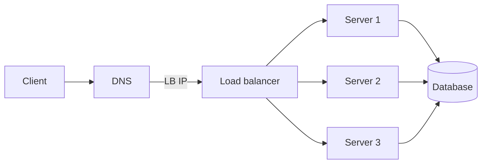
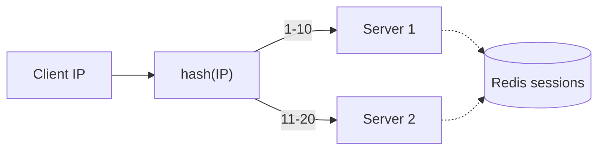
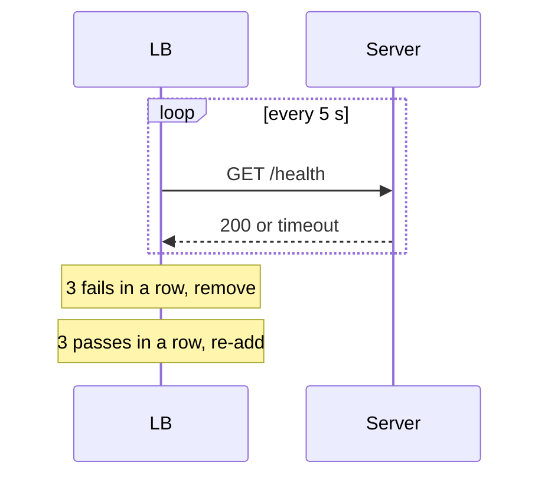
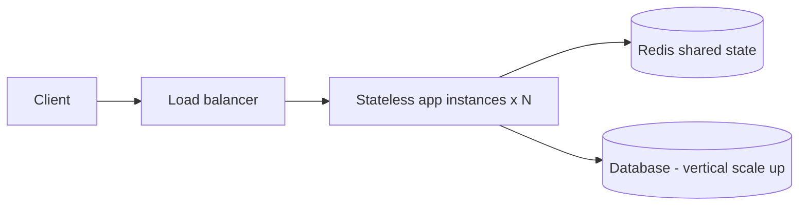

# 🚦 Load balancing

*One server scales only so far; a load balancer spreads requests across many servers and keeps sick ones out of rotation.*

## ❓ Why and where it sits

### 📈 The ceiling
- Client → DNS → server → DB works until one server saturates.
- Example: already on a **128 GB** machine and still saturated after the app goes global → vertical scaling is out; add S1, S2, S3.
- Now something must decide which server takes each request → **load balancer (LB)**.

### 🗺️ Placement
- DNS returns the **LB's IP**, not a server's.
- LB → S1 / S2 / S3; servers share a DB, or use their own DBs kept in sync via replication / partitioning.

### 🧰 The two jobs
1. **Choose the server** — no server overheated, none idle.
2. **Health checks** — send only to servers that can take the request.

## 🔄 Static algorithms: round robin and weighted

### 🔁 Round robin
- Request 1 → S1, 2 → S2, 3 → S3, 4 → S1…
- Needs only a counter: stateless, trivial, equal distribution.
- **Con:** ignores unequal hardware.

| | S1 | S2 | S3 |
|---|---|---|---|
| RAM | 4 GB | 8 GB | 16 GB |
| Storage | 100 GB | 200 GB | 500 GB |
| CPU | 16 core | 32 core | 64 core |

- Equal load → S3 idles while S1 overheats.

### ⚖️ Weighted round robin
- Weight by capacity: S1 **8 GB → 1**, S2 **16 GB → 2**, S3 **32 GB → 3**.
- Requests are spread **in proportion** — per cycle of 6: S1 gets 1, S2 gets 2, S3 gets 3. Not "everything to the heaviest".

> 🔑 Static algorithms suit homogeneous, short, similar-cost requests.

## 📊 Dynamic algorithms: least connections and least response time

### 🔗 Least connections
- S1 has **30** open connections, S2 has **50** → next request to **S1**.
- Best for **long-lived connections**: WebSocket chat, video streaming, gaming.
- **Cons:**
  - Heavy and light requests count the same: S1's 30 heavy AI calls vs S2's 50 light REST calls still sends S1 the next one.
  - LB must keep counts current (50 → 49 on each close).
  - Ignores hardware: weak S1 at **8** vs strong S2 at **16** (could take 100) → S1 still wins. Fix: *weighted* least connections.
  - A newly added instance is flooded before its caches and JIT warm up. Use slow start: ramp its share of traffic up over time.

### ⏱️ Least response time
- S1 averages **50 ms**, S2 **10 ms** over ~1,000 requests → next to **S2**.
- Captures real capability (hardware + current load). Good for latency-critical apps: trading, search.
- **Cons:** LB must track moving averages; spikes skew them — use a decaying (EWMA) average.

> 💡 Long-lived connections ≠ "sticky sessions". Sticky = **session affinity** (IP hash or cookie), a separate concern.

### 🎲 Power of two choices

- Pick two servers at random and send the request to the less loaded of the two.
- Near-optimal spread with minimal state and O(1) decisions. That matters at very high request rates, where scanning every server per request is too costly.
- Works best when it compares a load signal that reflects in-flight work, such as active requests.
- Target: no instance above about 1.2× the mean in-flight requests, even when request durations are skewed.

> 💡 Least connections checks the whole pool on every request. Two choices keeps most of that benefit while reading only two servers.

## 🌍 Affinity algorithms: geo and IP hash
<!-- related: sd-106 -->

### 🗺️ Geo-based
- S1 in **India**, S2 in **US** — each user goes to the closest region (cross-region hops add latency).
- LB tracks where servers are and where requests come from.
- **Cons:**
  - Regions need their own data → replication / partitioning cost.
  - Failover: if **India-A** fails, **India-B** must already hold A's data — continuous replication, not a copy at failure time.
  - **VPNs and proxies** mislead location.
- Usually done at DNS level (GeoDNS / anycast) in front of regional LBs.

### #️⃣ IP hash
- Hash client IP; S1 owns **1–10**, S2 owns **11–20**; hash 5 → S1.
- Same user → same server, so session stays local.
- **Cons:**
  - Server dies mid-session → user lands on S2 without the session.
  - Adding S3 means re-cutting ranges (e.g. 1–8, 9–12, 13–20) → most users remap.
- Fix for remapping: **consistent hashing** — only ~1/N of keys move.
- Modern default: **stateless servers**, session in a **JWT** or shared **Redis**, so any server can serve anyone.

### 🍪 Sticky cookie: session affinity without IP hash

- On the first response the balancer sets a cookie that names the server. Later requests carry the cookie, and the balancer routes them to that server.
- More resilient than IP hash: it works behind NAT and proxies, where many users share one IP, and adding a server does not reshuffle existing users.
- Affinity still breaks when that server fails. Keep session state shared (see the scaling section) so affinity is an optimisation, not a requirement.

### 🧬 Hybrids
- Real LBs combine: IP hash + round robin, least time + least connections, geo + weighted.

## 🧱 L4 vs L7

| | L4 (transport) | L7 (application) |
|---|---|---|
| Sees | IP + port, TCP/UDP | HTTP path, headers, cookies |
| Can do | Fast forwarding, huge throughput | Path routing, cookie affinity, TLS termination, retries, rate limits |
| Cost | Cheapest, lowest latency | More CPU per request |
| Example | AWS NLB | AWS ALB, NGINX, Envoy |

### 🎭 Virtual IP and LB redundancy
- Clients connect to one **virtual IP (VIP)** (or one DNS name), not to a machine.
- A single LB is a single point of failure, so run a **pair**: active–passive sharing the VIP via VRRP (keepalived) — if the active dies, the passive claims the VIP within seconds.
- Managed cloud LBs and **anycast** (the same IP announced from many locations) give the same effect without you running the pair.

## 🩺 Health checks

### 👀 Passive vs active
- **Passive** — watch real traffic (errors, timeouts). No extra load; detects only after users hit it.
- **Active** — LB sends probes (e.g. `GET /health`). Detects idle failures; adds small load.

### 🚥 Liveness vs readiness
- **Liveness** — is the process alive? Fail → restart it.
- **Readiness** — can it take traffic now (DB reachable, warmed up)? Fail → remove from rotation, don't restart.

### ⚙️ Parameters

| Param | Meaning | Example |
|---|---|---|
| Interval | How often to probe | Every **5 s** |
| Timeout | Max wait per probe | Normal replies **50 ms–5 s**; a sudden **10 s** means investigate (bad deploy, config change, busy server) |
| Unhealthy threshold | Consecutive failures → out of rotation | **2–5** in a row |
| Healthy threshold | Consecutive successes → back in | **2–5** in a row |

- Separate from these: **alerting** thresholds on aggregate counts, e.g. page after **20** failures in a window, or verify output quality every **100** successes. Rotation counts are small and consecutive; alert counts are larger and windowed.

### 🧪 Health-check pitfalls

- A check that only returns 200 from the web server passes while the instance's database connection is dead. The probe must exercise what the instance needs to serve.
- A check that calls a shared dependency fails whenever that dependency is slow, and then every instance leaves rotation together. Gate readiness on the instance's own state; use dependency health for alerts and degraded modes.

### 🔁 Retries

- Retry only idempotent requests.
- Cap retries with a budget, such as at most 10% extra load. Unbounded retries turn a partial outage into a full one.

## 📈 Autoscaling

- Health and load metrics show the traffic shape: an India-only app is busy by day, peaks in the evening, quiet at night → **scale down at night**.
- Scale on CPU, request rate, queue depth or p90 latency; keep a minimum fleet and a cooldown.
- New instances join only after passing readiness.

| Style | Trigger | Good for | Weakness |
|---|---|---|---|
| **Reactive** (target tracking / step) | Metric crosses a target, e.g. CPU 60% | Unpredictable load | Lags the spike by boot + warm-up time |
| **Scheduled** | Clock: scale up at 18:00, down at 01:00 | Known daily or weekly cycles, planned sales | Wrong when the pattern shifts |
| **Predictive** | Forecast from past weeks | Regular cycles with a steep ramp | Needs history; still pair with reactive |

> 💡 Combine them: scheduled or predictive capacity for the known peak, reactive on top for surprises.

## 📏 Scaling up vs out

Scale up first while it is cheap and simple. Scale out the stateless tier once a single machine is no longer enough or no longer safe.

### 🪜 Vertical vs horizontal

| | Vertical (scale up) | Horizontal (scale out) |
|---|---|---|
| How | Bigger CPU, RAM and disk | More instances behind a balancer |
| Code change | None | Stateless design, or shared state |
| Ceiling | Hardware, and it gets expensive at the top end | Practically none; shared dependencies become the limit |
| Failure | Single point of failure | Losing one instance removes at most 1/N of capacity |
| Upgrades | Downtime for the swap | Rolling, with no downtime |

- Vertical is the better call when a single-threaded bottleneck dominates (a complex database join), when coordination overhead outweighs the gain, or when the scale does not yet justify distributed complexity.
- Databases follow the same ladder: vertical first, then read replicas, then sharding, which is the most complex step.

### 🧱 Externalise state

- Stateless services scale out trivially. Any instance serves any request.
- Session state in instance memory forces sticky sessions, and sticky sessions break scale-in and rebalancing. Move sessions to Redis or into a signed token.
- Stateful services need stickiness, a distributed cache or consistent hashing to route correctly.

### 📊 Autoscaling signal

- CPU alone lags behind latency during a pile-up. Combine CPU with request latency so the fleet scales earlier. Reference thresholds: scale out above 70% CPU, scale in below 20%.
- A CPU-only trigger on an I/O-bound service never fires while latency explodes. Use latency or queue depth for those services.
- Account for warm-up. A new instance should take full traffic only after its caches and JIT are warm, so a scale-out does not spike errors.

### 🚪 Connection draining on scale-in

- Without draining, scale-in kills in-flight requests, and every scale-in becomes a burst of 5xx.
- Take the instance out of rotation first. Let in-flight requests finish within a grace period (30 s in the reference design), then remove it.

### 🔌 Pool sizing

Each instance has its own connection pool, so adding instances multiplies the connections a database must accept. Scale the application until the database connection limit is hit, and it stops. Put a pooler such as PgBouncer in front of the database.

### ⚖️ Design decisions

| Decision | Chosen | Alternative | Why |
|---|---|---|---|
| API tier | Horizontal behind a balancer | Vertical upgrades | Linear capacity, failure isolation, no upgrade downtime |
| State | Externalised to Redis | Sticky sessions | Sticky sessions break scale-in and rebalancing |
| Database | Vertical first, then replicas | Immediate sharding | Sharding brings cross-shard transactions and an operations burden |
| Autoscaling trigger | CPU plus request latency | CPU only | Scales earlier during a pile-up |
| Instance size | Medium instances, many | Few huge instances | Blast radius and bin-packing beat raw per-instance speed |

### 🚩 Pitfalls

- Scale-in with no draining (see above).
- Autoscaling on CPU for an I/O-bound service.
- Scaling out a service whose bottleneck is one downstream dependency. More instances just queue faster.

