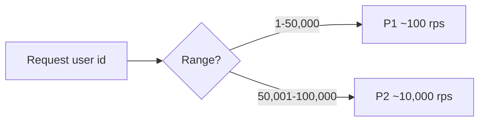
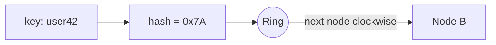
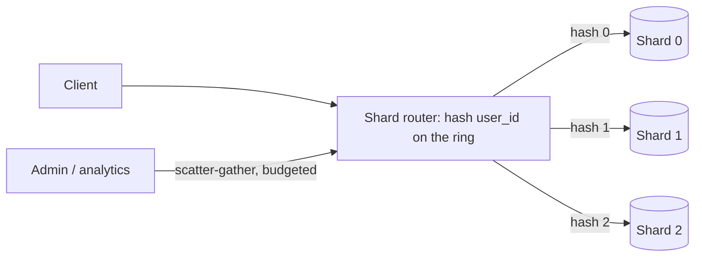
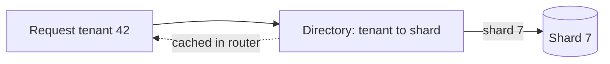
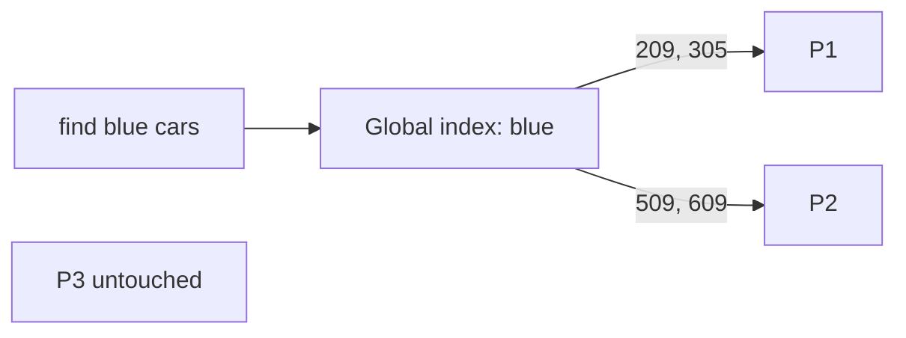

# 🧮 Partitioning

*Split data across nodes (sharding) when it is too big or too hot for one — then replicate each partition.*

## ❓ Why partition, and the two rules

### 📦 Why replication isn't enough
- Replication copies **all** data to every node — doesn't help when data outgrows one node.
- Indexes on one huge table still slow down as data grows; writes don't scale.
- Partition first, then **replicate each partition**.
- Example: cap a node at **10,000 records**; beyond that, add a partition or split into 5,000s.

### 📏 Two rules
1. **Complete** — union of all partitions = full data set; nothing lost or duplicated.
2. **Even** — load and data spread evenly; 90% / 10% defeats the point.

## ↔️ Horizontal vs vertical

| | Horizontal (sharding) | Vertical |
|---|---|---|
| Splits | **Rows** — each partition holds some users | **Columns** or whole tables |
| Example | Users 1–50k on P1, 50k–100k on P2 | `users` (hot: name, email) vs `user_profiles` (cold: bio, settings blob) |
| Scales | Data size and write throughput | Row width, I/O per read, team or feature isolation |
| Cost | Cross-shard queries and transactions | Joins across the split |

- **Functional partitioning** is vertical at service level: orders, payments and catalogue each get their own database.
- Usual order: split vertically by feature first, then shard the tables that still outgrow one node.

## 📐 Key-range partitioning

- User ids **1–50,000 → P1**, **50,001–100,000 → P2**.
- ✅ Range scans are cheap (ids 100–200 live together).
- ❌ Skew: if P1 ends up holding India users and P2 US users, and the app is popular in the US → **P1 ~100 rps, P2 ~10,000 rps**.
- **Hot spot** = one partition taking far more load; it can fail and force emergency rebalancing.
- Detect via per-partition request metrics; fix by splitting the hot range.

## #️⃣ Hash partitioning and consistent hashing

### 🔢 Hash of key
- `partition = hash(key) mod N` — e.g. hash(user1) = 1, hash(user2) = 2, hash(user3) = 1.
- ✅ Spreads keys uniformly, kills range skew.
- ❌ Range queries hit every partition; changing N remaps almost every key.

### ⭕ Consistent hashing
- Nodes and keys on a hash ring; a key belongs to the next node clockwise.
- Add/remove a node → only ~**1/N** of keys move.
- **Virtual nodes** smooth distribution and let bigger machines take more. Each physical host owns about 100–200 ring positions, so its share is the sum of many small arcs and load averages out. A host with twice the capacity gets roughly twice the positions.
- Lookup is a binary search over the V ring positions: O(log V).
- A joining node pulls its ranges, or ramps up on traffic, before taking full load. Otherwise a cold node takes a miss storm.
- Every node computes the same ring from the same membership list, with no coordinator in the data path. Version the ring so two clients never disagree on the owner of a key during a change.
- Use a well-distributed hash for ring positions (Murmur3, xxHash). A weak or non-uniform one, such as Java's `String.hashCode`, clusters keys and defeats the balance that vnodes exist to give.
- Replicas go on the next N ring positions only if those positions belong to distinct physical hosts (or racks). With vnodes, two adjacent positions can sit on the same machine.

### 🆚 Alternatives to a ring

- **Fixed hash slots** (Redis Cluster uses 16,384) — explicit slot ownership and easy manual moves. The slot count is fixed, and slots still need balanced assignment.
- **Rendezvous (highest-random-weight) hashing** — minimal movement and no ring state to sync. Each lookup is O(N) over the nodes, and weighted removal is awkward.
- **Central directory** — avoid it on the data path, where it becomes a bottleneck. Use it only for placement that must move often (see the directory section above).

## 🔑 Shard key choice

Every routing decision depends on the shard key. Choose it before choosing a strategy.

### 📊 Strategy at a glance

| Strategy | Distribution | Range queries | Main risk |
|---|---|---|---|
| Range | Ordered by value; uneven when traffic clusters | Cheap; usually one shard | Newest-range hotspot with timestamp keys |
| Hash | Uniform | Scatter-gather to every shard | Locality is lost; remap cost if N changes (use consistent hashing) |
| Directory | Whatever you assign | Depends on placement | Extra hop; the directory must be replicated and cached |

### ✅ Criteria for a good key

- **High cardinality** — many distinct values, so keys spread across many partitions.
- **Even traffic** — avoid a key that concentrates load (a country code, a status flag).
- **Immutable** — changing the key means moving the row.
- **Carried by most requests** — if the common query names the key, it touches one shard. For a per-user workload, `user_id` is the natural choice.

> 🔑 The right key is the one most requests already carry. A request that needs only one shard is the fast path.

### 📈 Monotonic keys send every write to one shard

- A timestamp or auto-increment key makes every new write land on the newest shard. The write hotspot moves forward with time.
- A per-shard auto-increment ID collides as soon as rows move between shards. Use globally unique IDs instead, such as Snowflake-style or UUID-based IDs.
- A unique constraint that spans shards (for example, unique email) does not hold by itself. Keep a lookup table keyed by that value and write it in the same logical operation.

### 🏗️ Routing

Routing is stateless: every router computes the shard from the key. There is no central lookup on the request path.

## ⚖️ Rebalancing

| Approach | How | Note |
|---|---|---|
| Fixed many partitions | Create e.g. 1,000 partitions up front; move whole partitions between nodes | Simple; Elasticsearch, Riak |
| Dynamic split | Split a partition when it grows past a size | HBase, MongoDB |
| Consistent hashing | Ring + vnodes | Cassandra, DynamoDB |

- Move data in the background, throttled; flip routing only after copy completes.
- Keep a routing map (config service / ZooKeeper) so clients find the right partition.
- **Online reshard, no write freeze:** the new shard joins the ring → its key range is copied (snapshot plus change stream) → dual reads verify the copy → routing flips → the donor deletes the moved keys.
- Copying without a change stream loses every write made during the copy, and the loss shows up at cutover.
- **Split before the shard is stuck:** alert at about 70% disk and 60% CPU per shard. A shard that is too full to move cannot be rebalanced in time.
- **Plan headroom up front:** the reference design starts with 16 shards at 4× headroom, so growth becomes a split rather than a redesign.

### 📒 Directory (lookup) partitioning
- Instead of a formula, a **lookup service** stores `key → partition` explicitly (e.g. `tenant 42 → shard 7`).
- ✅ Any placement is possible: move one tenant, isolate a noisy customer, pin a region's users to a region.
- ❌ An extra hop on every request, and the directory is critical — it must be replicated, highly available and **cached** by routers.

## 🔎 Secondary indexes: local vs global

- Single DB: `products(name, color, price, material)` → index `material` so "material = wood" avoids a full scan.
- Partitioned: where does the index live?

### 🏠 Local (document-partitioned) index
- Each partition indexes only its own rows. Cassandra, Elasticsearch.
- P1 holds cars **200–400**, P2 holds **500–700**:

| Colour | P1 index | P2 index |
|---|---|---|
| Blue | 209, 305 | 509, 609 |
| Red | 350, 359 | 610, 690 |
| Silver | — | — |

- "Blue car" → **scatter–gather**: every partition is queried; each answers fast from its index.
- "Silver car" → still sent to **every** partition; each quickly replies "none".
- ✅ Writes are local. ❌ Every read fans out to all partitions.

### 🌐 Global (term-partitioned) index
- One index covering all data, itself partitioned by term: "blue → 209, 305 (P1), 509, 609 (P2)".
- "Blue car" → read the index, then hit **only P1 and P2**; P3, P4… stay free.
- ❌ Writes touch the data partition **and** the index partition. Adding blue car **1011** in **partition 79** also updates the "blue" index entry — usually **asynchronously**, so the index is briefly stale (DynamoDB GSIs).

## 🔀 Cross-shard work

The request path should touch exactly one shard. Any other access is cross-shard work, and it should be rare and budgeted.

### 🔎 Scatter-gather reads

- Query each shard and merge the results. Fine for admin screens and analytics under a fan-out budget.
- Never put a scatter-gather on the request path. Its latency is the slowest shard's.

### 🧩 Joins across shards

- **Application-side join** — fetch from each shard, join in the service. The shards stay independent, and no distributed SQL coordinator is needed.
- **Distributed SQL join** — only if the join is central and frequent. It brings coordinator complexity with it.

### 💳 Multi-shard writes: saga or 2PC

| | Saga | Two-phase commit (2PC) |
|---|---|---|
| Mechanism | A sequence of local steps, each with a compensating action on failure | Prepare on every shard, then commit everywhere |
| Failure of the coordinator | Keeps going, compensating as needed | Participants block while holding locks |
| Cost | Intermediate states are visible; compensations must be written and tested | Simpler model, but availability drops during coordinator failure |

> 🔑 Prefer a saga for multi-shard workflows when availability matters. Its intermediate states are the price.

## 🔥 Hot keys

- Even perfect hashing can't split **one** key: a celebrity profile, a viral product.
- Mitigations:
  - **Cache** the hot key in front of the DB.
  - **Key salting** — write `key#0..key#9` across partitions, read and merge all 10.
  - Read replicas for the hot partition.
  - Choose a higher-cardinality partition key (e.g. user id + date).
  - **Sub-shard the key:** store `user:<id>:0` … `user:<id>:N` across shards and fan in at read time. This spreads a celebrity's load. Giving the hot shard bigger hardware only delays the next split.

> 📝 Practice: a celebrity account makes one shard hot. Design the write and read paths for one profile split over N sub-keys, and state what each path costs.

