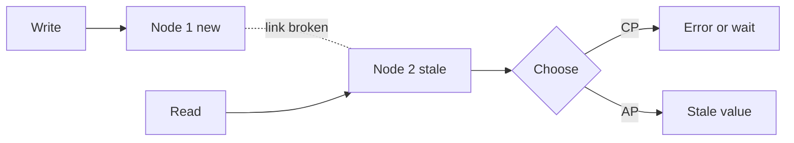
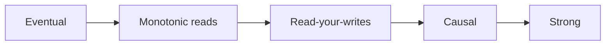

# 🔺 CAP & consistency

*When the network between replicas breaks, a distributed store must choose: refuse (consistent) or answer with possibly stale data (available).*

## 🔤 The three letters

| Letter | Meaning |
|---|---|
| **C — Consistency** | **Linearizability**: every read sees the latest completed write, as if one copy existed. Not the "C" of ACID |
| **A — Availability** | Every request to a non-failed node gets a non-error response |
| **P — Partition tolerance** | Keeps working when the **network between nodes drops messages** |

- P is about **network partitions**, not sharding. A single-shard system with two replicas still faces it.
- Example: P1 updated, link to P2 broken, a read hits P2:
  - Choose C → show "loading…" / error until P2 syncs.
  - Choose A → return P2's stale value.

## 🧭 CA, CP, AP
<!-- related: sd-106 -->

| Combo | Behaviour | Example |
|---|---|---|
| **CA** | Only possible on a **single node** (no network to partition) | Small app on one DB |
| **CP** | During a partition, out-of-date side refuses or redirects requests | **Banking**: send ₹100; the recipient's view waits until the transfer commits rather than showing a wrong balance |
| **AP** | During a partition, keep serving, reconcile later | **Instagram**: followers see a new photo a second or two late |

- Choice can be **per feature**: payments CP, feed AP.
- Systems: CP — ZooKeeper, etcd, Spanner, HBase; AP — Cassandra, DynamoDB (default), Riak.

## ⚡ PACELC
<!-- related: sd-106 -->

- **If Partition**: A or C. **Else** (normal operation): **Latency** or **Consistency**.
- Partitions are rare; the latency/consistency trade is paid on every request (sync replication, quorum reads).

| System | P → | E → |
|---|---|---|
| DynamoDB / Cassandra | A | L |
| Spanner | C | C |
| MongoDB (majority) | C | C |

## 📶 Consistency levels

| Level | Guarantee | Typical way |
|---|---|---|
| **Strong** (linearizable) | Reads see latest write | Leader reads, sync replication, quorum w + r > n |
| **Read-your-writes** | You see your own writes | Route writer's reads to leader briefly |
| **Monotonic reads** | Never go back in time | Stick a user to one replica |
| **Causal** | Cause seen before effect | Version vectors, same partition |
| **Eventual** | Replicas converge if writes stop | Async replication |
| **Weak** | No guarantee a read sees a recent write | Fire-and-forget updates; the next update supersedes a missed one |

> 🔑 Pick the weakest level the feature tolerates; stronger costs latency and availability.

## 🧾 Pick consistency per data type

One system usually holds data with different needs. Decide per dependency, and state its partition behaviour explicitly.

| Data | Partition behaviour | Consistency | Why |
|---|---|---|---|
| Balances, inventory, locks | CP: block or error | Strong (quorum) | A stale balance or oversold stock breaks money and stock invariants; stale lock ownership corrupts them |
| Carts, feeds | AP: serve possibly stale data | Eventual, with read-your-writes for the user | Seconds of staleness is a smaller cost than an outage |
| Likes, view counts, DNS answers | AP | Eventual | Paying a quorum round trip for a counter users accept as stale is a bad trade |
| Game positions, live video frames | AP | Weak | The next update supersedes the missed one; delivering stale data late is worthless |

### ⏱️ What each level costs

- A strong write pays one quorum round trip. An eventual write pays one local write.
- Many stores let each request choose its level (ONE, QUORUM, ALL in Cassandra-style systems). Hot paths opt into consistency without a second system.
- Convergence window: replicas typically converge within about 1 s of lag. Alert past that.
- Strong reads need a quorum overlap: with N = 3, R = 2 and W = 2, R + W > N.

### 🔁 Read-your-writes on an async store

A user edits their profile, and the next page load shows the old value. Options:

- Route that user's reads to the leader for a short window after the write.
- Carry the write's log position or timestamp in the session. A replica serves the read only once it has applied that position; otherwise the read goes to the leader.
- Pin the user's reads to one replica. This holds until that replica fails over.

### 🧠 Eventual means convergence, not no guarantee

Given no new writes, every node converges to the same value. Reads may be stale during the convergence window. That is a specific guarantee, not an absence of one.

Why is eventual consistency acceptable for a shopping cart but not for a bank balance? A stale cart costs some friction, such as two devices showing slightly different carts. A stale balance drives wrong overdraft decisions, which carries financial and regulatory risk. The business consequence sets the consistency requirement.

### ⚖️ Design alternatives

**CP everywhere (Spanner-style)** — no reconciliation logic, and reads are always current. Availability drops during partitions, and cross-region writes are slower.

**AP everywhere with CRDTs** — never rejects a write and merges deterministically. The domain has to fit CRDTs, and linearizable operations are not available.

### 🚩 Pitfalls

- Claiming all three CAP properties hold at once in a distributed system.
- Applying CAP to steady state. CAP constrains partitions only; steady-state latency versus consistency is PACELC.
- Failing to name a real system in each camp, with the reason it sits there.
- Treating CAP's linearizable "C" and ACID's "C" (invariants) as the same thing. See the transactions material in SQL & relational modelling.

