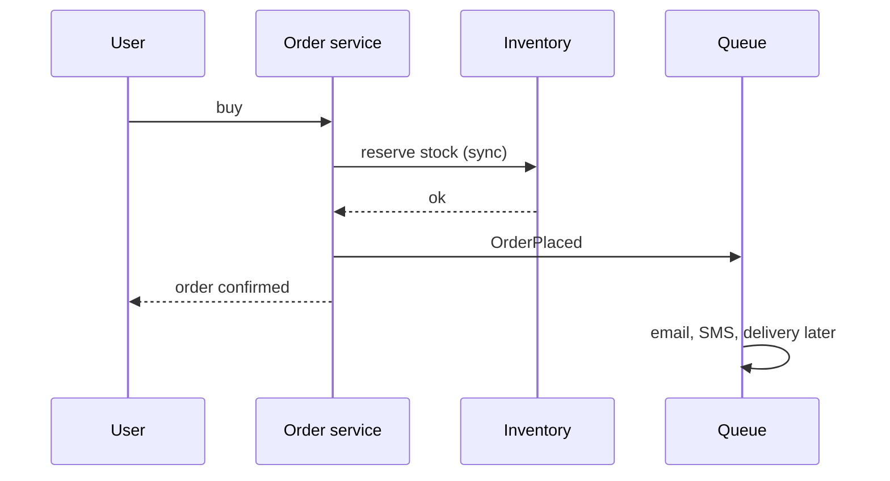
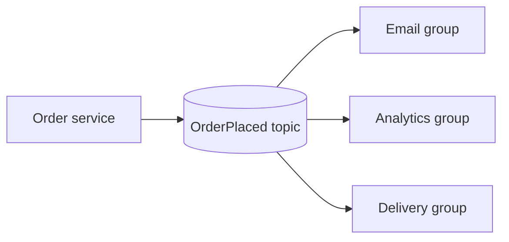
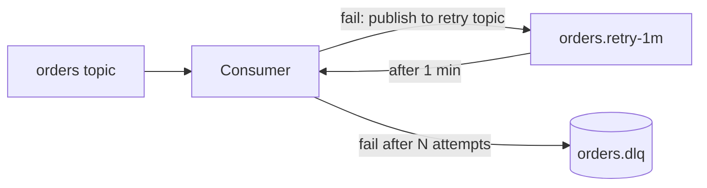
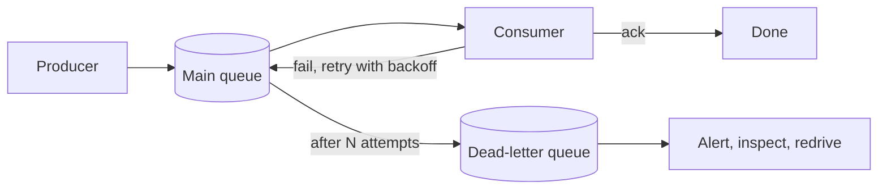

# 📬 Message queues & async

*Do the must-happen-now work synchronously; hand everything else to a queue that buffers, retries and decouples services.*

## ⚖️ Sync vs async

### 🛒 E-commerce purchase

| Task | Mode | Why |
|---|---|---|
| Update inventory | **Sync** | Last unit must go out of stock now, or you oversell |
| Order confirmation email | Async | Fine a minute late |
| Notify delivery partner | Async | Separate service's job |
| SMS / WhatsApp | Async | Same |

### 🔒 Keep sync when
- **Financial** steps (charge, balance).
- **Security** checks (auth, fraud gate).
- **Dependent** steps — the email can't go before the order is confirmed; it's async relative to the user, but after the commit.

### 🔥 Fire-and-forget → async
- Broadcasts: live match streams lag **0–10 s** and nobody minds.
- Email, SMS, WhatsApp.
- **OTP**: timers are **30 s+** because delivery is async.

## 🧩 Producer, consumer and why a queue
<!-- related: sd-65 -->

- **Producer (publisher)** puts messages in; **consumer (subscriber)** takes them out; broker sits between.
- Why not call the email service directly? Your request thread waits, and you must handle its outages yourself.

### ✅ Qualities
1. **Holds** messages durably (buffer).
2. **Delivers** them to consumers.
3. **Retries** failures.
4. **Levels load** — consumers work at their pace during spikes.

### 🔀 Point-to-point vs pub/sub

| | Point-to-point (work queue) | Pub/sub (topic) |
|---|---|---|
| Each message goes to | **One** consumer of the group | **Every** subscribing group |
| Use | Spread jobs across workers (competing consumers) | Fan out an event: email, analytics, search index |
| Examples | SQS, RabbitMQ queue | Kafka topic with groups, SNS, RabbitMQ fanout |

## 🔢 Ordering and priority

### ➡️ FIFO
- **Strict FIFO:** 1 ✓, 2 ✓, 3 fails → the queue **blocks**; 4 waits even after the consumer recovers. Avoid unless order truly matters.
- **Unordered / best-effort:** 3 fails → move on to 4, retry 3 separately (DLQ).
- Global order is expensive; use **per-key ordering** — Kafka partitions by key (e.g. order id), so one order's events stay ordered while different orders run in parallel.

### ⭐ Priority queue
- Each message has a priority; here 1 = most important.
- Messages 1st = **10**, 2nd = **3**, 3rd = **8**, 4th = **1** → processed **4, 2, 3, 1**.
- Risk: starvation of low priority; add aging or separate queues per priority.

## 📥 Pull vs push

| | Pull | Push |
|---|---|---|
| Who starts | Consumer asks when free | Broker sends to consumer |
| Backpressure | Natural — consumer takes what it can | Needs prefetch limits / acks |
| Examples | **Kafka**, **SQS** | **RabbitMQ**, **SNS**, webhooks |

## 🆚 Kafka vs RabbitMQ

Both brokers buffer and deliver messages, but they start from different ideas: Kafka keeps an ordered, replayable log, while RabbitMQ routes each message to queues and deletes it once acknowledged.

### ⚖️ Side by side

| | Kafka | RabbitMQ |
|---|---|---|
| Core model | Distributed, replicated, partitioned **commit log** | Broker that routes from **exchanges** to **queues** |
| Delivery | Consumers **pull**; each group tracks its own **offset** | Broker **pushes** to consumers, bounded by prefetch |
| After consumption | Kept for the retention period (e.g. 7 days) and **replayable** | Deleted on ack |
| Ordering | Per **partition**, chosen by key | Per **queue**; several competing consumers break order |
| Routing | Topic plus key; no rich routing | Direct, topic, fanout and headers exchanges |
| Extras | Retention, replay, compaction | Per-message TTL, priority queues, dead-letter exchanges |
| Throughput | Very high, batch-friendly | Lower ceiling; strong per-message features |
| Fits | Event streams, analytics, event sourcing, audit log, many consumers at different speeds | Task queues, complex routing, short-lived messages |

> 🔑 Choose Kafka when history matters and several independent consumers read the same events. Choose RabbitMQ when each message is a job to route and finish.

### 🔁 Delivery and failure handling
- Both default to **at-least-once**: acknowledge after the side effect, and the message is redelivered after a crash.
- Kafka can do exactly-once inside Kafka: an idempotent producer dedupes retries, and transactions commit the produce and the consumer's offset together. It costs throughput and couples the systems, so the usual choice is at-least-once plus idempotent consumers.
- Kafka has no built-in retry or dead-letter handling. The pattern is a **retry topic** per delay tier (e.g. `orders.retry-1m`, `orders.retry-10m`) that feeds back to the consumer after its delay, and a **DLQ topic** after N attempts. The partition keeps flowing.
- RabbitMQ attaches a **dead-letter exchange** to the queue and uses TTL-based delay queues for backoff. Avoid requeue-in-place loops: they hot-cycle a poison message.
- Commit offsets **after** processing. Committing first drops messages silently if the consumer crashes.

### 🧮 Partitions and retention
- Partitions cap parallelism: one consumer per partition per group, and any extra consumers sit idle.
- Size from peak rate ÷ per-consumer throughput, plus headroom. Example: 200K msgs/sec peak at 5K msgs/sec per consumer needs at least 40 partitions.
- Adding partitions later remaps keys and breaks per-key ordering for in-flight messages. Over-provision at creation rather than repartition a keyed topic.
- Retention is a cost decision. A 7-day replayable log powers backfills and rebuilding a new consumer; "delete after ack" saves storage but loses replay.

## ☠️ Failures: poison messages, DLQ, idempotency
<!-- related: sd-65 -->

- **Poison message** — can never succeed (malformed, invalid). Retrying forever wastes consumer and broker capacity and can block a strict queue.
- **DLQ (dead-letter queue)** — after N retries (with backoff), move it aside; main flow continues. Alert on DLQ depth; inspect, fix, **redrive**.
- **At-least-once delivery** — consumer does the work, crashes before acking, message is redelivered. Duplicates are normal; exactly-once is not free.
- **Idempotent consumers** — dedupe on a message / idempotency key (store processed ids), or make writes naturally idempotent (upsert, `SET status = shipped`).

## 🎯 When to use and when to avoid

### ✅ Use for
- Async work: notifications, emails, image/video processing.
- **Decoupling** — analytics events, log pipelines, event-driven services.
- **Load levelling** — absorb spikes; competing consumers share async work (they don't route sync client requests — that's the LB's job).
- **Deferred / scheduled** jobs — daily reports; catalogue edits all day, publish in the evening.

### ❌ Avoid when
- **Low volume** — a broker adds cost and ops; call directly.
- **Real-time response** needed — the caller would just wait.
- Caller needs a **per-request result** now — use a sync call (or request/reply with a callback).

## 🩺 Consumer lag and skew

Consumer lag is the newest offset in a partition minus the group's committed offset. Absolute lag means little on a busy topic, which is always a few thousand messages behind; watch the **growth trend** and the **time to drain** instead.

### 🧭 Diagnosis order
1. **Quantify.** Is lag growing or flat? Compare the produce rate with the consume rate.
2. **Isolate.** Read lag per partition. Uniform lag is a throughput gap; one hot partition is a skewed key.
3. **Root-cause.** Producer spike, consumer regression after a deploy, GC pauses, a synchronous downstream call per message, rebalance storms, or a poison message wedging one partition.
4. **Mitigate**, then **prevent** with a capacity model, lag-trend alerts and a runbook.

| Shape of lag | Likely cause | Fix |
|---|---|---|
| Uniform growth | Consumers slower than the produce rate | Add consumers up to the partition count; batch downstream calls |
| One partition behind | Hot key (one tenant, one celebrity) | Salt or split the key; accept changed ordering for that key |
| Repeated sawtooth | Rebalance on every restart or deploy | Cooperative rebalancing and static membership |
| One partition stalled | Poison message or slow handler | Retry topic and DLQ, so one bad event never blocks the partition |
| Plateau after a spike | Backlog not draining | Raise parallelism, cap the producer, drain on a bounded catch-up plan |

### 🔄 Rebalances
- **Eager** rebalance stops every consumer in the group until assignments are redistributed; lag grows during the pause.
- **Cooperative** rebalance moves only the partitions whose owner changes.
- **Static membership** (a fixed `group.instance.id` per consumer) keeps a restarting consumer's partitions through its session timeout, so a quick restart does not reshuffle the group.
- Work done inside the poll loop that exceeds `max.poll.interval.ms` gets the consumer kicked out, and the group rebalances again. Keep each poll's work short, or process in bounded batches.

### 🚨 First five minutes of an incident
1. **Communicate** the impact: dashboards are stale, and by how much.
2. **Confirm** consumers are still progressing (offsets moving, not frozen).
3. **Restart** wedged consumers.
4. **Scale out** if the partition count leaves headroom.
5. Only then **diagnose** in depth.

> 🔑 Resetting offsets to latest is a last resort: it freshens the view instantly but silently drops the backlog for every other consumer group. Use it only for purely ephemeral views.

