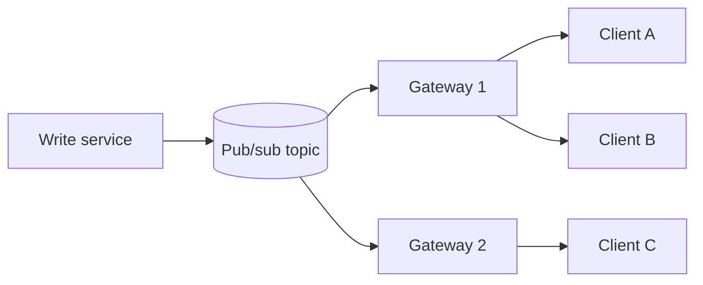

# 📣 Realtime updates

*Getting new data to people who are already looking at the screen. The hard part is rarely the socket itself; it is fanning one event out to many subscribers without falling over, and catching up clients that drop off.*

## ❓ The problem
<!-- related: sd-38, sd-111, sd-112, sd-117, sd-135 -->

Users expect a feed, a score, a cursor or a price to change without a refresh. Three things make that hard:

- **Fan-out.** One update must reach thousands or millions of open sessions.
- **Connection state.** Each open socket is a long-lived resource on some server. Clients sleep, roam between networks and reconnect constantly.
- **Gaps.** A client that reconnects must recover what it missed, not just start listening again.

Transport choice (short polling, long polling, SSE, WebSockets) is covered in the APIs & communication styles note. This note is about what happens behind the connection.

## 🧰 Solution options
<!-- related: sd-38, sd-112 -->

### 🔁 Pull with polling

- The client asks every N seconds, passing a `since` cursor.
- Simple, cache-friendly and works everywhere.
- Costs: wasted requests when nothing changed, and an average delay of half the interval.

### 📨 Push over a persistent connection

- The server holds one connection per client (SSE or WebSocket) and writes events as they happen.
- Latency is close to zero.
- Costs: connection count, sticky routing and reconnect logic on the client.

### 🧭 Pub/sub backbone between gateways

<!-- related: sd-117, sd-135 -->

- A user connects to any gateway node. The gateway subscribes to the topics that user needs (a post, a room, a symbol).
- A business service publishes one event per change to the topic, and the broker fans it out to every gateway holding a subscriber.
- Gateways hold connections, not business data, so they can be added or lost without losing state.

### 🧾 Snapshot plus sequenced deltas

<!-- related: sd-38, sd-111 -->

- On subscribe, the server sends the current state with a sequence number, then only the changes after it.
- The client checks that sequence numbers are contiguous. A gap means it asks for a fresh snapshot.
- Essential for dashboards and collaborative documents, where a silently missing edit is worse than a slow refresh.

| Option | Latency | Server cost | Client complexity | Good for |
|---|---|---|---|---|
| Polling | interval ÷ 2 on average | low, but many empty reads | trivial | slow-moving data, few clients |
| SSE | sub-second | one connection per client | low, reconnect built in | one-way feeds to browsers |
| WebSocket | sub-second | one connection per client | medium | two-way: chat, cursors, games |
| Pub/sub fan-out | sub-second | brokers plus gateways | medium | many subscribers per event |

## 🧭 When to pick which
<!-- related: sd-112, sd-117 -->

- Changes once a minute and few viewers: polling. Say so; it is the honest answer.
- One-way updates to a browser: SSE.
- Two-way and interactive, such as presence or cursors: WebSocket.
- One event must reach many subscribers, and events come from several services: pub/sub behind gateways.
- State that must not drift on screen: snapshot plus sequence numbers.

> 🔑 Connections are the capacity unit. Estimate concurrent sockets, not daily users: 10M DAU with 5% online at peak is 500k open connections to place and route.

## 🚩 Common interview pitfalls

- Designing a socket server without saying how a reconnecting client gets the events it missed.
- Broadcasting only to connections on one node. The subscriber is usually on another gateway.
- Running a database read per subscriber for every change. Compute the change once and fan out the message.
- Forgetting heartbeats. A half-open TCP connection on a mobile network looks alive for minutes.
- Sending every intermediate value to a slow client. Coalesce updates and send the latest value on a short tick.
- Ignoring the background app: pause or downgrade the stream when the client is not visible.

The event log behind the backbone (partitions, consumer groups, replay) is in the Message queues & async note. What to do when a gateway dies mid-stream is in the Faults & reliability note.
