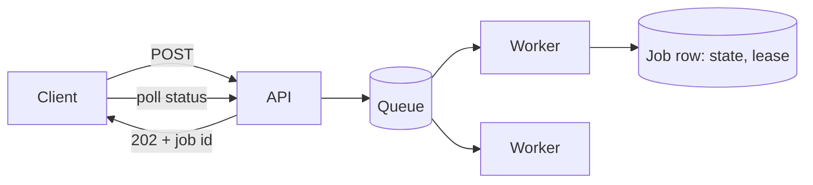

# ⏳ Long-running tasks

*Work that takes seconds to hours cannot sit inside a request. Accept it, return a handle, run it elsewhere, and make progress visible and retries safe.*

## ❓ The problem
<!-- related: sd-68, sd-10, sd-108, sd-130 -->

- Load balancers, proxies and mobile networks cut idle or slow requests long before a transcode, export or bulk import finishes.
- Workers die mid-task. The work must be restartable without repeating side effects.
- Users want to see status, cancel a job and fetch the result later.

## 🧰 Solution options
<!-- related: sd-68, sd-130 -->

### 📬 Accept and queue

- The API validates the request and returns `202 Accepted` with a job id and a status URL.
- The job goes on a queue; a pool of workers consumes it.
- Scales by adding workers. Retries come from the queue's redelivery.

### 🧾 Job table as the source of truth

- One row per job: state (queued, running, succeeded, failed), attempts, lease owner and lease expiry.
- A worker claims a job by taking a lease and renews it while working. If the lease expires, another worker re-claims the job.
- Queryable, so dashboards and support can see stuck work. This is the option to pair with a queue for anything users pay for or wait on.

### 🧩 Checkpointed steps

- Split the job into stages or chunks and persist a checkpoint after each one.
- A restart resumes from the last checkpoint instead of from zero.
- Worth it only when one unit of work is expensive, such as a multi-hour encode.

### 🔒 Making retries safe

- Delivery is usually at-least-once, so a handler will sometimes run twice.
- Make the effect idempotent: key writes by job id, use upserts, or record a processed-marker in the same transaction as the effect.
- Only the effect needs to be idempotent. The job itself can be retried freely once that holds.

| Concern | Inline with timeout | Queue only | Queue + job table |
|---|---|---|---|
| User sees progress | no | no | yes |
| Survives worker crash | no | yes, redelivered | yes, lease expires |
| Stuck-job visibility | no | hard | easy |
| Cancellation | no | awkward | state flag checked by worker |

## 🧭 When to pick which
<!-- related: sd-108, sd-130 -->

- A few seconds, one step, nobody watching: inline with a timeout is fine. Still say why it is inline.
- Anything the user waits on: accept and queue, with a status endpoint.
- Reporting, backoff policy, manual cancel and retries visible to support: queue plus job table.
- Expensive multi-stage pipeline: checkpoint per stage.
- Lease length: several times the renewal interval, so one missed heartbeat does not steal the job.

> 🔑 Return a handle quickly and make the work itself the thing that can be retried.

## 🚩 Common interview pitfalls

- Holding the HTTP request open for the whole job.
- Retrying a non-idempotent effect, so a notification is sent twice or a charge is taken twice.
- A dead worker with no lease expiry. The job sits in "running" forever.
- Poison jobs retried without a cap. Limit attempts, move the job to a dead-letter store and alert.
- No cancellation path, or cancellation that leaves partial output behind.
- Clients polling every 100 ms. Use backoff, or push a completion event.

For the queue mechanics (redelivery, dead-letter queues, ordering) see the Message queues & async note. Retry and timeout policy is in the Faults & reliability note, and queue-age metrics are in the Monitoring note.
