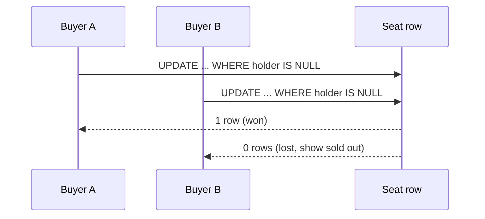

# 🔒 Contention

*Many clients want the same seat, row, counter or document at once. Decide how much to serialise, where to do it, and what a losing request is told.*

## ❓ The problem
<!-- related: sd-73, sd-93, sd-135, sd-72 -->

- Two buyers, one last ticket. Two edits to one paragraph. Two transfers touching one balance.
- A naive read, check in application code, then write leaves a window where both requests see "available" and both write.
- A single hot row can cap throughput even when every other part of the system scales.

Isolation levels and how a database prevents each anomaly are in the SQL & relational modelling note. This note is about the pattern at system level.

## 🧰 Solution options
<!-- related: sd-73, sd-93 -->

### ⚛️ Atomic conditional update

- One statement carries the check and the write, for example `UPDATE seats SET holder = ? WHERE id = ? AND holder IS NULL`.
- The affected-row count tells the winner from the loser. There is no window between check and write.
- The default for claims, counters and stock decrements on a single row.

### 🧱 Pessimistic lock

- `SELECT ... FOR UPDATE`, or a distributed lock with a TTL, serialises the critical section.
- Costs: waiting, deadlock risk when locking several rows in different orders, and a lock that expires while its holder is paused. Fencing tokens (a number that increases with each grant, checked by the resource) close that last gap.

### 🔁 Optimistic concurrency

- Read a version number, then write with `WHERE version = ?`. On conflict, retry or report.
- Good when conflicts are rare and the user can be shown a clear message. Under heavy contention the retries pile up on the same row.

### 🎟️ Reservation with expiry

- Hold the seat or stock for a fixed time, such as 10 minutes, and release it if payment never completes.
- Turns a hard conflict into a soft one. Needs a sweeper or TTL-based expiry, and a rule for a payment that lands after the hold lapsed.

### 🪣 Partition the hot resource

- Split one counter into N sub-counters and sum on read. Split inventory per warehouse.
- Spreads the contention. The read becomes a fan-in, and the business rule must tolerate the split.

### 🧷 Single writer per key

- Route every write for one key to one partition or one single-threaded consumer.
- Serialises without locks, at the cost of a partition that can become hot.

| Option | Behaviour under contention | Failure risk | Use when |
|---|---|---|---|
| Conditional update | high for claims, one row at a time | none beyond the statement | seats, claims, stock |
| Pessimistic lock | low, requests wait in line | deadlock, lock expiry | short critical sections |
| Optimistic version | falls as retries grow | wasted work | rare conflicts, human edits |
| Reservation with TTL | high, holds are soft | abandoned holds | checkout, ticketing |
| Sharded counter | high | read cost | likes, views |
| Single writer per key | bounded by one partition | hot partition | ordering-critical updates |

## 🧭 When to pick which
<!-- related: sd-135, sd-94 -->

- One row, simple claim: conditional update.
- A rule across several rows, such as money moving between two accounts: a transaction that locks rows in a fixed order.
- Long think time while a human edits: optimistic version with a clear conflict message.
- A flash sale on one hot item: a short-TTL reservation in front of the write, plus a queue to smooth arrivals.
- Counters at very high write rate: sharded counters, and accept an approximate read.

> 🔑 The losing request should fail fast and cheaply, and you should say what the user sees when it does.

## 🚩 Common interview pitfalls

- Read, check in application code, then write. This is the classic race.
- Distributed locks with no TTL reasoning and no fencing token.
- Unbounded retries that turn a hot row into a thundering herd.
- Forgetting the abandoned hold: a user who closes the tab must not keep a seat forever.
- Making one row the only write path for a popular item with no sharding story.
- Saying "use a transaction" without naming the anomaly it prevents. Write skew, for example, needs a constraint or an explicit lock on both rows.

For what the user can see while a conflict is being resolved, see the CAP & consistency note. For splitting a hot row across shards, see the Scaling writes note.
