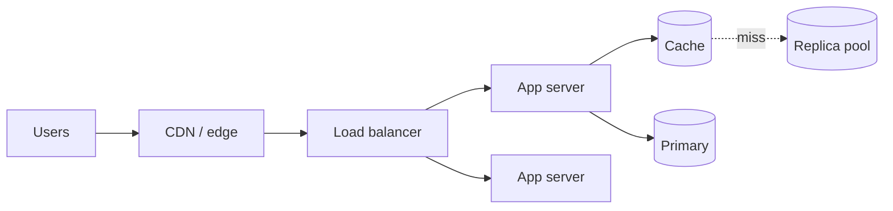

# 📖 Scaling reads

*Most systems read far more than they write. Make the common read cheap first, then add replicas, caches and precomputed views, in roughly that order of effort.*

## ❓ The problem
<!-- related: sd-63, sd-67, sd-64, sd-34 -->

- One primary cannot serve hundreds of thousands of reads per second at acceptable latency.
- Reads that look cheap, such as a home feed or a profile page, often join many tables or fan in from many sources.
- Caching fixes latency but adds staleness and invalidation work.

## 🧰 Solution options
<!-- related: sd-63, sd-67 -->

### 🧬 Shape the query first

- Covering indexes, a denormalised read model, and no N+1 query loops.
- Free in infrastructure terms, and often removes most of the load. Try this before any new component.

### 🪞 Read replicas

- Asynchronous followers take the read traffic; the primary keeps the writes.
- Read throughput grows with the number of replicas until replication lag becomes the problem.
- Read-your-writes needs care: route the user's own reads to the primary, or to a replica that has passed their last write. The mechanics are in the Replication note.

### ⚡ Cache-aside

- The application checks the cache, falls back to the database, then fills the cache.
- What matters here is the hit rate. At 99% hits, only 1 in 100 reads reaches the database. The Caching note covers invalidation and stampedes.

### 🧾 Precomputed views

- Build the read result ahead of time: a fan-out-on-write timeline, a materialised view, or a search index used as a read model.
- Trades write cost and storage for very cheap reads.
- Breaks down when one write fans out to a huge audience, the celebrity problem. A hybrid that pulls the few huge sources at read time is the usual answer.

### 🌍 Edge and CDN

- Cacheable responses, such as static assets and public pages, served from points near the user.
- Purge delay and personalised data limit what can be cached. The CDN and segmenting ideas are in the Video streaming note.

| Lever | Adds | Costs | Breaks when |
|---|---|---|---|
| Index and query shape | nothing new | slower writes | the query needs a different shape |
| Read replicas | read throughput | lag, routing rules | writes are the real bottleneck |
| Cache | fast hits | staleness, invalidation | hit rate is low or keys are hot |
| Precomputed view | near-O(1) reads | write amplification | one write fans out widely |
| CDN and edge | global latency | purge delay | content is per user |

## 🧭 When to pick which
<!-- related: sd-64, sd-34 -->

- Read-heavy with acceptable latency: fix indexes, then add replicas.
- Many identical reads of the same object: cache, and a CDN if it is public.
- Expensive aggregation on every read: a precomputed view updated from events.
- Personal data with high fan-in: a per-user cache entry with a short TTL, or a view per user.
- Watch replica lag. When it grows past what users tolerate, stop routing reads there.

> 🔑 A read problem is usually a query-shape problem first, a hot-key problem second and a capacity problem last.

## 🚩 Common interview pitfalls

- Adding a cache before fixing the query that joins eight tables.
- Proposing replicas for a write-bound system.
- Forgetting read-your-writes: a user saves a profile and immediately sees the old value.
- Ignoring hot keys. One viral item can saturate a single cache node even when the cluster is idle.
- Using a precomputed feed without a plan for accounts with millions of followers.
- Quoting a hit rate without the request volume it applies to.

For cache placement and invalidation see the Caching note. For how replicas copy data and what lag means, see the Replication note. For spreading read load across instances, see the Load balancing note.
