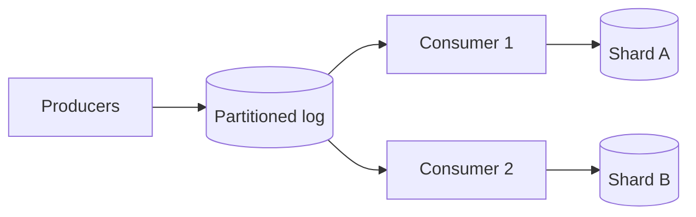

# ✏️ Scaling writes

*Replicas do not help writes. Scaling writes means splitting the data, buffering the work, batching it, or accepting that some writes are merged later.*

## ❓ The problem
<!-- related: sd-112, sd-86, sd-65 -->

- Every write lands on one primary, and its disk, locks and log have hard limits.
- Bursts arrive faster than the database can commit them.
- Counters and aggregates turn each event into a read-modify-write on one hot row.

## 🧰 Solution options
<!-- related: sd-112 -->

### ✂️ Partition by key

- Hash or range partition, so each shard takes a slice of the write load.
- Scales close to linearly when most writes carry the partition key. The Partitioning note covers hashing, rebalancing and hot keys.
- Costs: queries that do not include the key must scatter to every shard.

### 📥 Buffer through a log or queue

- Producers append to a partitioned log or queue. Consumers write to the store at the rate it can sustain.
- Absorbs spikes and decouples the producer from database speed.
- Costs: lag, and at-least-once delivery, so the write must be idempotent. The Message queues & async note has the mechanics.

### 📦 Batch and coalesce

- Combine many small writes into one bulk insert, or one counter increment carrying a delta, every 100 ms.
- Large throughput gain. Costs: added latency and a window of lost data if the process crashes before the flush.

### 🧮 Aggregate in memory, flush periodically

- Each node counts locally and flushes deltas to the store on an interval.
- The same idea sits behind sharded counters: many small cells, summed on read.

### 🧱 Append events, derive state

- Write immutable events, which are cheap and sequential. Current state is a projection built from them.
- Good for audit trails and high-rate ingest. Reads need a projection, so projection lag becomes a visible delay.

| Lever | Throughput gain | Cost | Watch for |
|---|---|---|---|
| Partition | near-linear if keys spread | cross-shard queries | one hot shard |
| Queue buffer | absorbs bursts | lag, duplicates | consumer lag growing |
| Batching | large | added latency, loss window | batch size and flush interval |
| In-memory aggregate | large for counters | loss on crash | flush interval |
| Append-only events | high | projection work | projection lag |

## 🧭 When to pick which
<!-- related: sd-86, sd-65 -->

- Spiky writes that can tolerate seconds of delay: a queue in front.
- Counters and metrics: batching plus sharded counters.
- Uniform keyed writes past one node: partition by the key the writes carry.
- Audit or financial history: append-only events, while the user-facing balance is kept consistent in its own row.
- One known hot key: split that key. Adding nodes does not help a single key.

> 🔑 Buffer and batch before you shard. They are cheaper to add and undo, and sharding is hard to reverse.

## 🚩 Common interview pitfalls

- Adding read replicas to a write-bound system.
- Sharding by a key most writes do not carry, so every write becomes a scatter-gather.
- Choosing a monotonically increasing key as the shard key. All new writes hit the last shard.
- Forgetting the duplicates a queue creates. The consumer must be idempotent.
- Quoting a throughput number without the batch size or the loss window it assumes.
- Assuming sharding fixes a single hot key. It does not; the key must be split.

For the tools that absorb bursts, see the Message queues & async note. For shard placement and rebalancing, see the Partitioning note. For the consistency cost of accepting writes on several nodes, see the CAP & consistency note.
