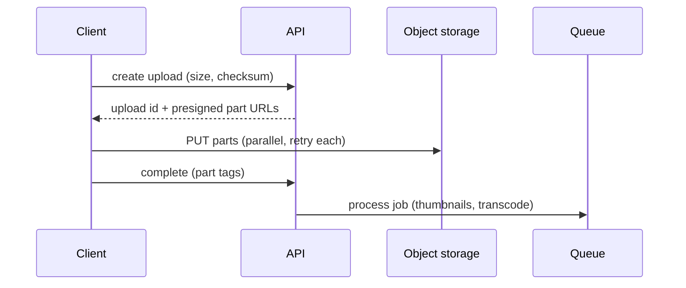

# 🧳 Large blobs

*Video, photos and archives are too big to pass through application servers. Send the bytes straight to object storage, in parts, and let the database hold only the index.*

## ❓ The problem
<!-- related: sd-10, sd-68, sd-69, sd-116 -->

- App servers become bottlenecks and memory hogs when they proxy multi-gigabyte bodies.
- A single request that fails late on a flaky network wastes every byte already sent.
- Storing blobs in the database bloats backups, replicas and caches.

## 🧰 Solution options
<!-- related: sd-10, sd-36 -->

### 🔗 Presigned direct upload

- The server issues a short-lived signed URL scoped to one object key.
- The client uploads straight to object storage. The API only records metadata once the upload completes.
- Authentication happens at URL issue time, so the blob path never touches the API tier.

### 🧩 Multipart, resumable upload

- Split the file into parts (commonly 5 to 100 MB), upload them in parallel, and retry failed parts alone.
- Completion takes a manifest of part tags. Resume from the last acknowledged part after a network drop or app kill.
- Costs: part bookkeeping, and cleanup of uploads that never completed, which otherwise bill silently.

### 🌍 Serve through a CDN with range requests

- Public or signed CDN URLs; clients fetch byte ranges for seeking and for resumable downloads.
- The origin sees little traffic. The segmenting and adaptive-bitrate ideas are in the Video streaming note.

### 🧾 Metadata in a table, bytes in object storage

- The row holds key, size, checksum, owner and state (uploading, processing, ready, quarantined).
- Derived files, such as thumbnails and transcodes, are produced by a long-running job, never on the upload request.

### 🔐 Content-addressed keys

- Key the object by its hash. Identical files are stored once, and sync clients can skip uploads they already have.
- Costs: hashing a large file on the device before upload.

| Approach | Server load | Recovery after failure | Use when |
|---|---|---|---|
| Proxy through the app | high | restart the whole upload | small files only |
| Presigned single PUT | low | restart the whole upload | medium files, good network |
| Multipart, resumable | low | resume per part | large files, mobile |
| CDN with range requests | none at origin | per range | playback, big downloads |

## 🧭 When to pick which
<!-- related: sd-68, sd-130, sd-116 -->

- Under a few megabytes on a reliable network: one presigned PUT.
- Anything large or on mobile: multipart and resumable.
- Read by many people: CDN with signed URLs that expire quickly.
- Derived versions: an asynchronous job, not the upload path.
- Sync apps where duplicates are common: content-hash keys.

> 🔑 Presigned URLs solve authentication without proxying the bytes. Say that explicitly; it is the point interviewers look for.

## 🚩 Common interview pitfalls

- Routing the bytes through the API "for auth". Signed URLs make that unnecessary.
- Marking a file ready before the upload completes or passes a checksum and scan.
- Forgetting to garbage-collect abandoned multipart uploads.
- Putting multi-gigabyte files in a database column.
- Skipping checksums, so one corrupt part passes silently.
- Leaving signed URLs valid for hours, or scoped to a whole bucket.

For turning an upload into derived files, see the Long-running tasks note. For CDN caching behaviour, see the Caching note.
