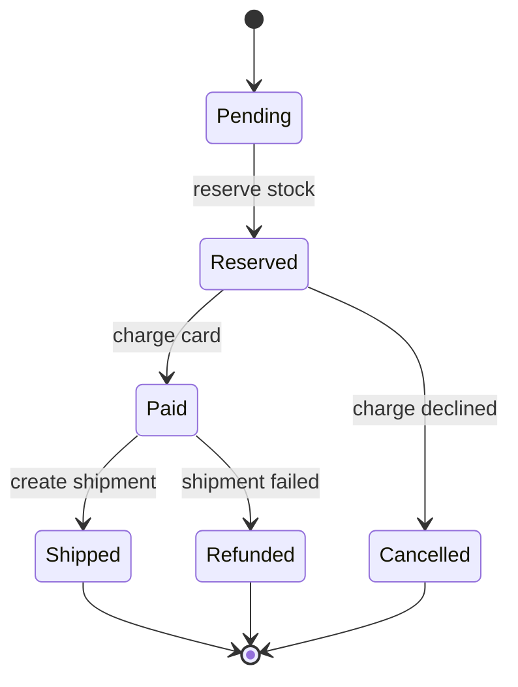

# 🪜 Multi-step processes

*A business action spans several services, and no single transaction covers them all. Model the steps explicitly, make each one retryable, and define how to undo the ones that already happened.*

## ❓ The problem
<!-- related: sd-16, sd-94, sd-70, sd-30 -->

- Booking a ride: reserve a driver, charge a card, notify the rider. Any step can fail after an earlier one succeeded.
- A distributed two-phase commit across services blocks when the coordinator fails, so it is rarely the right default.
- Users want to see where their order is, and support wants to see why it stalled.

## 🧰 Solution options
<!-- related: sd-16, sd-94 -->

### 🎼 Orchestration

- One workflow component calls each step in order, stores progress, and runs compensations in reverse on failure.
- Easy to read, observe and change. The orchestrator becomes a dependency that must itself be reliable.

### 🎶 Choreography

- Each service reacts to events and emits the next one. No central owner.
- Loosely coupled, but the overall flow is spread across services, and a stuck process is hard to trace.

### 🧾 Durable state machine with an outbox

- Persist the process state (for example `PENDING → RESERVED → PAID → SHIPPED`) and make each transition idempotent.
- The state row is the source of truth for retries and for the status a user sees.
- The outbox writes the state change and the outgoing event in one local transaction, and a relay publishes the event. This avoids saved-but-never-announced bugs.

### 🔁 Idempotent steps and compensations

- Each external call carries an idempotency key, so a retry cannot repeat the effect.
- A compensation is a business action (a refund, a release of stock), not a rollback. Some effects cannot be undone, such as a sent email, so order the steps: reversible ones first, irreversible last.

| Option | Visibility | Coupling | Failure handling |
|---|---|---|---|
| Orchestration | central and easy to read | orchestrator knows all steps | compensations in one place |
| Choreography | spread out, harder to trace | loose | each service compensates |
| Two-phase commit | consistent, but blocks | tight | coordinator failure blocks everyone |
| State machine with outbox | explicit in one table | medium | retry from the stored state |

## 🧭 When to pick which
<!-- related: sd-94, sd-70, sd-16 -->

- Three or four steps owned by one team: orchestration with persisted state.
- Many teams reacting independently: choreography, with an outbox in each producer.
- Money moves: a state machine plus idempotency keys on every external call.
- Cancellation mid-way is a requirement: define the compensation before writing the forward path.
- Two-phase commit only inside one database or a platform that supports it well.

> 🔑 Name the compensation for every step. A saga without compensations is just a sequence of hopes.

## 🚩 Common interview pitfalls

- Assuming one database transaction spans the payment provider and your own database.
- Retrying a non-idempotent step, so a customer is charged twice.
- Compensations that can fail themselves. They need retries and a manual queue for what remains.
- Dual writes: update the database, then publish the event, and lose the event on a crash.
- No timeout on a step, so a process sits in "pending" forever.
- Saying "saga" without saying what each compensation does.

For the outbox and queue mechanics see the Message queues & async note. For reservation holds with expiry, see the Contention note. For retry and circuit-breaker policy, see the Faults & reliability note.
