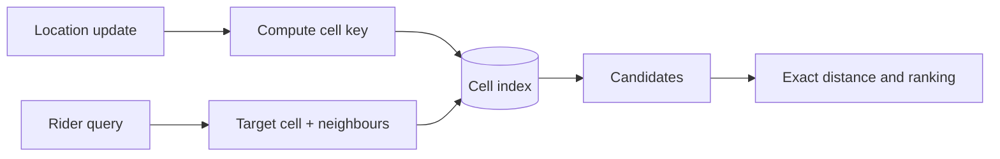

# 📍 Proximity search

*Find the nearby items quickly. The trick is turning two-dimensional distance into keys a normal index can range over, then computing exact distance on the few candidates that remain.*

## ❓ The problem
<!-- related: sd-70, sd-30, sd-117, sd-29 -->

- "Drivers within 2 km" across millions of points that move every few seconds.
- A B-tree on latitude and longitude alone answers a two-dimensional range poorly: it can use the first column well and scans the rest.
- Distance on a sphere, not a flat plane, matters once the search area is large.

## 🧰 Solution options
<!-- related: sd-70, sd-29 -->

### 🧱 Bounding box in a relational index

- Filter on a latitude range and a longitude range, then compute the exact distance.
- Simple and correct for small or mostly static tables. Gets poor when the box is wide and the index helps with only one column.

### #️⃣ Geohash, S2 or H3 cells

- Encode the location into a cell id; nearby points share a prefix or a neighbourhood.
- Index the cell id as an ordinary key. A query reads the target cell and its neighbours.
- The boundary problem: two points a metre apart can sit in different cells, so always include the neighbouring cells.

### 🌳 Quadtree or k-d tree

- Recursively split the space; leaves hold the points.
- Fast to query for points that rarely change. Each change means a rebalance, so it suits places (shops, restaurants) more than drivers.

### 🧭 In-memory grid for moving points

- Keep each moving point's current cell in memory, partitioned by region. Each ping updates one entry.
- Very fast updates and queries. The state lives on a service that must be sharded by region and rebuilt after a restart.

### 🔁 Candidates, then rank

- The cheap index returns a few hundred candidates. Exact distance, ETA, availability and ranking run only on those.

| Option | Update cost | Query cost | Best for |
|---|---|---|---|
| Bounding box and B-tree | low | fine when selective | small or static data |
| Geohash, S2 or H3 cells | low, one key | a few cell lookups | moving points at scale |
| Quadtree or k-d tree | rebalance on change | fast | mostly static places |
| In-memory grid | very low | very low | live driver and rider positions |

## 🧭 When to pick which
<!-- related: sd-70, sd-117 -->

- A few thousand fixed places: a spatial index in the database, or a bounding box.
- Millions of moving points with frequent updates: cell keys held in memory or a key-value store, partitioned by region.
- Places that rarely move, such as stores: a quadtree or a geo index.
- Always: an exact-distance filter and a result limit (the nearest K, not everything).

> 🔑 Index the cell, not the coordinate. A cell is a plain key that caches and partitioners already understand.

## 🚩 Common interview pitfalls

- Forgetting neighbouring cells, so results near a border vanish.
- Using flat Euclidean distance on raw latitude and longitude over long distances.
- Treating the location index as static when drivers ping every few seconds.
- Ignoring the hot cell during a stadium event or at an airport.
- Returning every match instead of the nearest K.
- Stopping at "use PostGIS" without explaining the key that makes the search work.

For sharding the location data by region, see the Partitioning note. For the in-memory cell store, see the Caching note. For the multi-step ride flow that follows a match, see the Multi-step processes note.
