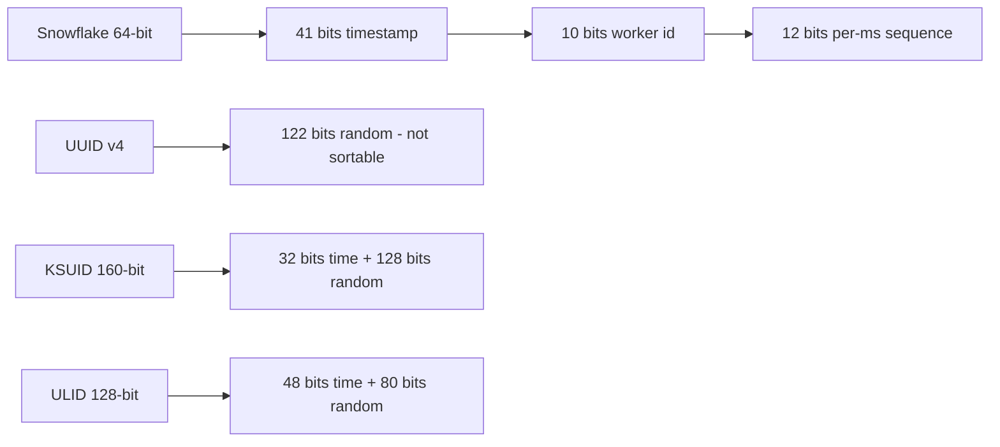

# 🆔 Unique ID generation

*Distributed systems need identifiers that are unique without a central counter. The options trade size, sortability and coordination: random IDs are simple but not sortable, time-ordered 64-bit IDs fit a BIGINT and keep index inserts cheap, and database sequences are simple but become a bottleneck and leak data.*

## 🧭 Why not a database sequence
<!-- related: sd-67 -->

- An auto-increment column is simple and perfectly ordered, but it is a single point of failure and cannot shard.
- Sequential **public** IDs leak business data: competitors read your order volume from them, and scrapers enumerate every resource by walking the sequence.
- So the rule is: sequential is fine internally, but do not expose it as the public identifier.

## 🧩 The four options

| Scheme | Size | Sortable by time | Coordination needed | Notes |
|---|---|---|---|---|
| **UUID v4** | 128-bit (122 random bits) | ❌ | None | 36 characters in canonical text form; safe at low to medium volume |
| **Snowflake** | 64-bit | ✅ | Machine ID assignment | Fits a BIGINT; Twitter's scheme |
| **KSUID** | 160-bit (32-bit time + 128-bit random) | ✅ (second precision) | None, no clock sync needed | 20 bytes, base62 text, URL-safe |
| **ULID** | 128-bit (48-bit time + 80-bit random) | ✅ | None | Good for client-side or edge generation |
| **DB auto-increment** | 64-bit | ✅ | Single DB (bottleneck) | Cannot shard |

> 🔑 Choose by constraint: sortable by time → Snowflake or KSUID. No clock discipline → UUID v4 or KSUID. Must fit an integer column → Snowflake.

## 🧱 Snowflake layout and numbers
<!-- related: sd-67, sd-64 -->

| Field | Bits | Meaning |
|---|---|---|
| Timestamp | 41 | Milliseconds since a custom epoch; about **69 years** of range |
| Worker (machine) ID | 10 | Up to **1,024** machines |
| Sequence | 12 | Up to **4,096** IDs per millisecond per machine |

- **Throughput:** 4,096 IDs per ms per machine, across 1,024 machines.
- **Collisions:** zero, as long as machine IDs are unique fleet-wide.
- **Index locality:** IDs grow with time, so new rows append at the right edge of the primary-key B-tree. Random UUIDs scatter inserts across index pages and fragment the index.

## 🔧 Operating Snowflake safely
<!-- related: sd-67 -->

### 🪪 Worker IDs are leases
- Each process leases its worker ID from a registry (ZooKeeper or etcd) at startup.
- The lease must be **renewed** to keep issuing. A process that loses its lease stops issuing.
- Do **not** derive the worker ID from IP or MAC modulo 1024. Two hosts can map to the same value and collide silently.

### ⏪ Clock rollback
- NTP can move the clock backwards. If the generator keeps issuing, it re-issues timestamps it already used.
- Block issuing until the clock catches up (or refuse to issue). Do not ignore the rollback.

> 🔑 Unique machine IDs are the only thing that stops collisions. Enforce them with a renewable lease, never with a value derived from the host.

### 🐞 Failure modes
- A lease not renewed after a long GC pause means two processes briefly hold the same worker ID.
- Duplicate IDs appear whenever both issue in the same millisecond with the same sequence value.

## ⏱️ Roughly ordered, not strictly ordered
- Time-sortable IDs are only roughly ordered across machines because of clock skew.
- Never use them as a causality clock or to decide which of two events happened first.
- Serialization: JavaScript numbers lose precision above 2^53. Send 64-bit IDs as **strings** in JSON, not numbers.

## 📊 Where each choice is made

| Decision | Chosen | Alternative | Why |
|---|---|---|---|
| Primary keys in a sharded DB | Snowflake (64-bit, time-ordered) | UUID v4 | Fits a BIGINT and appends to the B-tree; random UUIDs fragment index pages |
| IDs generated by clients or edge | ULID / KSUID | Snowflake | No machine-ID registry or clock discipline needed on devices |
| Worker ID assignment | Lease from ZooKeeper / etcd | Derive from IP / MAC modulo 1024 | Derived IDs collide silently when two hosts map to the same value |
| Clock rollback | Block until the clock catches up | Ignore it | Ignoring rollback re-issues timestamps that were already used |

## 🔀 Alternatives

### 🏢 Instagram-style (shard epoch + shard ID + sequence)
- **Pros:** 64-bit, time-ordered, no runtime coordination.
- **Cons:** needs upfront shard planning.

### 🆕 UUIDv7 (RFC 9562)
- **Pros:** a UUID column type with a 48-bit millisecond timestamp prefix, so inserts append to the B-tree. Generated natively by PostgreSQL 18 and mainstream UUID libraries, so it is the default when the schema already uses UUIDs.
- **Cons:** 128 bits, twice the size of a BIGINT index entry; ordering across machines is only millisecond-coarse.

### 🗄️ Plain database sequence
- **Pros:** simple, perfectly ordered.
- **Cons:** single point of failure; does not scale to distributed writes.

## ⚠️ Pitfalls
- Exposing sequential IDs publicly: competitors read your volume and scrapers enumerate every resource.
- Snowflake IDs serialized as JSON numbers: JavaScript loses precision above 2^53. Use strings.
- Worker-ID lease not renewed after a long GC pause: two processes briefly hold the same ID.
- Treating time-ordered IDs as strictly ordered across machines: they are only roughly ordered.

## 🧵 Follow-up: what if two Snowflake machines share a machine ID?
- You get duplicate IDs whenever both issue in the same millisecond with the same sequence value.
- Prevent it with leased worker IDs from a registry (ZooKeeper or etcd) that must be renewed to keep issuing, not with IP or MAC modulo 1024, which silently maps two hosts onto one ID.
