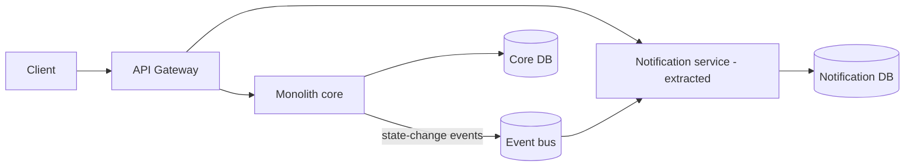
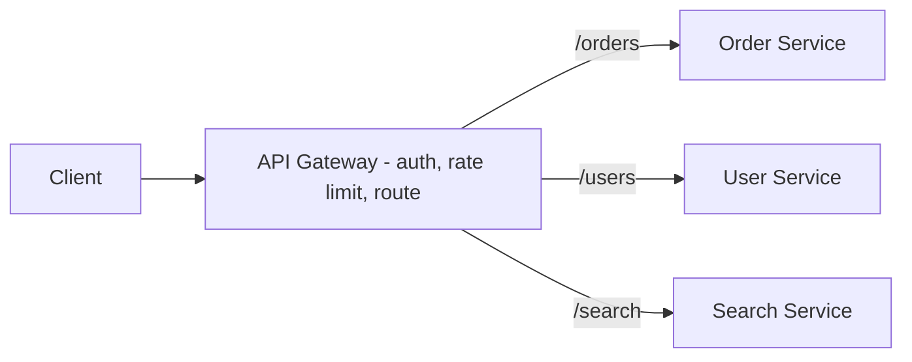
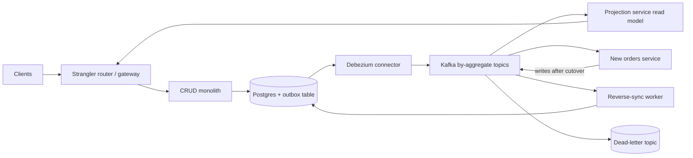

# 🧩 Services, gateways & migration

*Splitting a system into services buys independent deployment and scaling, and pays for it with network failures, distributed data and more operations. This note covers when to split, the gateway that fronts the services, the sagas that replace cross-service transactions, and how to migrate a monolith to events without downtime.*

## 🧱 Monolith vs microservices
<!-- related: sd-98 -->

### ⚖️ What each shape costs
- **Monolith:** a single deployable unit. Simple to develop, test, debug and deploy; in-process calls are fast.
- **Microservices:** independent deployment and scaling, polyglot choices, team autonomy. Paid for with network failures, latency, eventual consistency and distributed tracing.

### 🔔 When to split (extraction signals)
- **Deployment is the bottleneck:** release cycles are long because every change ships with everything else.
- **Scaling needs diverge:** one component (for example high-CPU rendering or a notification sender) needs capacity the rest does not.
- **Team growth (Conway's Law):** service boundaries should follow team boundaries, with at most 2 teams per service.
- Split **by business capability**, not by technical layer. A "database service" or "auth utils service" means every feature touches every service.

> 🔑 Start with a modular monolith: one deployable, internally module-bounded. Extract only where pain is measured. Distributed complexity before the domain is understood is pure cost.

### 🏗️ Target shape after a first extraction

- **Modular monolith core:** still one deployable, internally bounded.
- **Extracted service:** deployed and scaled independently; owns its datastore.
- **Event bus:** asynchronous integration, so the core and extracted services stay decoupled.
- The first split is the notification sender, through a strangler facade. It is peripheral, asynchronous and low-risk, so it proves the pipeline before any core domain work.

### 📋 Requirements that come with it
- **Deploy independence:** extracted services ship on their own cadence. That is the reason to pay the distributed-systems tax.
- **Data ownership:** one database per service. Integrate through events, never through cross-service tables. A shared database re-couples everything through schema coupling.
- **Observability:** distributed tracing with correlation IDs from the day the first service is split.
- **Blast radius:** one failing service degrades one feature. Put circuit breakers at every boundary.
- **Contracts:** contract tests between services, so breaking changes fail in CI rather than in production.

### 📊 Decisions

| Decision | Chosen | Alternative | Why |
|---|---|---|---|
| Start point | Modular monolith | Microservices from day one | Distributed complexity before the domain is understood is pure cost |
| Extraction trigger | Pain-driven (deploy time, divergent scale, team growth) | Mandatory decomposition | Extraction is expensive; pay only where pain is measured |
| First split | Notification sender via strangler fig | Core domain split | Peripheral, async, low-risk; proves the pipeline first |
| Integration | Async events for state changes | Synchronous call chains | Sync chains couple availability; one slow service cascades |
| Data | Database per service | Shared database | A shared DB re-couples everything through schema coupling |

### 🔀 Alternatives
- **Stay a modular monolith:** no network hops, ACID transactions, simplest operations. Deploy and scaling coupling eventually caps team throughput.
- **Full microservices now:** maximum autonomy and independent scaling. Pays for tracing, sagas and consistency work before any pain exists.

### ⚠️ Pitfalls
- Splitting by technical layer instead of business capability. Every feature then touches every service.
- An extracted service still reading the monolith's tables "temporarily". Schema changes now need two teams' sign-off, indefinitely.
- Chatty synchronous call chains replacing in-process calls. A request that made 30 function calls now makes 30 network calls.
- No contract tests between services. Breaking changes surface in production.

## 🔗 Cross-service transactions: sagas
<!-- related: sd-102 -->

Distributed transactions across services are an availability trap, so a **saga** runs a sequence of local transactions, each with a **compensating action** that undoes it if a later step fails.

| Style | How it works | Trade-off |
|---|---|---|
| **Choreography** | Each service reacts to events published by the others | No central coordinator; the overall flow is hard to see and debug |
| **Orchestration** | A coordinator calls each service in turn and runs compensations on failure | Flow is explicit and visible; the coordinator is one more component to run |

- Compensation is visible in the domain model: a refund is a business event, not a rollback.
- 2PC across services and Kafka is an availability trap in practice. Prefer sagas with explicit compensation.
- Orchestrators such as Temporal, or explicit choreography, both work. Give every step a compensation.

## 🚪 API gateway
<!-- related: sd-6 -->

### 🧭 What it does
- A single entry point for all clients. Routes path → service, with canary weights on the route table.
- Cross-cutting work at the edge: TLS termination, authentication (JWT for users, API keys for partners), rate limiting per API key, request and response transformation for legacy clients, caching, logging, metrics and trace-ID injection.
- Services receive only verified identity headers. They never see raw credentials.
- **Versus a reverse proxy:** a proxy routes; a gateway also authenticates, rate-limits and transforms.
- **Versus a service mesh:** the gateway handles north-south traffic (client to backend); a mesh handles east-west traffic (service to service) through sidecars. They are complementary.

- **Gateway tier:** an HA edge that terminates TLS, verifies JWTs and enforces rate limits.
- **Route table:** path → service mapping with canary weights.
- **Backends:** receive only verified identity headers.

### 🚦 Rate limiting at the edge
- Token buckets, keyed per API key (or per user or IP where needed).
- Over the limit: respond **429** with a `Retry-After` header.

### 📋 Requirements
- **Added latency:** under 5 ms at p50 (JWT verify + route + rate check).
- **Availability:** at least 3 nodes behind an L4 front. Config rollouts with zero downtime.
- **Observability:** per-route metrics and trace IDs on 100% of requests.
- The gateway sits on the critical path, so HA is non-negotiable.

### 📊 Decisions

| Decision | Chosen | Alternative | Why |
|---|---|---|---|
| Ingress model | Dedicated API gateway | Direct service URLs | One host for auth and rate limiting; services evolve independently |
| Auth placement | JWT verified at the gateway | Verified in each service | One policy point; services trust an internal identity header |
| Availability | HA gateway cluster | Single gateway instance | The gateway is on the critical path |
| Granularity | One gateway for all clients | BFF per client type | An extra hop and policy drift; split only when client needs truly diverge |

### 🔀 Alternatives
- **Plain reverse proxy (for example Nginx):** simpler, faster, battle-tested. Limited per-key quotas and JWT handling; transformation logic lives in config files.
- **Backend-for-frontend gateways per client:** each client gets an optimal API shape. N gateways to secure and operate, and cross-cutting policy is duplicated.

### 🧵 Follow-up: Kong or AWS API Gateway?
- **Kong** is open source, self-hosted, with a plugin ecosystem and full control. Choose it when you need customization.
- **AWS API Gateway** is fully managed, Lambda-friendly and usage-priced. Choose it inside an AWS ecosystem. Managed cost scales with traffic.

### ⚠️ Pitfalls
- Business logic creeping into gateway plugins. The gateway becomes a monolith that every team must deploy through.
- JWT verified at the gateway, but services reachable directly inside the network. The identity header can be forged.
- Gateway timeouts longer than client timeouts. Clients retry while the gateway still waits, doubling the load.
- One gateway config repo edited by every team with no ownership. A typo in one route takes down all routes.

## 🌀 Strangler migration: monolith to event-driven
<!-- related: sd-102 -->

The technique: a CRUD monolith has to become event-driven with zero downtime. Put a **strangler facade** in front of it, move endpoint groups to new services one route (or one percentage) at a time, and keep every phase reversible by a route flip. The facade, a transactional outbox with CDC, projections, and a reverse-sync worker are what make the switch safe.

### 🧩 Moving parts

- **Strangler router:** an API gateway or Envoy route table. Routes move per route, per percentage.
- **Outbox and CDC:** the monolith writes business rows and an outbox row in the same transaction. Debezium streams the outbox through logical replication into Kafka.
- **Projections:** CQRS read models built from events, in their own stores. The facade switches reads onto them gradually.
- **Reverse-sync:** during the overlap, changes from Kafka flow back into the monolith's tables. The monolith stays queryable, so rollback is a route flip, not a restore.
- **Dead-letter topic:** holds events that fail processing, with an operator tool for reprocessing by (topic, partition, offset).

### 🪜 Phases

| Phase | What happens | Rollback |
|---|---|---|
| 0. Instrument | Per-endpoint traffic map, contract tests at the facade, pick the first seam (a read-heavy, low-write domain such as Orders) | Nothing moves yet |
| 1. Outbox | Monolith commits outbox rows with business rows; Debezium to Kafka, verified at production scale (lag under 1 s) | Stop the connector; the monolith is unchanged |
| 2. Shadow read | Projections built from Kafka and diffed against monolith SQL reads on live traffic for 2–4 weeks | No user traffic has moved |
| 3. Read cutover | Facade serves reads from projections, with a kill switch back to SQL. The monolith keeps full write authority | Kill switch, instantly |
| 4. Write carve | The orders service owns its tables and emits events. Reverse-sync keeps the monolith queryable | Route revert |
| 5. Decompose | Freeze window with no route to monolith tables, then drop reverse-sync, expand/contract dead columns behind flags, retire dead code | Per step, until the freeze |

- **Shadow diff:** 2–4 weeks of clean read-path diffs before any read cutover. Divergence should be found by a diff job, not by customers.
- **Write carve:** only after the read path is proven. Writes go to the new owner first, and the monolith is kept warm by reverse-sync.
- **Decompose only when no one reads the old tables.** Work on the contract phase does not begin while you cannot name every reader.

### 📮 Event publishing: outbox, not dual writes

- **Dual write:** the app writes the database, then produces to Kafka. It loses events when the broker or the process dies between the two.
- **Transactional outbox:** the business row and the outbox row commit in one transaction. CDC publishes the outbox, so an event exists if and only if the state change committed.
- **Per-aggregate partitioning:** the aggregate ID is the partition key, so one order's events serialize. A single global partition would cap throughput at one partition, and correctness needs only per-entity order.
- **Keep payloads small:** notification events plus keyed snapshot fields. Full-row state transfer bloats payloads and leaks PII into every consumer's logs.
- **Prune the outbox.** An unpruned outbox table grows without bound and slows every business transaction's insert.

> 🔑 At-least-once delivery plus consumers that dedupe on `event_id` (or entity and version) is effectively-once. Side-effecting consumers must dedupe, so a replay never re-sends an email or re-charges a card.

### 🔐 Governance

- **Schema:** Avro or Protobuf in a schema registry, in **BACKWARD** compatibility mode, enforced from day one. Retrofitting compatibility rules later is painful; enforcing them up front is free.
- **Replay:** compacted topics retained for at least 30 days. A consumer resumes at its committed offset after a crash. If its read model is corrupt, rebuild from the compacted topic, and flip it live only after the shadow diff is clean.
- **Deleting the old table:** publish replacement read paths, turn on query logging to find the unnamed readers, migrate the stragglers, make the column nullable, and drop it after two release cycles.

### 🧾 Targets

| Measure | Target |
|---|---|
| CDC lag, outbox to Kafka | Under 1 s at production write volume |
| Publish path | 100% of events leave through the outbox; 0 direct produces from application code |
| Duplicates | Consumers dedupe on `event_id`; at-least-once plus dedupe |
| Shadow diff | 2–4 weeks clean before read cutover |
| Rollback | Every phase reversible by a route flip in minutes |
| Replay retention | Compacted topics kept for at least 30 days |

### 🔀 Alternatives
- **Big-bang rewrite to services and events in one release:** no dual-run complexity and a single clean cutover, but zero rollback, and every integration bug surfaces in production at once. This is how these migrations usually die.
- **Strangler to synchronous REST services, skipping events:** a much simpler model with synchronous errors and no replay infrastructure. It forfeits the decoupling and fan-out that motivated event-driven design. It is the honest answer when there is only ever one consumer.

> 🔑 Sometimes the honest answer is to keep the monolith. Say what stays synchronous forever, and why.

### ⚠️ Pitfalls
- Outbox table never pruned. It grows without bound and slows every business transaction.
- Assuming global event ordering. A consumer that breaks under per-partition order has a design bug, not a Kafka bug.
- Fat events full of PII broadcast to every subscriber. The schema becomes a compliance surface.
- No shadow verification. Divergence between the old and new read paths is found by customers instead of a diff job.
- Schema-registry enforcement introduced after the fact. Retrofitting compatibility rules is a civil war.

### 🧵 Follow-up: a consumer crashed halfway through an 8M-event rebuild
- With a consumer group it resumes at the committed offset.
- If its read model is corrupt, rebuild from the compacted topic and flip it live only after the shadow diff is clean.
- Side-effecting consumers dedupe on `event_id`, so the replay never re-sends an email or re-charges a card.
