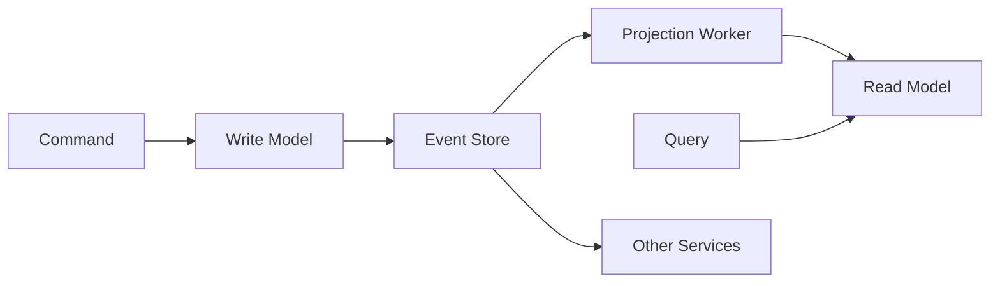

# 📜 Event sourcing & CQRS

*Event sourcing stores what happened instead of the current state. CQRS separates the write model, which enforces invariants, from read models shaped for queries. Together they suit a complex domain with audit needs and read-heavy views, and they cost eventual consistency in the reads.*

## 🧾 Event sourcing: store events, not state
<!-- related: sd-72 -->

- The current state is a **replay** of the stored events. Nothing overwrites a row.
- The event log is a natural audit trail and allows time-travel debugging: rebuild the state as it was at any point.
- **Snapshots** keep long-lived entities cheap to load: the aggregate loads its latest snapshot plus the tail of events after it, roughly O(snapshot + tail). Snapshot every 100 events.
- **Events are immutable.** Zero edits to stored events. When an event's schema changes, old versions are upcast inside the projectors.

## 🔀 CQRS: write model and read models

- **Write model:** enforces invariants. It handles commands and appends events.
- **Read models:** denormalized projections, updated asynchronously and scaled independently of the write side.
- **Publish and subscribe:** other services subscribe to events without the publisher knowing who they are.
- **Rebuildable:** any read model can be rebuilt from the event log.
- Partition the transport by aggregate ID (for example Kafka), so per-aggregate ordering is preserved and other services subscribe for free.

### 📋 Requirements

- **Projection lag:** under 2 s behind the event store. Beyond that, the UI shows a pending state.
- **Aggregate load:** O(snapshot + tail), with a snapshot every 100 events.
- **Idempotent projections:** dedupe by (aggregate, sequence). Duplicates must not change a read model twice.
- **Immutability:** zero edits to stored events; upcast old versions in projectors.

## 🏷️ Name events as domain facts

- Name events for what happened in the business: `OrderShipped`, not `OrderUpdated`.
- A CRUD-named event loses the business meaning the log exists to keep. Consumers cannot tell why the state changed.

## ⚙️ Projections: pipeline and idempotency

- A projection worker reads the event stream and updates a read model. Lag is measured against the event store.
- **Separate projections from side effects.** A rebuild replays events, so any handler that sends an email or charges a card must not run as part of a projection rebuild.
- **Invariants that span aggregates** need a saga or a reservation, not a join against the write model. The write model should not query other aggregates to validate a command.

## 🧩 Event sourcing only where it pays

| Decision | Chosen | Alternative | Why |
|---|---|---|---|
| State persistence | Event store + snapshots | Row-per-state CRUD | Free audit log and time travel; CRUD loses the history the domain needs |
| Read model | Asynchronous CQRS projections | Query the event store directly | Projections index for real query patterns; replaying raw events is too slow |
| Scope | Order aggregate only | Event-source everything | Complexity is justified where invariants and audit matter, not for CRUD data |
| Consistency | Eventual read models | Synchronous projection update | A synchronous projection adds write latency and couples the write path to read schemas |
| Transport | Kafka partitioned by aggregate ID | Dedicated event-store DB only | Per-aggregate ordering; other services subscribe for free |

### 🔀 Alternatives
- **Plain CRUD with an audit table:** far simpler and synchronously consistent. The audit log drifts from real state, and there is no time travel or rebuild.
- **CQRS without event sourcing:** read models without an event store. It needs separate change capture (CDC) and loses the single authoritative log.

## 🖥️ Eventual consistency in the UI
<!-- related: sd-72 -->

- Use **optimistic UI**: apply the command's expected result immediately on the client.
- If the read model lags, show a pending indicator.
- If the server rejects the command, roll the optimistic change back.

| Good fit | Poor fit |
|---|---|
| Complex domain with audit requirements | Simple CRUD |
| Read/write mismatch (many reads over denormalizable views) | Teams new to projections and eventual consistency |
| Eventual consistency acceptable in reads | Data that needs synchronous read-your-writes everywhere |

## 🔐 GDPR erasure in an immutable log

- Immutable events conflict with erasure requests. Hard deletes fight the design.
- Design the answer up front with **crypto-shredding**: encrypt personal fields with a per-user key. Destroying the key makes the data unreadable, which satisfies erasure without rewriting the log.
- The same technique applied to a data lake is in the Data platform & pipelines note.

## ⚠️ Pitfalls
- Events named after CRUD operations (`OrderUpdated`) instead of domain facts (`OrderShipped`). The log loses the business meaning it exists to keep.
- A read-model rebuild that re-triggers side effects such as emails or charges. Projections and side-effecting handlers must be separate.
- Querying the write model to validate data that spans aggregates. Use a saga or a reservation instead of a join.
- No plan for GDPR erasure in an immutable log. Crypto-shredding with per-user keys must be designed in from the start.

## 🧵 Follow-up: how do you handle UI eventual consistency?
- Apply the command result immediately on the client (optimistic UI).
- Show a pending indicator while the read model catches up.
- Roll back on a server error.
