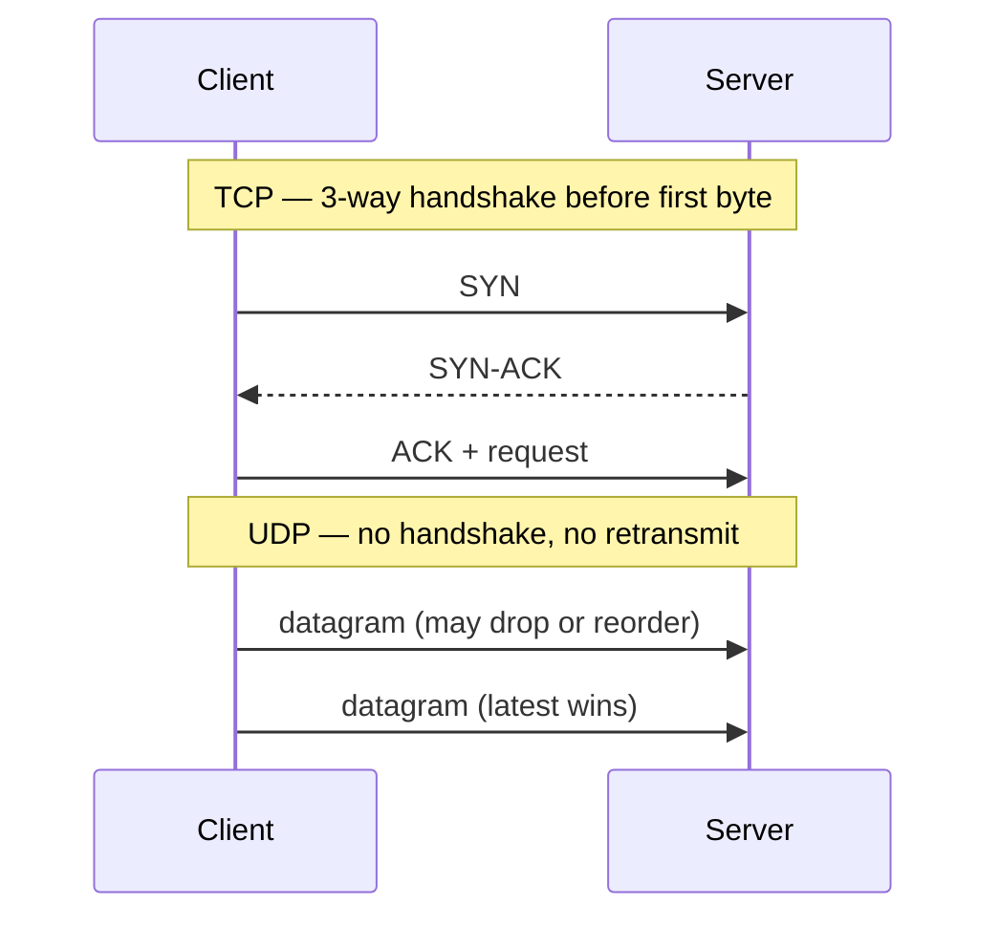
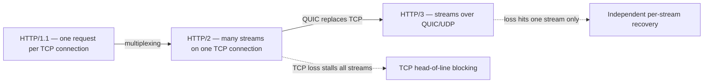

# 🚚 Transport: TCP, UDP & HTTP versions

*Transport protocols decide how bytes move between hosts. TCP guarantees delivery and order at a latency cost. UDP sends independent datagrams with no guarantees. HTTP/3 moves HTTP onto QUIC, which runs over UDP, so a lost packet only stalls the stream it belongs to.*

## 🔗 TCP vs UDP

### 🤝 TCP: reliable, ordered, connection-oriented
<!-- related: sd-118 -->

- A three-way handshake (SYN, SYN-ACK, ACK) happens before the first byte. TLS adds more round trips on top.
- Delivers an ordered byte stream. Lost packets are retransmitted.
- Flow control stops a fast sender overwhelming the receiver. Congestion control shrinks the sending rate when the network drops packets.
- Costs: handshake latency, 20+ byte headers, and a stall of at least one round trip on every loss.

### 📮 UDP: connectionless, no guarantees
- No handshake, no connection state at either end. No delivery guarantee, no ordering, no congestion control.
- Header is 8 bytes, against 20+ for TCP.
- Use it when **a late packet is worth less than a delayed one**: live video (a stale frame beats a stall), online gaming (old position updates are irrelevant), WebRTC.
- **DNS** uses UDP because a query is small and fits one packet. The client simply retries on loss, which is cheaper than a handshake. DNS falls back to TCP for large zone transfers.

### 📊 Which transport for which workload

| Workload | Transport | Why |
|---|---|---|
| Web and API traffic | TCP (HTTP/2) | Reliability and ordering are needed; reimplementing them is error-prone |
| File transfer | TCP | Every byte must arrive, in order |
| Live video | UDP (RTP / WebRTC) | Retransmitting a stale frame adds stall, not quality |
| Game state sync | UDP | Newest-wins: old position packets are worthless |
| DNS | UDP | One small request and response; retry is cheaper than a handshake |
| New web infrastructure | QUIC / HTTP/3 | 0-RTT resumption, no cross-stream head-of-line blocking, built-in TLS |

> 🔑 Reliability and ordering are features you pay for. Use TCP unless the data loses value when it arrives late.

### 🧱 Custom reliability over raw UDP
- Games do this. You then own congestion control, retransmission and ordering yourself. It is a multi-year trap.
- A UDP protocol without congestion control starves other flows and gets throttled by carriers.

### ⚠️ UDP pitfalls
- Sending datagrams larger than the path MTU. IP fragmentation means losing any fragment loses the whole datagram.
- Assuming UDP works everywhere. Some corporate networks block it, so keep a TCP fallback.
- Using TCP for live video. Retransmission delay causes stalls, and a dropped frame is better than a stall.

## 🌐 HTTP/1.1 → HTTP/2 → HTTP/3

### 🐢 HTTP/1.1
- One request per TCP connection. Pipelining is broken in practice.
- Head-of-line blocking: a slow response holds up the ones queued behind it on the same connection.
- Text headers are repeated on every request. Cookie and user-agent headers dominate the bytes on high-request pages.
- Browsers open about 6 parallel connections per host as a workaround, which costs handshakes and memory.

### ⚡ HTTP/2
- **Multiplexing:** N requests share one TCP connection as independent streams.
- Binary framing and **HPACK** header compression. Repeated headers cost almost nothing.
- Connection overhead is paid once per origin, not six times.
- **Still has TCP-level head-of-line blocking.** TCP delivers bytes in order, so one lost packet stalls every stream until it is retransmitted.

### 🚀 HTTP/3
- **QUIC replaces TCP.** QUIC runs over UDP with per-stream reliability, so a lost packet blocks only its own stream.
- Built-in TLS 1.3. **0-RTT** resumption for repeat connections.
- **Connection IDs** instead of IP:port. A session survives a Wi-Fi → LTE switch, where TCP would re-handshake.
- Header compression is **QPACK**, the HTTP/3 counterpart of HPACK.

**In practice:** server push went nowhere. The real wins are multiplexing, header compression (HPACK / QPACK) and connection reuse.

### 📊 Version comparison

| Version | Transport | Connections per origin | Head-of-line blocking | Handshake cost | Mobile network switch |
|---|---|---|---|---|---|
| HTTP/1.1 | TCP | About 6 | Per connection | TCP + TLS, 2–3 RTT | Connections reset |
| HTTP/2 | TCP | 1 | Across all streams on loss | TCP + TLS, 2–3 RTT | TCP re-handshakes on IP change |
| HTTP/3 | QUIC over UDP | 1 | Per stream only | 0-RTT resumption | In-flight requests survive via connection ID |

### 📊 Trade-offs for the move

| Decision | Chosen | Alternative | Why |
|---|---|---|---|
| Transport evolution | HTTP/2 now, HTTP/3 at the edge | Stay on HTTP/1.1 | Multiplexing and compression remove the HTTP/1.1 workarounds; HTTP/3 fixes TCP loss stalls |
| Mobile resilience | HTTP/3 (QUIC) | HTTP/2 over TCP | Connection IDs survive Wi-Fi → LTE switches; TCP re-handshakes on IP change |
| Header cost | HPACK / QPACK compression | Resend text headers | Repeated cookie and user-agent headers dominate HTTP/1.1 bytes |
| Compatibility | HTTP/3 with HTTP/2 fallback | HTTP/3 only | HTTP/3 support is broad but not universal; the fallback keeps old clients working |

### 🔁 Fallback
- HTTP/3 support is broad but not universal, and UDP is blocked or throttled on some networks. The fallback to HTTP/2 over TCP must be fast. Browsers race the two (Happy Eyeballs).

### 🔀 Alternatives
- **Skip HTTP/3, stay on HTTP/2:** universal support and mature tooling. Keeps TCP head-of-line blocking under loss, and mobile handoffs still reset connections.
- **WebSocket or long-polling for everything:** one connection for application traffic. It solves push, but loses request and response semantics and HTTP caching.

### 🧹 Drop the HTTP/1.1 workarounds
- Domain sharding, sprite sheets and inlining were built for HTTP/1.1. On HTTP/2 they defeat multiplexing and connection reuse. Remove them when you move.

### ⚠️ Pitfalls
- Keeping HTTP/1.1-era workarounds on HTTP/2.
- Assuming HTTP/3 always wins. UDP may be blocked, so the fallback path must be fast.
- Claiming HTTP/2 eliminates head-of-line blocking. It removes it at the HTTP layer only; TCP still stalls every stream on loss.
- Enabling 0-RTT for non-idempotent requests. 0-RTT data can be replayed by an attacker, so allow it only for requests that are safe to repeat.

## 🧵 Follow-up: why does HTTP/2 still have head-of-line blocking?
- HTTP/2 multiplexes logical streams over one TCP connection.
- TCP delivers bytes in order. One lost packet stalls all streams until it is retransmitted.
- QUIC gives each stream independent reliability, so loss only blocks the affected stream.

## 🧵 Follow-up: why does DNS use UDP instead of TCP?
- DNS queries are small enough to fit in one UDP packet and are latency-sensitive.
- UDP avoids the TCP handshake. On loss, the client simply retries.
- DNS over TCP is used for large zone transfers.
