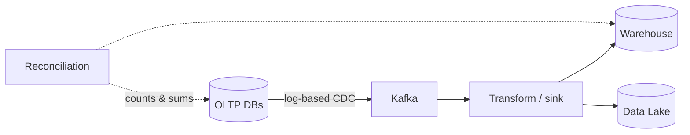
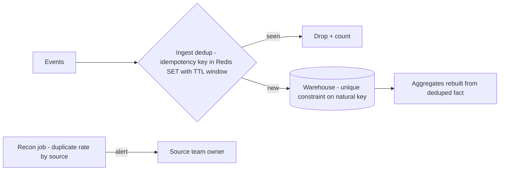
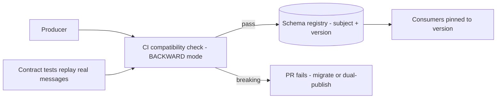
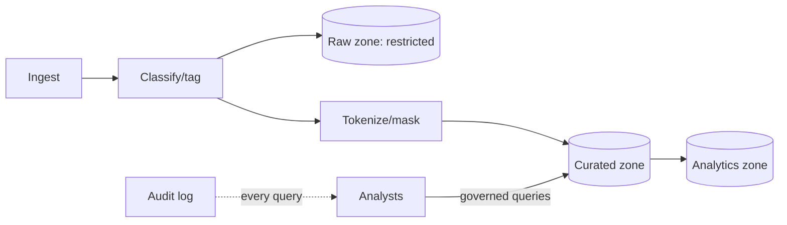

# 🛢️ Data platform & pipelines

*Getting operational data into a warehouse or lake without hurting the source, keeping the analytics correct through replays and schema changes, and protecting personal data once it lands in the lake.*

## 🔁 OLTP to warehouse: capturing changes
<!-- related: sd-86, sd-99 -->

### 🧭 How the data gets out

| Option | How it works | Trade-off |
|---|---|---|
| **Log-based CDC** | Reads the database commit log (Postgres logical replication, MySQL binlog) and streams changes | Derived from the actual commits; near-zero query load on the OLTP database |
| **Dual writes** | The app writes the OLTP database and the warehouse separately | A crash between the two writes leaves them permanently inconsistent |
| **Query extract** | Periodic `SELECT` against the OLTP tables | Loads the production database during extraction |
| **Nightly batch ETL** | Bulk extract once a day | Day-old data, plus heavy load on the OLTP during extraction |

> 🔑 Dual writes corrupt on partial failure. CDC derives the warehouse state from the commit log, so it cannot disagree with the source about what committed.

### 🧩 Hard parts of CDC
- **Initial snapshot:** snapshot a large table without coordinating with the log position, and rows changed during the snapshot are either missed or doubled. Take the snapshot at a known log position, then apply the log from there.
- **Deletes:** propagate them. If deletes (soft or hard) are not captured, the warehouse keeps rows the source removed.
- **Upstream schema evolution:** a column change in the source must reach the sink. See the schema evolution section below.

### 🔄 Delivery and correctness
- **Delivery:** at-least-once with idempotent upserts. MERGE on the key makes replays harmless. End-to-end exactly-once across systems is costly and rarely needed.
- **Reconciliation:** daily comparison of counts **and sums** against the source of truth, with drift repair.
- **Counts alone are not enough.** A stuck update leaves counts equal while sums drift.
- **Lag monitoring per source,** with alerts that fire before the freshness SLA is breached.

### 📋 Requirements
- **Freshness:** the warehouse is within minutes of the OLTP commit.
- **Source impact:** about zero additional query load on the OLTP database.
- **Correctness:** daily counts and sums match the source. Any drift is detected within one reconciliation cycle.
- **Lag alerting:** CDC lag alerts fire before the freshness SLA is breached.

### 📊 Decisions

| Decision | Chosen | Alternative | Why |
|---|---|---|---|
| Capture | Log-based CDC | Dual writes / query extract | Dual writes corrupt on partial failure; query-based loads OLTP |
| Delivery | At-least-once + idempotent upserts | End-to-end exactly-once | Exactly-once across systems is costly; MERGE on a key is simple |
| Consistency | Eventual + reconciliation | Strong synchronous consistency | Strong sync couples OLTP availability to analytics |

### 🔀 Alternatives
- **Nightly batch extracts (ETL):** simple and well understood. Day-old data and heavy load on the OLTP during extraction.
- **Application dual writes to OLTP and warehouse:** no CDC infrastructure. A crash between the two writes leaves them permanently inconsistent.

## ♻️ Deduplication & idempotent writes
<!-- related: sd-94, sd-99 -->

### 🔍 Where duplicates come from
- Pipeline replays after a failure or a backfill.
- Upstream retries: the producer resends a request whose response it never saw.

### 🩹 Short-term fix
1. Quantify the duplicates and their blast radius (reports, payments, inventory).
2. Dedupe the affected datasets.
3. Backfill the aggregates that were computed from them. Deleting duplicates without recomputing downstream aggregates leaves reports wrong after the "fix".
4. Communicate the impact.

Scoped repair is faster and lower risk than a full reprocess.

### 🛡️ Long-term prevention: make writes idempotent
- **Idempotency keys** at every write boundary.
- **Ingest dedupe window:** a keyed set with a TTL (for example Redis `SET` with a 24-hour window) drops replayed events before they land. Lookup is O(1) per event.
- **Warehouse unique constraint** on the natural key. This is the backstop: cleanup becomes an insert-time guarantee.
- **Recon job:** duplicate rate per source, feeding the data-quality dashboard and alerting the owning team.

- **Ingest gate:** the 24-hour keyed window drops replayed events before they land.
- **Warehouse constraint:** uniqueness on the natural key.
- **Recon job:** per-source duplicate rate feeds the dashboard and owner alerts.

> 🔑 A good idempotency key is stable across retries, unique per logical operation, and derived from the business (an order ID). Never use per-attempt UUIDs or timestamps.

### 📊 Decisions

| Decision | Chosen | Alternative | Why |
|---|---|---|---|
| Short-term | Targeted dedup + backfill | Full reprocess | Scoped repair is faster and lower risk |
| Long-term | Idempotency keys + MERGE | Manual cleanup runbooks | Runbooks rot; idempotency is structural |
| Store | Redis with TTL at ingest | Warehouse unique index only | Ingest dedup keeps downstream clean; the index is the backstop |

### 🔀 Alternatives
- **Exactly-once pipeline (Kafka transactions and transactional sinks):** duplicates are prevented end to end inside the pipeline. It does not cover upstream retries or non-transactional sinks, and it is costly.
- **Dedupe at query time (window functions or DISTINCT views):** no ingest changes. Every consumer must remember to do it, and the cost is paid on every query.

### ⚠️ Pitfalls
- Keys that change across retries (timestamps, random UUIDs).
- A dedupe window shorter than the longest replay or backfill. Old duplicates slip through after the TTL.
- Deleting duplicates without recomputing downstream aggregates.
- A unique constraint on a natural key that is not actually unique. For example, the same order line split across shipments is legitimate, and the constraint would drop it.

### 🧵 Follow-up: what makes a good idempotency key?
- Stable across retries.
- Unique per logical operation.
- Business-derived, such as the order ID. Never per-attempt UUIDs.

## 🧬 Schema evolution
<!-- related: sd-107 -->

### 🏷️ Compatibility modes

| Mode | Guarantee | Deploy order | Use when |
|---|---|---|---|
| **BACKWARD** (registry default) | A new-schema reader can read old data | Upgrade consumers first, then producers | Replaying history matters (the usual default) |
| **FORWARD** | An old-schema reader can read new data | Producers first | Producers must ship before consumers |
| **FULL** | Both directions | Either order | Deploy order cannot be controlled |

> 🔑 The compatibility direction must match the deploy order. A mismatch lets an incompatible change through.

### 🧰 Format and enforcement
- Use **Avro or Protobuf** with a **schema registry**. Typed schemas make breaks mechanically detectable. Raw JSON breaks the same way, just later.
- The registry checks compatibility per subject **at publish time**, never at runtime.
- **CI gate:** a breaking candidate fails the pull request. Contract tests replay real production messages against the candidate schema.
- The escape hatch for a breaking change is a dual-field migration.
- Versioned subjects let consumers pin to a version.
- Raw JSON topics outside the registry "because they are internal" break exactly the same way. Bring them in.

### 🔄 Migrating a breaking change
Example: a producer must change a field's type (string → int) on a topic with twelve consumers.
- **Never change it in place.**
- Add a new field (or a new subject) with the new type. Dual-publish both during the transition.
- Migrate consumers one by one against the registry.
- Drop the old field only after the deprecation window closes.

The same expand/contract idea applied to a database column under live load is covered by the zero-downtime schema change question.

### 🪜 Expand / contract
- **Expand:** add the new shape alongside the old, so rolling deploys can run both.
- **Contract:** remove the old shape only after every reader has moved.

### 🔀 Alternatives
- **Consumer-side tolerant readers only:** no central registry to operate, but each consumer finds breakage at runtime.
- **Versioned topics per breaking change (for example `orders.v2`):** clean separation and old consumers untouched, but producers dual-publish for the whole migration and topics multiply.

### ⚠️ Pitfalls
- A registry in BACKWARD mode with consumers upgraded before producers, or the reverse. The direction must match the deploy order.
- Renaming a field treated as "additive". To every consumer it is a delete plus an add.
- New fields with no defaults. Old messages cannot be read by the new schema.
- Raw JSON topics left outside the registry.

## 🔐 PII in the lake
<!-- related: sd-103 -->

### 🗂️ Zones

- **Raw (restricted):** untouched data, locked down to a few roles.
- **Curated (tokenized or masked):** what most analysts query. Joinable, but PII is not exposed.
- **Analytics (aggregates):** the broadest access, with no row-level PII.

### 🛡️ Protection choices

| Decision | Chosen | Alternative | Why |
|---|---|---|---|
| Protection | Tokenization + zones | Encrypt everything with shared keys | Tokenization keeps data joinable without exposing PII |
| Access | Central column and row policies | Per-team copies of datasets | Copies sprawl and leak; central policies audit cleanly |
| Erasure | Crypto-shredding | Hard deletes | Hard deletes fight the immutable lake design; shredding a key revokes decryptability |

### 🔐 Enforcement
- Classify and tag PII **at ingest**. Rescan periodically as well: PII turns up in free-text columns (support notes, addresses in comments) after classification.
- Row- and column-level authorization, with every access audited.
- Encryption at rest and in transit, with KMS-managed keys.
- Least privilege by default, with regular access reviews.
- Access control ends at the first CSV. Query results exported to spreadsheets must stay inside the audit boundary.

### 🧨 Erasure with crypto-shredding
- Encrypt each user's PII with a per-user key.
- Destroying that key makes every copy unreadable, including the immutable copies in the lake, which satisfies the erasure request without rewriting the log.
- The erasure flow must reach downstream copies too. Forgetting them is a common failure.
- Erasure must propagate within the SLA.

### 🎯 Tokenization pitfall
- A deterministic token with no salt per domain becomes a join key that re-identifies users across datasets. Salt per domain.

### 🤖 Analysts and ML without raw PII
- ML and data scientists train on the pseudonymized curated zone, never on raw PII.
- Exports from that zone carry re-identification risk controls.

### 🔀 Alternatives
- **Separate PII vault with join-by-token:** PII lives in one small, heavily controlled store. Every analysis that needs PII becomes a governed request to the vault.
- **Differential privacy or synthetic data for analysts:** strong privacy for aggregate analytics, but unusable for row-level operational analysis.

### ⚠️ Pitfalls
- Tokenization with a deterministic token and no per-domain salt.
- Forgetting downstream copies in the erasure flow.
- PII found in free-text columns long after classification. Rescan periodically.
- Query results exported to spreadsheets outside the audit boundary.
