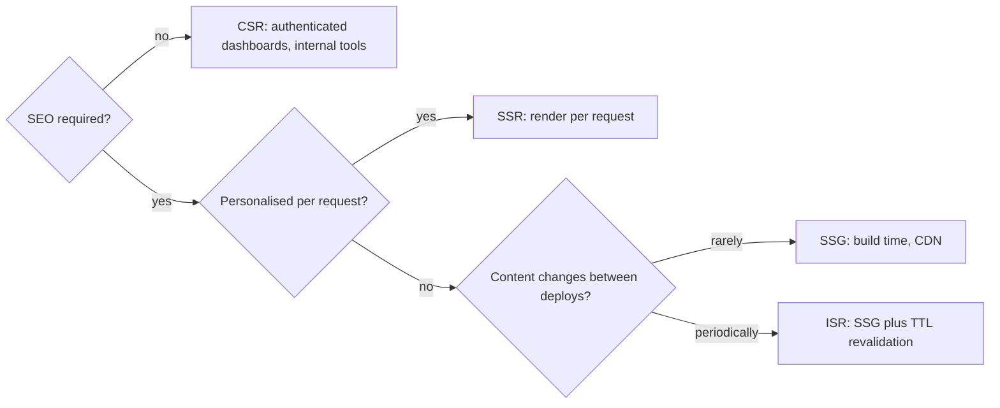
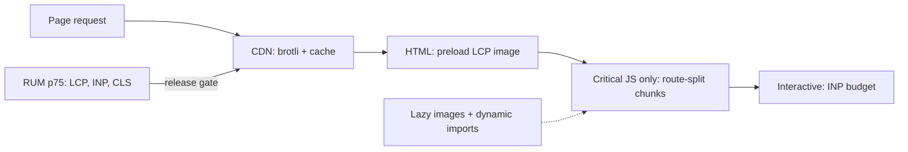

# 🖥️ Rendering & web performance

*Where HTML is produced (CSR, SSR, SSG, ISR), what the browser must do before a page is usable, and how Core Web Vitals, lazy loading and bundle splitting move those numbers in production.*

## 🧭 Rendering strategies: CSR, SSR, SSG, ISR
<!-- related: sd-34, sd-41 -->

### 📖 The four strategies

- **CSR (client-side rendering)** — the server sends an empty HTML shell plus a JS bundle; React renders in the browser. Fast navigation after load, slow first paint (blank until JS runs), weak SEO. Best for authenticated dashboards and internal tools.
- **SSR (server-side rendering)** — the server renders full HTML for every request. Good SEO and a fast first paint, but each request costs origin compute and the response is hard to cache. Best for personalised pages and real-time data.
- **SSG (static site generation)** — HTML is generated at build time and served from the CDN. Fastest option with zero runtime compute, but it cannot personalise. Best for marketing pages, docs and blogs.
- **ISR (incremental static regeneration)** — SSG with background revalidation after a TTL, a page-level stale-while-revalidate. Best for product pages and news: mostly static, but needs periodic freshness.

### 🗺️ Choosing a strategy

### 🧩 Personalised islands

User-specific parts (auth state, cart) hydrate on the client or stream in around a static shell. The page stays SSG or ISR while still showing personal data.

### 🚿 Streaming SSR and React Server Components

Streaming SSR sends HTML in chunks: the above-the-fold markup arrives first and the rest streams in, which improves LCP without waiting for the whole page to render on the server. React Server Components reduce the client JS that must be shipped and hydrated.

> 🔑 Choose the cheapest strategy that still meets the SEO and freshness requirements. Every step up (SSG → ISR → SSR → CSR for logged-in pages) trades CDN cacheability for per-request work or client cost.

### ⚖️ Trade-offs

| Decision | Chosen | Alternative | Why |
|---|---|---|---|
| Public pages | SSG + ISR | Full SSR | CDN-served HTML beats a per-request server render for mostly-static content |
| Authenticated app | CSR | SSR | No SEO benefit behind login; a server render per user kills cacheability |
| Fresh content | ISR (TTL revalidate) | Rebuild on change | Bounded staleness at near-static cost; no deploy pipeline run per update |
| Hydration budget | Route-level code splitting | One mega bundle | Ship only the JS the route needs; hydration cost applies to every strategy |

**Alternatives considered**

- **Full SSR for everything** — one mental model and always fresh, but origin render per request hurts cost and TTFB, and static pages gain nothing.
- **Streaming SSR / React Server Components** — progressive HTML and less client JS (better LCP on slow devices), but it locks you into a framework and is harder to reason about and debug than plain SSG or CSR.

### 🚩 Pitfalls

- Reading cookies or headers in a page meant to be static — the framework silently opts the whole route into per-request SSR.
- Hydration mismatch from rendering `Date.now()` or locale-dependent text on the server — React discards and re-renders the tree.
- ISR pages with personalised data baked in — the first visitor's content is cached for everyone.
- On-demand revalidation not wired to the CMS — editors publish and wait a full TTL, then report that the site is broken.

### 🧵 Follow-up

**What is streaming SSR?**

> HTML is sent in chunks: above-the-fold content arrives first and the rest streams in. It improves LCP without waiting for the entire page to render on the server.

## 📈 Core Web Vitals and delivery
<!-- related: sd-112, sd-36 -->

### 🎯 The three vitals

| Metric | Measures | Target at p75 (real users) | Main lever |
|---|---|---|---|
| **LCP** (Largest Contentful Paint) | Time until the largest visible element renders | < 2.5 s | Preload the hero image, serve HTML from the CDN, SSR/SSG so paint never waits on JS |
| **INP** (Interaction to Next Paint) | Responsiveness to input | < 200 ms | Break long tasks, defer non-critical JS, move heavy compute to Web Workers |
| **CLS** (Cumulative Layout Shift) | Visual stability | < 0.1 | Explicit dimensions on images and embeds; never inject content above existing paint |

- **Release gate:** a p75 regression on any vital blocks the release.
- **Images:** WebP or AVIF are 30–50% smaller than JPEG; use `srcset` and an image CDN (Cloudinary, imgix) for format negotiation and resizing.

### 🧱 Delivery: bundles, lazy loading and hints

- **Route-level code splitting** — Next.js does it automatically; use dynamic `import()` for heavy libraries that load on demand.
- **Lazy loading** — `loading="lazy"` on images below the fold; `React.lazy()` for components.
- **Bundle hygiene** — tree shaking, minification, brotli at the CDN; inspect output with a bundle analyser such as webpack-bundle-analyzer.
- **Resource hints**
  - `<link rel="preload">` for the LCP image.
  - `rel="prefetch"` for the next likely route.
  - `rel="dns-prefetch"` for third-party origins.
- **Fonts** — `font-display: swap` with a preload, so text paints immediately.

> 💡 Lazy loading is for content below the fold. The image that decides LCP must load eagerly and early.

### 🔍 Measuring: field data over lab scores

- Collect real-user metrics with the `web-vitals` library and the PerformanceObserver API, and ship them to RUM tooling (Vercel Speed Insights, Datadog RUM).
- Lighthouse is lab-only: simulated devices hide the device and network spread real users experience.
- Segment p75 by route and device. A fast homepage can hide a slow checkout.

| Decision | Chosen | Alternative | Why |
|---|---|---|---|
| Optimisation target | RUM p75 field data | Lab Lighthouse score | Lab misses the real device and network distribution |
| Image format | WebP/AVIF via image CDN | Original JPEG | Smaller files; the CDN handles negotiation and resize |
| JS delivery | Route-split + dynamic `import()` | Single bundle | Parse cost scales with bytes; unused routes never reach the phone |
| Font loading | `font-display: swap` + preload | Block render on font | Text paints immediately; swap avoids the invisible-text period |

**Alternatives considered**

- **Optimise only for a Lighthouse 100** — easy to game and quick wins, but lab-only.
- **No image CDN, client-side everything** — no vendor and a simpler deploy, but multi-MB images and one mega bundle sink LCP and INP on mid-range devices.

### 🚩 Pitfalls

- `loading="lazy"` on the LCP hero image — the browser deprioritises the one image that decides LCP.
- Third-party tags (analytics, chat widgets) loaded synchronously in `<head>` — they own INP no matter how lean your bundle is.
- Font swap causing layout shift — use metric-compatible fallback fonts (`size-adjust`), or CLS pays for `font-display: swap`.
- Measuring p75 across all pages combined — a fast homepage hides a slow checkout.

### 🧵 Follow-up

**How do you monitor Core Web Vitals in production?**

> Use the PerformanceObserver API with the `web-vitals` library in the browser, and send the samples to a RUM tool such as Vercel Speed Insights or Datadog RUM. Lighthouse is lab-only: it misses the real user distribution and device variance.
