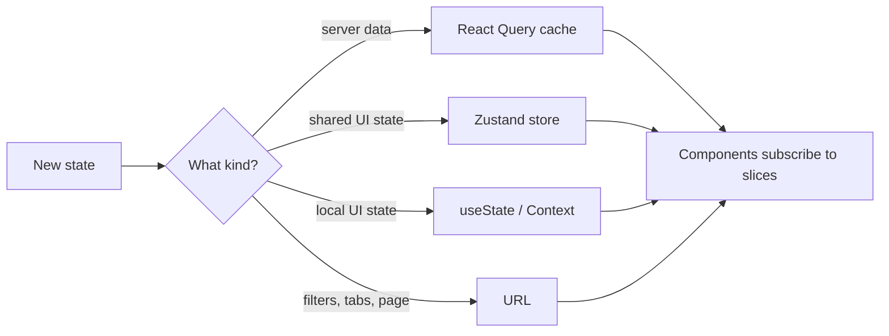
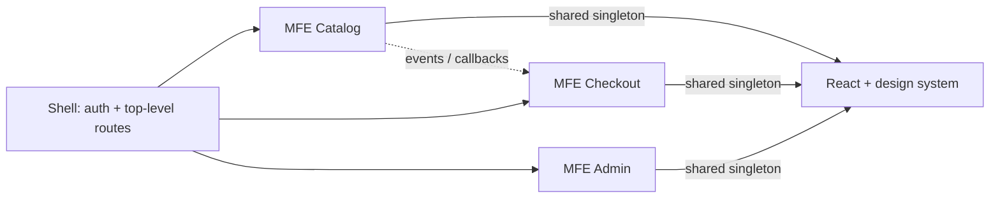

# 🧱 Frontend state & microfrontends

*Frontend state comes in several kinds, each with its own lifecycle and tool. Microfrontends split a large frontend across teams, and the hard parts are shared runtime, style isolation and failure containment.*

## 🗄️ State by type
<!-- related: sd-38, sd-112 -->

### 🧭 Taxonomy

| Kind | Examples | Lifecycle | Tool |
|---|---|---|---|
| **Server (remote) state** | API data, lists, user profile | Owned by the server, cached on the client, can go stale | React Query / SWR |
| **Client UI state** | Modal open, sidebar width, selection | Lives in the browser session | `useState`, Zustand, Context |
| **Form state** | Field values, validation, dirty flags | Scoped to one form | Form library or local state |
| **URL state** | Filters, tabs, pagination, search | Must survive reload and the back button | Router query params |

Do not store every kind in one global store: each has a different lifecycle and a different correct owner.

### 🧰 The tools

- **Local state (`useState`)** — colocate state as close to its use as possible. Easiest to reason about.
- **Context API** — shares state between siblings without prop drilling. Every consumer re-renders when the value changes, so split contexts or memoise the value carefully.
- **Redux (Redux Toolkit)** — predictable global store, strict unidirectional flow, time-travel debugging, middleware. Verbose; best for complex apps with many interconnected slices.
- **Zustand** — lightweight, no Provider, subscribe to specific slices rather than the whole store.
- **React Query / SWR** — purpose-built for server state: caching, background refetch, stale-while-revalidate, deduplication. Replaces most `useEffect` data fetching.

> 🔑 Rule of thumb: React Query for server data, plus Zustand for client UI state, beats Redux for everything.

### ⚖️ Trade-offs

| Decision | Chosen | Alternative | Why |
|---|---|---|---|
| Server state | React Query / SWR | Redux + thunks | Purpose-built cache with dedup, retries and SWR; Redux reimplements it by hand |
| Client state | Zustand | Context API | Slice subscriptions avoid re-rendering whole consumer trees |
| Complex global app | Redux Toolkit | Zustand | Devtools, middleware and enforced patterns pay off at scale |
| Shared local state | Split focused Contexts | One app-wide Context | Small contexts re-render fewer consumers on change |

**Alternatives considered**

- **Redux Toolkit for everything** — one predictable store, time-travel and a large ecosystem; boilerplate for simple apps, and server-state caching is still hand-rolled on top.
- **Context API as the global store** — zero dependencies, but every consumer re-renders on any value change, with no caching, middleware or slicing.

### 📏 Requirements the design must meet

- A state change re-renders only the components subscribed to that slice.
- N components needing the same server data produce **one** request.
- 100% of filters, tabs and pagination restorable from the URL, so the back button behaves correctly.
- A new piece of server data needs one query hook, not actions plus reducers plus thunks.

### 🧵 Follow-up

**How do you prevent Context from causing unnecessary re-renders?**

> Split into smaller, focused contexts and memoise the context value with `useMemo`. Or use Zustand, where components subscribe only to the slice they use.

### 🚩 Pitfalls

- Copying React Query data into local state "to edit it" — the copy never updates when the cache refetches.
- Zustand selectors returning new objects on every call — every subscriber re-renders on every change; use shallow equality.
- Query keys that omit a parameter (filter, page) — two different requests share one cache entry.
- Global stores never reset on logout — the next user sees the previous user's UI state.

## 🧩 Microfrontends
<!-- related: sd-39, sd-100 -->

### 🎯 The problem

Large teams on one frontend monolith hit deployment coupling, long build times and coordination overhead. Microfrontends split the UI into independently built and deployed pieces, owned by different teams.

### 🔌 Integration patterns

| Pattern | Isolation | Deploy independence | Main cost |
|---|---|---|---|
| **iframe** | Maximum | Full | Poor UX: no shared routing, separate scroll, `postMessage` only, heavy memory |
| **Web Components** | Shadow DOM for styles | Full | Standard browser API, works across frameworks; you still own the wiring |
| **Module Federation (Webpack 5)** | Module-level | Full, at runtime | Each MFE exposes modules as remotes that the shell loads from a CDN |
| **Single-SPA** | Route-based activation | Full | Orchestrates several SPAs; you manage the shell and lifecycle contract |

### 🤝 Shared concerns

- **Auth** — a shared cookie, or a custom event emitted by the shell.
- **Design system** — a shared package, or a Module Federation remote.
- **Routing** — the shell owns top-level routes; each MFE owns its sub-routes.
- **Runtime** — React and the design system are `singleton: true` with a `requiredVersion`, so the page loads one copy.
- **Contracts** — cross-MFE communication goes through events and callbacks, never direct imports. The shell CI verifies every MFE's declared props and events.

> 🔑 Module Federation singletons dedupe the React copy: about 40 KB gzipped saved per MFE. Duplicated runtimes slow every page load.

### ⚖️ Trade-offs

| Decision | Chosen | Alternative | Why |
|---|---|---|---|
| Integration | Module Federation runtime | Build-time npm integration | Runtime remotes deploy independently; npm coupling reintroduces release trains |
| Framework sharing | Webpack singletons | Bundle React per MFE | Singletons dedupe the runtime; duplicates slow every page load |
| Isolation | Shadow DOM / CSS scoping | Global styles | Prevents cross-MFE style bleed; global styles break with independent deploys |
| Adoption threshold | MFEs at real team-scale pain | Modular monolith | Coordination overhead must be paid for by genuine autonomy needs |

**Alternatives considered**

- **iframe composition** — hard isolation and any framework, but routing and UX seams, `postMessage`-only communication, accessibility pain and heavy memory use.
- **Modular monolith** (one app, strict module boundaries) — one deploy, simple debugging and shared tooling. Deploy coupling returns as the team count grows.

### 🚩 Pitfalls

- Remote entry files cached at the CDN with long TTLs — the shell keeps loading yesterday's MFE after a deploy.
- A remote failing to load takes down the whole page — wrap each mount in an error boundary with a fallback.
- Shared state smuggled through `window` globals — hidden coupling that breaks independent deploys.
- Each MFE bringing its own router — the back button and deep links fight between them.

### 🧵 Follow-up

**How do you prevent version conflicts when MFEs share React?**

> Mark React as `shared` with `singleton: true` and a `requiredVersion`. Webpack then negotiates one version. A mismatched major version raises a warning, so teams must align.
