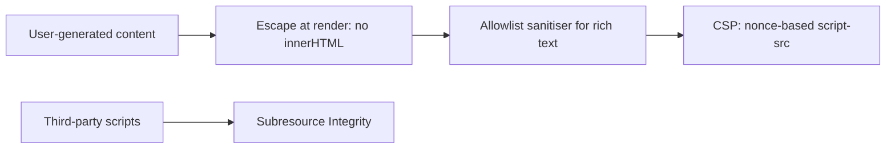

# 🛡️ Web security fundamentals

*The browser's security model decides what an attacker can reach. The core defences are escaping and CSP against script injection, SameSite cookies against cross-site requests, explicit CORS allowlists, and HttpOnly session cookies.*

## 💉 Cross-site scripting (XSS)
<!-- related: sd-41 -->

### 🧭 The threat

An attacker injects JavaScript into a page that another user then runs. Once it runs, it can read the DOM, act as the user and steal session data. User-generated content (comments, profiles, rich text) is the main entry point.

### 🧼 Prevention layers

- **Escape at render** — insert user content as text (`textContent`, or framework interpolation) rather than `innerHTML` or `dangerouslySetInnerHTML`.
- **Allowlist sanitiser for rich text** — when HTML must be allowed, pass it through a sanitiser that keeps only known-safe tags and attributes.
- **Validate URL schemes** — escaping text does not neutralise a malicious `href`. Reject `javascript:` URLs in user-supplied links.
- **Content-Security-Policy as the backstop** — a nonce-based `script-src` blocks injected scripts even when escaping fails.

> 🔑 Escaping is the first wall and CSP is the second. Assume one escape will eventually be missed.

### 🛑 Content-Security-Policy

- A strict, nonce-based policy kills injected scripts even when escaping fails.
- Add `'unsafe-inline'` "temporarily" to make a widget work and the XSS backstop is gone. Fix the widget instead.
- Pin third-party scripts with Subresource Integrity (SRI) where the vendor allows it.
- Report CSP violations and triage them; the reports are an early warning for injection.

### 🧵 Follow-up

**Should auth tokens go in localStorage or cookies?**

> Cookies with `HttpOnly` and `SameSite` are safer. XSS can read localStorage and steal the token, whereas HttpOnly cookies are inaccessible to JavaScript. The trade-off is that cookies are sent on every request, which SameSite mitigates for CSRF.

## 🔁 Cross-site request forgery (CSRF)
<!-- related: sd-9 -->

### 🧭 The threat

A malicious site triggers an authenticated request to your site, and the browser attaches the victim's cookies automatically.

### 🛡️ Defences

- **`SameSite=Strict` or `Lax` cookies** — the browser blocks sending the cookie on cross-site requests. This is browser-enforced by default.
- **Double-submit CSRF token** for APIs that must support cross-site use or older browsers: the token is echoed in a header and compared with a cookie value.
- **No state-changing GET endpoints** — `SameSite=Lax` still sends cookies on top-level GET navigations, so a GET that changes data is attackable.

| Decision | Chosen | Alternative | Why |
|---|---|---|---|
| CSRF defence | SameSite cookies | CSRF token only | SameSite is enforced by the browser; tokens remain for legacy browsers |

## 🌐 CORS
<!-- related: sd-41 -->

### 🧭 How it works

Browsers block cross-origin responses by default. The server opts in with `Access-Control-Allow-Origin`. CORS is a relaxation of the browser's protection, not a server-side security control.

### 📋 Rules

- Use an **explicit origin allowlist** for credentialed endpoints. Never use a wildcard (`*`) with credentials — browsers reject it.
- Do not reflect the request `Origin` header back into `Access-Control-Allow-Origin`. That is an allowlist in name only.

| Decision | Chosen | Alternative | Why |
|---|---|---|---|
| API sharing | Explicit origin allowlist | Wildcard with credentials | Browsers reject wildcard with credentials; allowlists are auditable |

## 🍪 Session storage and cookies
<!-- related: sd-9 -->

### 🔐 Secure cookie attributes

- **`HttpOnly`** — no JavaScript access; XSS cannot read the session.
- **`Secure`** — sent over HTTPS only.
- **`SameSite`** — controls cross-site sending (see CSRF above).
- **`Max-Age`** — bounds the session lifetime.

### ⚖️ Token storage

| Decision | Chosen | Alternative | Why |
|---|---|---|---|
| Token storage | HttpOnly cookie | localStorage | XSS cannot read HttpOnly; localStorage theft is one injected script away |
| Strictness of CSP | Nonce-based strict CSP | Loose allowlist | Strict nonces stop injected scripts even when escaping fails |

**Alternatives considered**

- **JWT bearer tokens in localStorage** — stateless and simpler CORS, but any XSS exfiltrates the token, so expiry and refresh design must be careful.
- **Framework escaping alone, no CSP** — simple, but one `dangerouslySetInnerHTML` or sanitiser bypass means full compromise.

## 🔒 Transport and security headers
<!-- related: sd-41 -->

### 🚚 HTTPS and HSTS

- `Strict-Transport-Security` (HSTS) with `includeSubDomains` and a long `max-age` prevents protocol-downgrade attacks.
- 100% of traffic over HTTPS, with `Secure` on every cookie.

### ✅ Header checklist

Verify these in CI, not by hand:

- `Content-Security-Policy` (nonce-based)
- `Strict-Transport-Security`
- `X-Content-Type-Options: nosniff`
- `frame-ancestors` (clickjacking)

### 📏 Targets

- **XSS:** zero `innerHTML` or `dangerouslySetInnerHTML` sinks on user content outside the sanitiser.
- **Session tokens:** zero readable from JavaScript.
- **CORS:** zero wildcard origins on credentialed endpoints.

### 🚩 Pitfalls

- `javascript:` URLs in user-supplied links — escaping the text does not neutralise the `href`.
- CSP with `'unsafe-inline'` added temporarily to make a widget work — the XSS backstop is gone.
- State-changing GET endpoints — `SameSite=Lax` still sends cookies on top-level GET navigations.
- Reflecting the request `Origin` header into `Access-Control-Allow-Origin` — an allowlist in name only.
