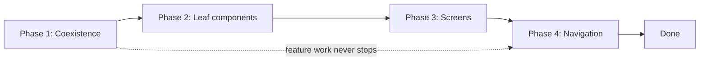

# 🧬 XML to Compose migration

*Move a large XML UI to Compose without freezing feature work: interop on main, leaf components first, screens behind flags, navigation last.*

## 🪜 Migration plan
<!-- related: behav-31, sd-20, sd-22, tech-73 -->

### 🎯 The constraint

A large app (about 200 screens, 50+ engineers across roughly 8 teams) cannot pause for a rewrite. Feature work continues on `main` throughout, so both UI systems coexist for months or years. The timeline (typically 1–3 years) is set by the capacity teams allocate, not by technical complexity.

### 🪜 Four phases

1. **Coexistence** — bridges in both directions: `ComposeView` inside existing Fragments, and `AndroidView` (or `AndroidViewBinding`) for legacy widgets inside Compose. Add a theming bridge so XML and Compose screens read the same design tokens.
2. **Design-system leaf components** — migrate buttons, fields, lists and the like first. They have a tiny blast radius and benefit every team immediately.
3. **Screens, one at a time, behind flags** — each migrated screen ships behind a feature flag with a per-screen rollback to the XML version.
4. **Navigation last** — it has the highest blast radius, so do it once the team has Compose fluency.

### 🧱 What is shared and what is not

- **ViewModels and the data layer are untouched.** Only the UI layer migrates, so both UI systems use the same ViewModels.
- **Main always builds and ships.** No long-lived branch and no big-bang rewrite.

## 🛡️ Safety nets and ownership
<!-- related: behav-31, sd-20, sd-22, tech-73 -->

### 🛡️ Safety nets

- **Screenshot baselines** (Paparazzi, Roborazzi or Compose preview screenshot testing) captured before each migration. A visual regression gates the migration PR.
- **Feature flags** per screen, so a flag flip is an instant rollback. Reverting a merged screen migration is a merge exercise.
- **Lint rule against new XML** — block new XML layouts, or old ones keep being written while the migration runs.

### 👥 Ownership

- **Feature teams migrate their own screens.** A central team becomes the bottleneck and learns nobody else's domain.
- **The platform staff engineer** owns the playbook, the bridges, the migration guide, lint rules and office hours. Their job is to remove blockers, not to be the throughput.

### 📊 Measure

- Percentage of screens migrated, per team.
- Regression rate per team.

## ⚖️ Trade-offs and pitfalls
<!-- related: behav-31, sd-20, sd-22, tech-73 -->

### ⚖️ Trade-offs

| Decision | Chosen | Alternative | Why |
|---|---|---|---|
| Overall strategy | Incremental interop on `main` | Big-bang rewrite on a branch | A long-lived branch diverges and never merges; interop ships value continuously |
| First target | Design-system leaf components | Whichever screen is easiest | Tiny blast radius; every team benefits immediately |
| Navigation | Last phase | Early, to get it over with | Highest blast radius; do it when Compose fluency exists |
| Rollback | Feature flag per screen | Git revert | A flag flip is instant; reverting a screen migration is a merge exercise |
| Ownership | Feature teams migrate their screens | Central team does it all | A central team becomes the bottleneck |

**Alternatives considered**

- **Big-bang rewrite on a long-lived branch** — clean end state and no interop code, but the branch diverges from `main`, never merges, and feature work must freeze.
- **Compose for new screens only, never migrate old ones** — zero migration cost, but two UI stacks and two design systems forever; hiring and onboarding pay twice.

### 🚩 Pitfalls

- Compose screens inside Fragments without setting `ViewCompositionStrategy` — compositions leak or dispose on the wrong lifecycle.
- The XML theme and the Compose theme drift apart — migrated screens look subtly different from their neighbours.
- New XML screens still written while old ones are migrated — add a lint rule that blocks new XML layouts.
- Screenshot tests generated only after migration — with no baseline, nothing proves the screen still looks the same.

### 🧵 Follow-up

**How long does this take at scale?**

> 1–3 years for a large app. The timeline is set by the team capacity allocated, not by technical complexity.

**Who does the actual screen migrations?**

> The individual feature teams own their screens. The staff engineer removes blockers and is not the bottleneck.
