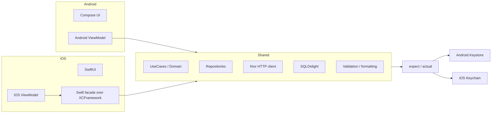

# 🔀 Kotlin Multiplatform

*Share domain and data logic between Android and iOS with Kotlin Multiplatform while keeping each UI native, and be honest about when the cost pays off.*

## 🧭 When to adopt and what to share
<!-- related: sd-22, tech-102, tech-204 -->

### 🧭 When KMP wins and when it loses

- ✅ Both platforms need the same features, with comparable team sizes.
- ✅ Significant shared business logic (finance, complex validation, domain rules).
- ✅ Greenfield project, or clear architectural boundaries.
- ❌ A large existing codebase where KMP would need a rewrite.
- ❌ An iOS team significantly larger or more opinionated about architecture.
- ❌ A UI-heavy app with little shared logic — the shared layer would be trivially thin, and KMP becomes pure tax.

> 🔑 Choose KMP for shared logic and a comparable team on both sides. Otherwise it is cost without parity payoff.

### 🧱 What to share and what to keep native



- **Shared module** — UseCases, domain models, complex validation, currency, date and phone formatting, analytics event definitions.
- **Shared data layer** — a Ktor HTTP client and SQLDelight persistence, with one schema generating code for both platforms.
- **Platform UI stays native** — Android ViewModel with Compose, and iOS ViewModel with SwiftUI. Both consume the same shared layer.
- **Keep native** — navigation (each platform's model is deeply different), and camera or anything else needing deep OS integration.
- **Dependency direction** — UI → platform ViewModel → shared UseCases and Repositories. Shared code never imports UI.

## 🔌 Platform seams and targets
<!-- related: sd-22, tech-102, tech-204 -->

### 🔌 Platform seams: expect / actual

`expect` declares an interface in shared code and `actual` supplies the platform implementation:

```kotlin
// commonMain
expect fun generateUUID(): String

// androidMain
actual fun generateUUID(): String = java.util.UUID.randomUUID().toString()
```

Use the same pattern for secure storage (Android Keystore vs iOS Keychain), permissions, biometrics and push tokens. Keep the surface to a handful of capabilities, each tested on both platforms.

- **iOS consumption** — the shared layer is exported as an XCFramework and wrapped in a Swift-friendly facade. Raw coroutines and `Flow` leak into Swift ViewModels and fight Combine or async-await, so wrap `suspend` and `Flow` (by hand or with SKIE).
- **Prefer interfaces with DI** for larger platform dependencies; `expect` and `actual` suit small functions and values.

### 📏 Non-functional targets

- **Logic parity:** each business rule implemented once, with zero duplicated validation or pricing code across platforms.
- **Binary cost:** the Kotlin/Native runtime plus shared code typically adds a few MB to the iOS download, more with heavy dependencies such as Ktor engines and serialization. Measure it and agree a size budget before adoption.
- **Build cost:** the XCFramework compile is a cached CI step. A shared-code change triggers both pipelines under one review.
- **Debuggability:** 100% of iOS crash reports symbolicate back to Kotlin source.

## 🛣️ Rollout and trade-offs
<!-- related: sd-22, tech-102, tech-204 -->

### 🛣️ Rollout

- Adopt in **new feature modules first**. New code gains parity immediately, with no big-bang migration.
- Set up cached framework builds and crash symbolication in CI before shipping shared code to production.

### ⚖️ Trade-offs

| Decision | Chosen | Alternative | Why |
|---|---|---|---|
| UI layer | Native (Compose / SwiftUI) | Compose Multiplatform everywhere | Native preserves platform idioms; shared UI couples release velocity and hiring |
| Shared scope | Domain + data layers | Share everything including UI | Sharing thin logic buys tooling cost without parity payoff |
| Platform APIs | `expect` / `actual` bridges | Wrap everything in shared abstractions | Bridges keep platform code explicit and individually testable |
| iOS API shape | Swift facade over suspend / Flow | Expose raw Kotlin APIs | Raw coroutines leak into Swift ViewModels |
| Persistence | SQLDelight (shared schema) | Room + Core Data separately | One schema, one migration story, generated for both platforms |
| Networking | Ktor multiplatform | Retrofit + URLSession separately | One HTTP stack and shared DTOs; engines swap per platform |
| Adoption point | New feature modules first | Rewrite the existing app | New code gains parity immediately |

**Alternatives considered**

- **Compose Multiplatform for UI as well** — one UI codebase and a single release train, but non-idiomatic iOS feel, hard iOS-team buy-in, and platform-widget interop (camera, maps) is still required.
- **Flutter (Dart) instead of KMP** — one language for UI and logic and mature tooling, but a full rewrite in Dart, retooling both teams, and an embedder boundary to platform APIs.

## 🎨 Pitfalls and follow-up
<!-- related: sd-22, tech-102, tech-204 -->

### 🎨 Where Compose Multiplatform fits

Compose Multiplatform moves UI into the shared layer. It suits internal tools and uniform screens where identical behaviour beats native feel. It is risky for consumer apps, where each platform is expected to feel native.

### 🚩 Pitfalls

- Choosing KMP because it is trendy, not because the team structure and problem fit it.
- Android-specific types (`Context`, `Parcelable`) leaking into the common module — it stops compiling for iOS.
- Exposing sealed classes and generics unchanged to Swift — they arrive as awkward Objective-C classes with lost type information.
- Treating the Kotlin/Native memory model and threading as "the same as JVM" without testing concurrency on iOS.

### 🧵 Follow-up

**What is `expect` / `actual`?**

> `expect` declares an interface in shared code. `actual` provides the platform-specific implementation, for example `expect fun generateUUID(): String` with `actual` versions on Android and iOS.

**Where does Compose Multiplatform fit into this picture?**

> It moves UI into the shared layer. It is best for internal tools and uniform screens, and risky for consumer apps where each platform should feel native.
