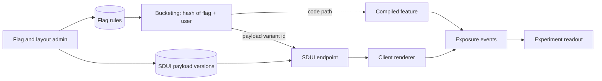

# 🎛️ Feature flags vs server-driven UI

*Pick feature flags or server-driven UI by what changes, then run both under one bucketing, rollback and governance model.*

## 🧭 Choosing the tool
<!-- related: sd-83, sd-84, sd-20, sd-109 -->

### 🧭 The decision rule

Pick the tool by what changes:

- **New behaviour already compiled into the app** → a feature flag.
- **Layout or content rearranged from existing components** → SDUI (server-driven UI).
- **A new component or new logic** → a release first, then flag it.

| | Feature flags | SDUI |
|---|---|---|
| Use case | Toggle code paths | Change UI layout remotely |
| Type safety | Strong (code already exists) | Weak (JSON at runtime) |
| Risk | Low | Higher (dynamic rendering bugs) |
| Release dependency | Code must ship first, then ramp | None within the component set already shipped |

### 🔗 How they work together

- **Flags select the payload variant.** A layout experiment uses the same bucketing and exposure logging as a code experiment. One bucketing function means one exposure log and no double assignment.
- **Emergency paths differ.** A kill switch (flag) disables a broken code path. A payload rollback (SDUI) reverts a broken layout. An SDUI payload can hide a broken surface, but a code bug still needs a release.
- **One governance model.** Every flag and every SDUI payload has an owner, a version and an audit trail, so an incident review has one timeline of "what changed remotely".
- **Core flows stay compiled.** Checkout and auth run on compiled code with flags only. Checkout must not depend on a layout service being correct.

## 📏 Targets and trade-offs
<!-- related: sd-83, sd-84, sd-20, sd-109 -->

### 📏 Targets

- **Kill-switch reach:** a disabled flag or rolled-back payload reaches active clients within one foreground or refresh cycle.
- **Experiment integrity:** one assignment per user per experiment across flags and SDUI payloads.
- **Blast radius:** a bad SDUI payload degrades one surface, never the core flows.
- **Sprawl:** zero flags older than 90 days without an owner-approved exception.
- **Scale assumed:** 10M+ users, hundreds of live flags. Home and promo surfaces churn weekly; checkout and auth change only with releases.

### ⚖️ Trade-offs

| Decision | Chosen | Alternative | Why |
|---|---|---|---|
| Scope split | Flags toggle code paths; SDUI changes layout | Flags for every UI change | Flags are switches over shipped code; layout changes need the SDUI renderer |
| Layout experiments | Flag assigns the payload variant | SDUI endpoint does its own bucketing | One bucketing function, one exposure log |
| Core flows | Compiled + flags only | SDUI everywhere | Checkout must not depend on a layout service |
| Governance | Shared owner / version / audit model | Separate processes per tool | Incident review needs one timeline |

**Alternatives considered**

- **Flags only, no SDUI** — type-safe and cheap to build, but every layout tweak needs a release plus a flag, so promos wait for the release train.
- **SDUI only, flags expressed as payload fields** — one system to operate, but code-path kill switches and backend flags have no home, and the payload schema bloats with toggles.

## 🧵 Follow-up and pitfalls
<!-- related: sd-83, sd-84, sd-20, sd-109 -->

### 🧵 Follow-up

**A promo redesign needs one new component. Flag, SDUI or release?**

> Release first. The component must exist in the app's renderer registry before any payload can reference it. Ship it dark, let the adoption curve pass the target app versions, then publish the SDUI payload. Target it with a flag to app versions that have the component, so older installs keep the old layout.

### 🚩 Pitfalls

- SDUI payloads referencing components that older app versions lack, with no app-version targeting — a fallback slot shows up for most of the install base.
- Running a layout experiment through SDUI and a code experiment through flags on the same users with independent bucketing — interaction effects make both readouts wrong.
- Using SDUI to hotfix a code bug — it can only hide the surface, and the fix still needs a release.
