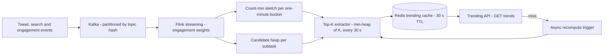

# 📊 Top-K & Count-Min Sketch

*Find the most frequent items in a stream that is too large to count exactly. A count-min sketch gives fixed-memory counts with one-sided error, a candidate heap supplies the keys, and a windowed, growth-based rank turns counts into trends.*

## 🧮 Count-Min Sketch
<!-- related: sd-140 -->

### 🧭 Options compared

| Option | Memory | Exact? | Verdict |
|---|---|---|---|
| Exact hash map of every topic per bucket | Grows with unique topics; tens of millions of keys an hour is gigabytes per bucket, per region and language slice | Yes | Rejected: bot floods make it grow without limit |
| One global Redis sorted set with `ZINCRBY` | Grows with unique topics | Yes | Rejected: every event hits one hot key, and decay needs extra work |
| **Count-min sketch per bucket with a candidate heap** | Fixed, about 80 KB per one-minute bucket | Approximate, overestimates only | **Chosen** |

> 💡 Exact counting is only cheap at low cardinality. Approximate counting is acceptable when the consumer only needs the top K.

### ⚙️ How it works

- A sketch is a `depth` × `width` array of counters, one row per hash function.
- **Update:** for each item, hash it once per row and add its weight to one counter in each row.
- **Query:** hash the item the same way and take the **minimum** of its counters. Collisions only add to a counter, so the minimum is the least-polluted estimate.
- Because collisions can only add, the estimate **never underestimates**. A small overcount on rare topics does not change the top K.

### 📐 Error bounds (ε, δ)

- With width `w` and depth `d`: `ε = e / w` and `δ = e^(-d)`.
- Estimate ≤ true count + `ε` × N, where N is the total weight added to the sketch, with probability at least `1 - δ`.
- Our numbers: width 2000 gives `ε ≈ 0.00136` of total weight; depth 5 gives `δ ≈ 0.0067`.

> 🔑 The error is a fraction of the whole stream's weight, not of the item's own count. State it as a bound, never as exact counts.

### 🧠 Memory and merging

- One one-minute bucket: depth 5 × width 2000 = 10K counters × 8 bytes = **80 KB**.
- 60 one-minute buckets = about **5 MB** of Flink state, regardless of how many unique topics arrive.
- Sketches merge by **element-wise addition**. A window sum is the sum of its bucket sketches, and sketches from parallel subtasks combine the same way, so merging is cheap.

## 🏆 Top-K over a stream
<!-- related: sd-67 -->

### 🔍 Why a candidate heap

- A sketch can answer "how many times did X occur?" but **cannot list its keys**. It has no way to enumerate the heavy hitters.
- Each Flink subtask therefore keeps a **candidate heap** of the topics it sees most often, updated on insert. Candidates come from this heap, and their counts come from the sketch.
- The heap is stored in checkpointed state with the sketches (see 🏗️ Reference pipeline).

### 🪜 Extracting the top K

1. Merge the window's bucket sketches by addition.
2. Estimate each candidate's count against the merged sketch.
3. Keep a **min-heap of size K**: push each candidate, and pop the smallest whenever the heap grows past K.
4. The heap then holds the top K. Cost is **O(n log k)**, cheaper than a full sort of all n candidates when K is small.

> 🔑 The candidate heap decides what can appear in the list; the sketch decides how big each candidate is. Neither works alone.

## 🪟 Windows & decay
<!-- related: sd-140, sd-67 -->

### 🪟 Window shapes

| Window | How it behaves | Trade-off |
|---|---|---|
| **Tumbling** | Fixed, non-overlapping windows; counts reset at each boundary | Simple, but creates a **cliff** at every boundary: a topic can drop to zero the moment a window ends |
| **Sliding** | Always covers the last N minutes | Exact window edge, the one we want for "last hour" |
| **Bucketed sliding** | Sliding window built from fixed 1-minute buckets; old buckets are dropped | Window edge is exact to one minute; memory is one sketch per bucket |
| **Exponential decay** | Each count is multiplied by a decay factor over time | Smooth, but it **blurs bucket boundaries** and needs extra work on a Redis sorted set |

- **Chosen:** bucketed sliding window of the last hour, built from 1-minute sketches. Buckets older than 60 minutes are dropped.

### ⏱️ Late events

- A late event lands in the one-minute bucket for **its own timestamp**, not the bucket that is current when it arrives.
- The sliding merge includes it for as long as that bucket is still in range; once the bucket ages out, the event is no longer counted.

### 📈 What "trending" means

| Ranking | Rule | Problem |
|---|---|---|
| **Absolute count** | Top K by total count over the window | Long-running topics always win, so new trends never surface |
| **Growth rate** | Compare the current window's count with the previous window's and rank by the change | Tiny topics produce huge ratios, so ranking becomes noise |
| **Weighted growth with a volume floor and cold-start guard** | Multiply each event by its weight before the increment, rank by weighted growth, require a minimum volume, and do not rank an empty or near-empty window | **Chosen.** The floor and the weights are product decisions that need tuning |

- Trending = **growth rate**, not absolute count. Old popular topics should not dominate.
- Growth is computed as current window vs previous window, and each candidate's count comes from the merged sketch.

### ⚖️ Weighting engagement

- Each event carries a weight: **like = 1, reply = 2, retweet = 3**.
- Flink applies the weight before updating the sketch, so a weighted event adds its weight to the counters. A retweet counts for more than a like.

### 🧊 Cold start

- `TopicMeta` records `firstSeen` and `totalCount` for each topic.
- A topic below the volume floor, or with too little history, is not ranked. This stops an empty or near-empty window from ranking noise.

## 🏗️ Reference pipeline
<!-- related: sd-67, sd-64, sd-99 -->

### 🗺️ Flow



### 🪜 Steps

1. **Ingest:** tweets, searches and engagements are published to Kafka, partitioned by topic hash.
2. **Weight:** Flink applies engagement weights before updating the sketch.
3. **Count:** each subtask updates the sketch for the current one-minute bucket and its candidate heap.
4. **Rank:** every 30 seconds the window's buckets are merged, candidates are estimated, growth is measured against the previous window, and the top K is extracted.
5. **Publish:** the result is written to the Redis sorted set `trending:top100` with a 30-second TTL.
6. **Serve:** `GET /trends` reads Redis; a hit returns immediately. A miss returns the last known list with `stale: true` and queues one asynchronous recompute.

### 🔁 Freshness and recovery

| Option | How it works | Trade-off |
|---|---|---|
| Hourly batch recompute (Spark) | A job rebuilds the list each hour | Results up to an hour old, plus micro-batch delay |
| Stream processing with a refresh timer (Flink) | Flink updates the sketch continuously; top K published every 30 s | A restart loses the in-memory candidate heap, and cached lists are not invalidated |
| **Checkpointed Flink state with a versioned cache on recovery** | Sketches and candidate heap are checkpointed; after recovery a new cache version replaces stale lists | **Chosen.** Checkpoint interval trades recovery loss against overhead, and the candidate heap must be checkpointed too |

> 💡 Flink beats Spark micro-batch on latency. A Lambda design with a separate batch layer was rejected in favour of one stream pipeline. Add batch backfill only if corrections ever need to reprocess history.

### 🛰️ Serving and caching

| Option | How it works | Trade-off |
|---|---|---|
| Recompute on every request | Each read computes the top K from the sketches | CPU load and latency grow with readers |
| Shared cache with synchronous refill | List stored in Redis with a 30-second TTL; a miss refills synchronously | Every expiry triggers a stampede of recomputes |
| **Cache with asynchronous recompute and stale-while-revalidate, segmented by region** | On a miss, return the last list with `stale: true` and queue a single recompute; separate lists per region and language | **Chosen.** Up to 30 seconds of staleness, and segmented lists multiply cache size |

> 🔑 About 99% of reads hit the cache, and stale-while-revalidate keeps expiry from becoming a stampede. A single global top K hides regional trends, so the segment key is part of the cache design.

### 🧾 API

```
// public read; ingest is internal only
GET /trends?window=1h&limit=100&region=global
  → 200 { asOf, stale: false, items: [{ topic, score, change, volume }] }
  → 200 { asOf, stale: true, items: [...] }     a recompute was queued; the last list is returned
  Cache-Control: max-age=30

// window values: 1h, 24h, 7d
```

### 🗄️ Storage

| Entity | Store | Key | Value | TTL / retention |
|---|---|---|---|---|
| `cms_bucket` | Flink operator state | `(subtask, bucket_minute)` | `long[depth][width]` counters; merged by element-wise addition | 60 min (sliding) |
| `trending_bucket` | Redis sorted set | `trending:1m:<ts>` | topic → score | 61 min |
| `trending:top100` | Redis string | `trending:top100` | JSON `[{topic, score, change}]` | 30 s |
| `topic_metadata` | Redis hash | `topic:meta:<topic>` | `{first_seen, total_count}` | 24 h |

### 📊 Capacity

- **Event rate:** ~500M tweets/day ≈ 5.8K/s average; peak 3–5× gives ~20–30K events/s (tweets, searches and engagements combined).
- **Unique topics per hour:** ~10–50M (estimate).
- **CMS memory:** fixed 80 KB per one-minute bucket.
- **State size:** 60 buckets × 80 KB ≈ 5 MB of Flink state.
- **Top-K cache:** 100 entries × ~200 bytes = 20 KB, 30-second TTL.
- **API QPS:** read-heavy; assume 10K QPS with caching.
- **Bandwidth:** event ingest ~50 MB/s raw; processed stream ~5 MB/s.

### 🎯 Requirements

- **Functional:** ingest a high-volume event stream; compute the top 100 trending topics over a 1-hour sliding window; define trending as growth rate, not absolute count; apply engagement weighting; serve results via API with at most 30 seconds of freshness.
- **Scalability:** billions of events per day in fixed memory.
- **Latency:** end-to-end freshness of 30 seconds or less.
- **Accuracy:** the sketch overestimates within a bounded error (ε, δ) and never underestimates.
- **Availability:** exactly-once processing in Flink plus a Redis cache; tolerate a processor restart.
- **State:** a fixed ~5 MB of sketch state, regardless of unique-topic count.

## 🚩 Pitfalls

- Trending = highest absolute count. It misses growth rate, so old popular topics always dominate.
- Ignoring the CMS error bounds. Claiming exact counts when the sketch is probabilistic.
- A single global top K with no geo or language segmentation.
- No cold-start handling: an empty window ranks noise.
- Forgetting cache invalidation when the stream processor restarts.
- Tracking heavy-hitter candidates only from the sketch. A CMS cannot enumerate keys, so keep a candidate heap updated on insert.
